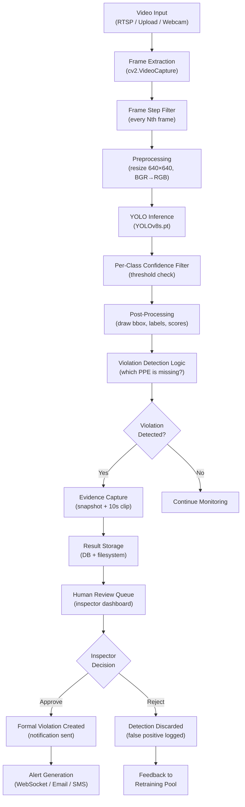
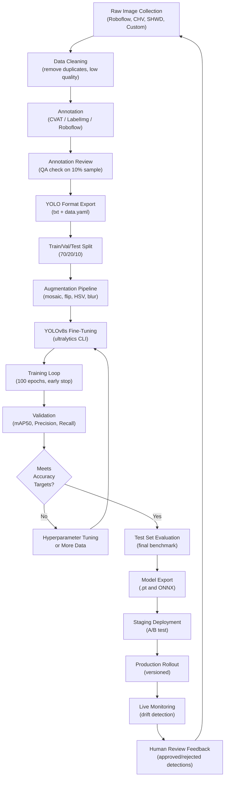

# AI Model Plan — ConstructSafe AI PPE Detection Engine

**Document Version:** 1.0  
**Date:** 2026-11-17  
**Author:** AI/ML Engineering Team  
**Status:** Planning / Pre-Implementation

---

## Table of Contents

1. [AI System Overview](#1-ai-system-overview)
2. [Critical Caveat: COCO-Pretrained Model Limitations](#2-critical-caveat-coco-pretrained-model-limitations)
3. [Detection Targets & Challenges](#3-detection-targets--challenges)
4. [Model Selection Options](#4-model-selection-options)
5. [Training Data Requirements](#5-training-data-requirements)
6. [Model Architecture Details](#6-model-architecture-details)
7. [Training Pipeline](#7-training-pipeline)
8. [Video Processing Pipeline](#8-video-processing-pipeline)
9. [OpenCV Integration](#9-opencv-integration)
10. [Detection Pipeline Diagram](#10-detection-pipeline-diagram)
11. [Training Pipeline Diagram](#11-training-pipeline-diagram)
12. [Performance Targets](#12-performance-targets)
13. [Hardware Requirements](#13-hardware-requirements)
14. [Human Verification Workflow](#14-human-verification-workflow)
15. [Alert Generation Logic](#15-alert-generation-logic)
16. [Evidence Storage](#16-evidence-storage)
17. [Model Versioning & A/B Testing](#17-model-versioning--ab-testing)
18. [Failure Modes & Fallback Strategies](#18-failure-modes--fallback-strategies)
19. [Ethical Considerations](#19-ethical-considerations)

---

## 1. AI System Overview

ConstructSafe AI uses a computer vision pipeline to automatically detect Personal Protective Equipment (PPE) compliance on construction sites. The core technology stack is:

| Component | Technology | Purpose |
|-----------|------------|---------|
| Object Detection | YOLOv8 (Ultralytics) | Real-time PPE detection |
| Image Processing | Pillow / OpenCV (`cv2`) | Image normalization, resize, annotation, bounding boxes |
| Inference Runtime | PyTorch + CUDA | Model execution |
| Model Format | YOLO `.pt` / ONNX | Weights storage and deployment |
| Backend Integration | FastAPI + BackgroundTasks | Asynchronous inference queue |
| Result Storage | PostgreSQL + local filesystem | Detections, snapshots, clips |
| Alert Delivery | WebSocket + DB | Real-time safety notifications |

### System Capabilities

- **Video Upload Analysis:** Batch process uploaded video files (MP4, AVI, MOV)
- **Webcam Support:** Browser-side webcam capture forwarded to inference API
- **Multi-Zone Detection:** Configure detection rules per site zone (e.g., hard-hat zone, high-visibility zone)
- **Violation Evidence:** Auto-snapshot and clip extraction on violation events
- **Human-in-the-Loop:** Inspector review queue for AI detections before formal violations are issued
- **Continuous Learning:** Reviewed detections feed back into model retraining

---

## 2. Critical Caveat: COCO-Pretrained Model Limitations

> [!CAUTION]
> **Standard pretrained YOLO models trained on the COCO dataset CANNOT reliably detect construction-site PPE and MUST NOT be used directly in production.**

### Why COCO Models Fail for PPE Detection

The COCO (Common Objects in Context) dataset contains 80 classes. While it includes "person", it does **not** include any construction PPE classes such as safety helmets, reflective vests, safety gloves, safety boots, or goggles. Attempting to use a COCO-pretrained YOLOv8 model for PPE detection will result in:

| Issue | Impact |
|-------|--------|
| **No PPE classes in model output** | The model simply cannot output "helmet", "vest", etc. |
| **False negatives on all PPE** | Every worker with PPE will show as a person with no gear detected |
| **Person detection only** | Only the `person` class (index 0) will fire |
| **Unusable compliance logic** | Cannot determine whether gear is worn or absent |
| **High false-positive risk** | Rule-based workarounds (e.g., "person with no helmet = violation") fail in complex scenes |

### What This Means for Implementation

- **Custom training is mandatory** for reliable PPE detection
- Using an off-the-shelf COCO model is a **critical failure risk** that would render the safety system ineffective and potentially expose the company to liability
- All three model options below (Section 4) address this limitation in different ways
- Until a properly trained model is available, the system **must not** flag PPE violations autonomously in a live environment

### Partial Workaround Risk (Do NOT rely on)

Some practitioners attempt a workaround: detect "person" via COCO, then use a secondary classifier to detect helmet presence. This approach has >30% error rates in real construction environments due to lighting, angles, and occlusion — it is not acceptable for a safety-critical system.

---

## 3. Detection Targets & Challenges

The system targets five PPE item categories. Each presents unique computer vision challenges.

### 3.1 Safety Helmets (Hard Hats)

- **Priority:** Critical — highest regulatory requirement
- **Detection Challenge:**
  - Hard hats vary widely in color (yellow, white, red, blue, orange) — no single color signal
  - Partial occlusion by machinery, scaffolding, or other workers
  - Viewed from above (camera mounted high) vs. profile vs. front creates significant pose variation
  - Similar shapes to civilian caps/hats — model must learn construction-specific helmet geometry
  - Reflections and shadows on glossy helmet surfaces confuse feature detectors
- **Minimum Confidence Threshold:** 0.60 (higher than default due to safety criticality)

### 3.2 Reflective / High-Visibility Vests

- **Priority:** High
- **Detection Challenge:**
  - Reflective patterns can saturate or bloom under direct sunlight or artificial floodlights
  - Workers may wear vests under jackets or other outerwear — partial visibility
  - Orange/yellow color can be confused with heavy equipment or painted surfaces
  - Dirt/mud accumulation on worn vests reduces reflectivity and visual distinctiveness
  - Vest may be visible only partially when worker is behind machinery or barriers
- **Minimum Confidence Threshold:** 0.50

### 3.3 Safety Gloves

- **Priority:** Medium
- **Detection Challenge:**
  - **Most difficult class to detect reliably** — small object relative to full-body detection
  - Hands are frequently occluded by tools, machinery, or body
  - Gloves vary enormously in color and style (rubber, leather, cut-resistant mesh)
  - Workers frequently remove gloves during breaks, creating temporal false negatives
  - At typical CCTV resolutions and distances, glove details may be sub-pixel
- **Minimum Confidence Threshold:** 0.45 (lower threshold due to small size; higher false positive rate acceptable)
- **Note:** Consider excluding glove detection from automated alerts for version 1.0 and moving it to human-review only

### 3.4 Safety Boots

- **Priority:** Medium
- **Detection Challenge:**
  - Feet are often out of camera frame (cameras mounted high, workers close to walls)
  - Mud, concrete, and site debris obscure boot distinctiveness
  - Standard boots vs. safety boots are visually very similar — steel-toe is not visible from outside
  - Workers may wear boot covers, rubber overboots, or gaiters that obscure base boot
  - Very low position in frame = typically poor resolution and motion blur
- **Minimum Confidence Threshold:** 0.45
- **Note:** Boot detection accuracy is expected to be low (<60% mAP50); supplement with zone-based policy enforcement

### 3.5 Safety Goggles / Eye Protection

- **Priority:** Medium (zone-specific — not required everywhere)
- **Detection Challenge:**
  - Face-level detection requires high resolution — small target on a distant person
  - Goggles are worn on the face; full face must be visible in frame
  - Workers frequently push goggles up onto helmet when not actively working — this is a compliance grey area
  - Goggles are transparent/translucent — glass and plastic elements create reflections
  - Face masks and shields may be confused with or overlap goggles
- **Minimum Confidence Threshold:** 0.50
- **Note:** Goggle detection is zone-restricted (e.g., grinding zones, chemical zones); configurable per zone

---

## 4. Model Selection Options

### Option A: Fine-Tune YOLOv8n/s on a Custom PPE Dataset ⭐ RECOMMENDED

**Strategy:** Start with YOLOv8 nano or small model weights (pre-trained on ImageNet for feature extraction), then fine-tune on a custom construction PPE dataset.

**Pros:**
- Best accuracy for construction-specific scenarios
- Full control over classes, thresholds, and training data
- Can be iteratively improved via feedback loop
- Smallest deployment footprint with nano variant (YOLOv8n: ~6MB)
- YOLOv8s offers better accuracy with ~22MB weights

**Cons:**
- Requires curating/annotating a quality dataset (500–2000+ images per class)
- Training time: 2–8 hours on GPU for initial training
- Ongoing maintenance as site conditions change

**Recommended Model Variants:**

| Variant | Parameters | Speed (CPU) | Speed (GPU) | Use Case |
|---------|-----------|-------------|-------------|----------|
| YOLOv8n | 3.2M | ~12 FPS | ~35 FPS | Edge devices, low-power |
| YOLOv8s | 11.2M | ~8 FPS | ~30 FPS | Balanced (recommended) |
| YOLOv8m | 25.9M | ~5 FPS | ~25 FPS | High accuracy, GPU required |
| YOLOv8l | 43.7M | ~3 FPS | ~20 FPS | Server-side only |

**Selection:** Use **YOLOv8s** for the initial production model — balanced speed/accuracy. Provide YOLOv8n as a fallback for CPU-only deployments.

---

### Option B: Existing Open-Source PPE-Trained YOLO Models

Several open-source PPE detection models exist, trained specifically on construction safety imagery:

| Model / Dataset | Classes | Notes |
|----------------|---------|-------|
| **CHV Dataset** (Construction Hazard & Vest) | Helmet, Person, Vest | Widely cited; ~8k images; helmet/vest focused |
| **hardhat-detection** (roboflow universe) | Hardhat, Head (no hardhat) | Binary helmet compliance model |
| **PPE-Detection (Roboflow)** | Helmet, Vest, Gloves, Boots, Goggles | 5-class; variable quality depending on version |
| **Safety-Helmet-Wearing-Dataset (SHWD)** | Helmet, Head | 7,581 images, well-annotated |
| **PICTOR-v3 Dataset** | PPE items in industrial settings | Multi-site; more generalizable |
| **OpenPPE (GitHub community)** | Multiple PPE classes | Community-maintained; check license |

**Pros:** No training required; can be deployed immediately for PoC  
**Cons:** May not match your specific site conditions; licensing restrictions may apply; accuracy is unknown for your camera setup; classes may not exactly match requirements  
**Recommendation:** Use for rapid prototyping and baseline benchmarking only; replace with Option A for production

---

### Option C: Pretrained Model + Rule-Based Fallbacks

**Strategy:** Use a COCO-pretrained model for person detection, then apply rule-based heuristics or secondary classifiers to infer PPE compliance.

**Example heuristic:** Detect person bounding boxes → crop ROI → classify presence of helmet in head region using a separate CNN classifier

**Pros:** No PPE-specific training required initially; faster time to demo  
**Cons:**
- Accuracy is fundamentally limited — not acceptable for formal violation reporting
- Multiple models = higher complexity and latency
- Rule-based logic breaks down with partial occlusions and varied angles

**Recommendation:** Only use as a temporary placeholder during initial development before Option A is ready.

---

## 5. Training Data Requirements

### 5.1 Dataset Sources

| Source | URL/Reference | Content | License |
|--------|--------------|---------|---------|
| **Roboflow Universe** | roboflow.com/universe | Multiple PPE datasets; search "construction safety PPE" | Varies (check each) |
| **CHV Dataset** | GitHub: ZijianHe/HARDHAT | Helmet + vest, 8k+ images | Academic / open |
| **SHWD Dataset** | GitHub: njvisionpower/Safety-Helmet-Wearing-Dataset | Helmet detection, 7,581 images | MIT |
| **OSHA Compliance Images** | osha.gov (manual collection) | Real US construction sites | Public domain |
| **OpenImages Dataset v6** | storage.googleapis.com/openimages | "helmet", "glove" classes present (not construction-specific) | Creative Commons |
| **Custom Site Photography** | Your own camera footage | Site-specific scenarios | Proprietary |
| **Kaggle PPE Datasets** | kaggle.com | Various PPE detection competitions | Varies |

### 5.2 Minimum Dataset Sizes (Per Class)

| PPE Class | Minimum Images | Recommended | Notes |
|-----------|---------------|-------------|-------|
| Safety Helmet | 1,000 | 3,000+ | Most available online |
| Reflective Vest | 800 | 2,500+ | Often bundled with helmet data |
| Safety Gloves | 600 | 2,000+ | Hardest to source; augment heavily |
| Safety Boots | 500 | 1,500+ | Low camera angle shots needed |
| Safety Goggles | 500 | 1,500+ | Face-level crops needed |
| **Person (no PPE)** | 1,000 | 3,000+ | Required as negative examples |
| **Total** | **~5,000** | **~15,000+** | With augmentation |

> [!TIP]
> Use Roboflow's augmentation pipeline (flip, rotate, brightness, blur, mosaic) to multiply a 3,000-image base dataset to 15,000+ effective training samples without manual annotation.

### 5.3 Annotation Format

All annotations must be in **YOLO TXT format**:

```
# Format: <class_id> <x_center> <y_center> <width> <height>
# All values normalized to [0, 1] relative to image dimensions
# One line per object, one file per image

0 0.512 0.234 0.089 0.062   # helmet
1 0.512 0.401 0.145 0.280   # vest
```

**Class index mapping (data.yaml):**
```yaml
# data.yaml
path: /datasets/ppe_dataset
train: images/train
val: images/val
test: images/test

nc: 5  # number of classes
names:
  0: helmet
  1: vest
  2: gloves
  3: boots
  4: goggles
```

**Annotation tool recommendations:** Roboflow (web-based, free tier), CVAT (open-source, self-hosted), LabelImg (desktop, free)

### 5.4 Train/Validation/Test Splits

| Split | Percentage | Purpose |
|-------|-----------|---------|
| Train | 70% | Model learning |
| Validation | 20% | Hyperparameter tuning, early stopping |
| Test | 10% | Final unbiased evaluation |

> [!IMPORTANT]
> Ensure images from the **same video sequence or same site** are kept within the same split to prevent data leakage. If 10 frames from the same camera angle appear in both train and val, validation metrics will be artificially inflated.

---

## 6. Model Architecture Details

### 6.1 YOLOv8 Architecture Summary

YOLOv8 uses a CSPDarknet-based backbone with a path aggregation network (PANet) neck and a decoupled head:

```
Input (640×640×3)
    ↓
Backbone: CSPDarknet (C2f blocks, SPPF)
    ↓
Neck: PANet (Feature Pyramid — P3/P4/P5)
    ↓
Head: Decoupled detection heads (cls + reg per scale)
    ↓
Output: Bounding boxes + class probabilities + confidence
```

**Three detection scales:**
- **P3 (80×80):** Small objects (gloves, goggles at distance)
- **P4 (40×40):** Medium objects (helmets, partial vests)
- **P5 (20×20):** Large objects (full-body vest detection)

### 6.2 Input Configuration

| Parameter | Value | Notes |
|-----------|-------|-------|
| Input resolution | 640 × 640 px | Standard; higher (1280) for small objects |
| Color space | RGB | OpenCV reads BGR; convert with `cv2.cvtColor` |
| Normalization | /255.0 | Built into Ultralytics pipeline |
| Letterboxing | Auto | Preserves aspect ratio with padding |
| Batch size (inference) | 1–8 | Adjust based on GPU VRAM |

### 6.3 Anchor Configuration

YOLOv8 uses **anchor-free detection** (unlike YOLOv5). No manual anchor box configuration is required. The model predicts box centers directly, simplifying deployment.

### 6.4 NMS (Non-Maximum Suppression) Settings

| Parameter | Default | Recommended | Notes |
|-----------|---------|-------------|-------|
| `conf` (confidence threshold) | 0.25 | 0.50 | Reduce false positives; adjust per class |
| `iou` (IoU threshold for NMS) | 0.45 | 0.45 | Suppress duplicate boxes |
| `max_det` | 300 | 100 | Max detections per image |
| `agnostic_nms` | False | False | Class-aware NMS |
| `classes` | None | [0,1,2,3,4] | Filter to PPE classes only |

### 6.5 Per-Class Confidence Thresholds

```python
# Configurable per-class thresholds (adjustable via admin UI)
CLASS_THRESHOLDS = {
    "helmet":  0.60,  # critical safety item — higher threshold
    "vest":    0.50,  # standard
    "gloves":  0.45,  # small object — accept lower confidence
    "boots":   0.45,  # low-camera-angle — accept lower confidence
    "goggles": 0.50,  # standard
}
```

---

## 7. Training Pipeline

### 7.1 Environment Setup

```bash
# Python 3.10+ required
python --version  # >= 3.10

# Create virtual environment
python -m venv venv_ppe
source venv_ppe/bin/activate  # Linux/Mac
.\venv_ppe\Scripts\activate   # Windows

# Install dependencies
pip install ultralytics==8.x.x    # includes torch dependency resolution
pip install torch torchvision torchaudio --index-url https://download.pytorch.org/whl/cu118
pip install opencv-python-headless
pip install albumentations
pip install roboflow  # optional: for dataset download
```

**Verify CUDA:**
```python
import torch
print(torch.cuda.is_available())  # Should print True
print(torch.cuda.get_device_name(0))
```

### 7.2 Training Command

```bash
# Fine-tune YOLOv8s on custom PPE dataset
yolo detect train \
  model=yolov8s.pt \
  data=/datasets/ppe_dataset/data.yaml \
  epochs=100 \
  imgsz=640 \
  batch=16 \
  lr0=0.01 \
  lrf=0.01 \
  momentum=0.937 \
  weight_decay=0.0005 \
  warmup_epochs=3 \
  warmup_momentum=0.8 \
  box=7.5 \
  cls=0.5 \
  dfl=1.5 \
  augment=True \
  flipud=0.0 \
  fliplr=0.5 \
  mosaic=1.0 \
  mixup=0.1 \
  copy_paste=0.1 \
  degrees=5.0 \
  translate=0.1 \
  scale=0.5 \
  shear=2.0 \
  perspective=0.0005 \
  hsv_h=0.015 \
  hsv_s=0.7 \
  hsv_v=0.4 \
  device=0 \
  workers=8 \
  project=runs/ppe \
  name=yolov8s_ppe_v1 \
  save=True \
  save_period=10 \
  patience=20 \
  plots=True
```

### 7.3 Hyperparameter Reference

| Hyperparameter | Value | Description |
|----------------|-------|-------------|
| `epochs` | 100 | Training iterations over full dataset |
| `batch` | 16 | Images per gradient update (reduce if OOM) |
| `imgsz` | 640 | Input resolution |
| `lr0` | 0.01 | Initial learning rate |
| `lrf` | 0.01 | Final LR as fraction of `lr0` (cosine decay) |
| `momentum` | 0.937 | SGD momentum |
| `weight_decay` | 0.0005 | L2 regularization |
| `warmup_epochs` | 3 | LR warmup period |
| `mosaic` | 1.0 | Mosaic augmentation (4 images combined) |
| `mixup` | 0.1 | MixUp augmentation probability |
| `copy_paste` | 0.1 | Copy-paste augmentation (good for small PPE) |
| `patience` | 20 | Early stopping patience (epochs without improvement) |

### 7.4 Validation Metrics

| Metric | Description | Target |
|--------|-------------|--------|
| **mAP50** | Mean Average Precision at IoU=0.5 | > 0.70 per class |
| **mAP50-95** | mAP averaged over IoU 0.5–0.95 | > 0.45 per class |
| **Precision** | TP / (TP + FP) | > 0.75 |
| **Recall** | TP / (TP + FN) | > 0.70 |
| **F1 Score** | 2 × (P × R) / (P + R) | > 0.72 |

**Per-class validation:**
```bash
yolo detect val \
  model=runs/ppe/yolov8s_ppe_v1/weights/best.pt \
  data=/datasets/ppe_dataset/data.yaml \
  split=test \
  plots=True \
  save_json=True
```

---

## 8. Video Processing Pipeline

### 8.1 Frame Extraction Strategy

Not every frame requires inference. The optimal strategy balances accuracy with computational cost:

| Scenario | Frame Rate Strategy | Rationale |
|----------|-------------------|-----------|
| Uploaded video (offline) | Every 5th frame (6 FPS equivalent from 30 FPS) | Enough for violation detection; reduce processing time |
| Live RTSP stream | Every 2nd frame (15 FPS equivalent) | Near-real-time response |
| High-risk zone monitoring | Every frame (30 FPS) | Maximum detection coverage |
| Initial scan / summary | 1 frame per second | Quick overview |

### 8.2 Frame Rate Selection Logic

```python
def compute_frame_step(source_fps: float, mode: str) -> int:
    """Return frame step (process every Nth frame)."""
    strategies = {
        "offline_standard":  max(1, int(source_fps / 6)),   # target 6 FPS
        "live_standard":     max(1, int(source_fps / 15)),  # target 15 FPS
        "live_high_risk":    1,                              # every frame
        "offline_summary":   max(1, int(source_fps)),       # 1 FPS
    }
    return strategies.get(mode, max(1, int(source_fps / 10)))
```

### 8.3 Batch Inference

```python
import cv2
from collections import deque

class FrameBatchProcessor:
    def __init__(self, model, batch_size: int = 8):
        self.model = model
        self.batch_size = batch_size
        self.frame_buffer = deque(maxlen=batch_size)

    def process_video(self, video_path: str, frame_step: int = 2):
        cap = cv2.VideoCapture(video_path)
        fps = cap.get(cv2.CAP_PROP_FPS)
        frame_idx = 0
        results_all = []

        while cap.isOpened():
            ret, frame = cap.read()
            if not ret:
                break

            if frame_idx % frame_step == 0:
                self.frame_buffer.append((frame_idx, frame))

                if len(self.frame_buffer) == self.batch_size:
                    batch_frames = [f for _, f in self.frame_buffer]
                    batch_results = self.model(batch_frames, verbose=False)
                    for (fidx, _), result in zip(self.frame_buffer, batch_results):
                        results_all.append((fidx, result))
                    self.frame_buffer.clear()

            frame_idx += 1

        cap.release()
        return results_all
```

### 8.4 Result Aggregation

For video uploads, aggregate per-frame detections to produce a video-level summary:
- **Violation timeline:** List of `(timestamp_seconds, class, confidence, bbox)` tuples
- **Violation summary:** Total violations per class; first occurrence and last occurrence timestamps
- **Worker tracking (optional v2):** Associate detections with tracked person IDs across frames

---

## 9. OpenCV Integration

### 9.1 RTSP Stream Reading

```python
import cv2

def open_rtsp_stream(rtsp_url: str, reconnect_attempts: int = 5):
    """Open an RTSP stream with retry logic."""
    for attempt in range(reconnect_attempts):
        cap = cv2.VideoCapture(rtsp_url, cv2.CAP_FFMPEG)
        cap.set(cv2.CAP_PROP_BUFFERSIZE, 3)  # Minimize latency
        cap.set(cv2.CAP_PROP_FOURCC, cv2.VideoWriter_fourcc(*"H264"))

        if cap.isOpened():
            print(f"[RTSP] Connected to {rtsp_url}")
            return cap
        else:
            print(f"[RTSP] Attempt {attempt+1} failed. Retrying...")
            time.sleep(2 ** attempt)  # Exponential backoff

    raise ConnectionError(f"Cannot connect to RTSP stream: {rtsp_url}")
```

### 9.2 Frame Preprocessing

```python
def preprocess_frame(frame: np.ndarray, target_size: int = 640) -> np.ndarray:
    """Resize and normalize frame for YOLO inference."""
    # OpenCV reads BGR; convert to RGB for Ultralytics
    rgb_frame = cv2.cvtColor(frame, cv2.COLOR_BGR2RGB)
    # Letterbox resize (preserves aspect ratio)
    # Ultralytics handles this internally; pass raw frame
    return rgb_frame
```

### 9.3 Post-Processing: Bounding Box Rendering

```python
COLORS = {
    "helmet":  (0, 200, 0),    # Green
    "vest":    (255, 165, 0),  # Orange
    "gloves":  (0, 150, 255),  # Blue
    "boots":   (128, 0, 128),  # Purple
    "goggles": (0, 220, 220),  # Cyan
}

def draw_detections(frame: np.ndarray, results, class_names: list) -> np.ndarray:
    """Draw bounding boxes, labels, and confidence scores on frame."""
    annotated = frame.copy()
    for box in results[0].boxes:
        cls_id = int(box.cls)
        conf   = float(box.conf)
        label  = class_names[cls_id]
        x1, y1, x2, y2 = map(int, box.xyxy[0])
        color  = COLORS.get(label, (200, 200, 200))

        # Draw rectangle
        cv2.rectangle(annotated, (x1, y1), (x2, y2), color, 2)

        # Draw label background
        label_text = f"{label} {conf:.2f}"
        (tw, th), _ = cv2.getTextSize(label_text, cv2.FONT_HERSHEY_SIMPLEX, 0.6, 1)
        cv2.rectangle(annotated, (x1, y1 - th - 8), (x1 + tw + 4, y1), color, -1)

        # Draw label text
        cv2.putText(annotated, label_text, (x1 + 2, y1 - 4),
                    cv2.FONT_HERSHEY_SIMPLEX, 0.6, (255, 255, 255), 1)

    return annotated
```

---

## 10. Detection Pipeline Diagram



---

## 11. Training Pipeline Diagram



---

## 12. Performance Targets

### 12.1 Inference Speed

| Hardware | Model | Target FPS | Min Acceptable FPS |
|----------|-------|------------|-------------------|
| CPU (8-core, modern) | YOLOv8n | 15 FPS | 10 FPS |
| CPU (8-core, modern) | YOLOv8s | 8 FPS | 5 FPS |
| NVIDIA GTX 1660 (6GB) | YOLOv8s | 30 FPS | 20 FPS |
| NVIDIA RTX 3080 (10GB) | YOLOv8s | 60 FPS | 40 FPS |
| NVIDIA RTX 3080 (10GB) | YOLOv8m | 40 FPS | 30 FPS |

### 12.2 Accuracy Targets (per class, on held-out test set)

| PPE Class | mAP50 Target | mAP50-95 Target | Priority |
|-----------|-------------|-----------------|----------|
| Helmet | > 0.80 | > 0.55 | Critical |
| Vest | > 0.75 | > 0.50 | High |
| Gloves | > 0.60 | > 0.35 | Medium |
| Boots | > 0.60 | > 0.35 | Medium |
| Goggles | > 0.65 | > 0.40 | Medium |
| **Overall mAP50** | **> 0.70** | **> 0.43** | — |

### 12.3 Latency Budget (End-to-End)

| Stage | Budget | Notes |
|-------|--------|-------|
| Frame capture | < 10 ms | RTSP buffer read |
| Preprocessing | < 5 ms | Resize + color convert |
| YOLO inference | < 50 ms | GPU target |
| Post-processing | < 5 ms | Box drawing |
| DB write | < 20 ms | Async; non-blocking |
| Alert dispatch | < 100 ms | WebSocket push |
| **Total (critical path)** | **< 70 ms** | **14+ FPS** |

---

## 13. Hardware Requirements

### 13.1 Minimum (CPU-Only Deployment)

| Component | Minimum Spec |
|-----------|-------------|
| CPU | Intel Core i5-8th gen / AMD Ryzen 5 (4+ cores) |
| RAM | 8 GB (16 GB recommended) |
| Storage | 50 GB SSD (video evidence grows; plan for expansion) |
| OS | Ubuntu 22.04 LTS or Windows 10/11 |
| Python | 3.10+ |
| Model | YOLOv8n only (CPU inference ~12 FPS) |
| Camera streams | 1–2 simultaneous streams |

### 13.2 Recommended (GPU Deployment)

| Component | Recommended Spec |
|-----------|----------------|
| CPU | Intel Core i7-12th gen / AMD Ryzen 7 |
| RAM | 32 GB |
| GPU | NVIDIA RTX 3070/3080 with 8–10 GB VRAM |
| CUDA | 11.8 or 12.x |
| Storage | 500 GB NVMe SSD |
| OS | Ubuntu 22.04 LTS |
| Camera streams | 4–8 simultaneous streams |

### 13.3 Cloud Alternatives

| Provider | Instance | GPU | Approx. Cost |
|----------|----------|-----|--------------|
| Google Cloud | n1-standard-4 + T4 GPU | NVIDIA T4 (16GB) | ~$0.35/hr |
| AWS | g4dn.xlarge | NVIDIA T4 | ~$0.526/hr |
| Azure | NC4as_T4_v3 | NVIDIA T4 | ~$0.526/hr |
| Self-hosted | NVIDIA Jetson AGX | 32-core GPU | ~$900 one-time |

---

## 14. Human Verification Workflow

### 14.1 Inspector Review Queue

All AI-generated violation detections are initially placed in a **pending review queue** before becoming formal violations. This human-in-the-loop design prevents false positives from directly affecting workers.

```
Detection Event
     ↓
Review Queue (status: "pending_review")
     ↓
Safety Inspector Dashboard → Review Interface
     ├── View: snapshot + video clip + confidence score + location
     ├── Approve → Status: "confirmed_violation" → Alert sent
     └── Reject → Status: "false_positive" → Worker cleared
```

### 14.2 Review Queue Data Model

```python
class DetectionReview(BaseModel):
    detection_id: UUID
    camera_id: UUID
    project_id: UUID
    detected_at: datetime
    worker_id: Optional[UUID]  # if worker tracking enabled
    ppe_class: str             # e.g., "helmet"
    confidence: float
    bbox: List[float]          # [x1, y1, x2, y2] normalized
    snapshot_path: str
    clip_path: Optional[str]
    review_status: Literal["pending_review", "confirmed_violation", "false_positive"]
    reviewed_by: Optional[UUID]
    reviewed_at: Optional[datetime]
    reviewer_notes: Optional[str]
```

### 14.3 Feedback Loop for Model Improvement

| Reviewer Decision | Action |
|-------------------|--------|
| **Confirmed violation** | Image + annotation added to `retrain_positive` pool |
| **False positive** | Image + annotation added to `retrain_negative` pool |
| **Ambiguous** | Flagged for annotation team review; excluded from auto-retraining |

Retraining is triggered when:
- Pool accumulates 500+ new samples, OR
- False positive rate exceeds 15% over trailing 7 days, OR
- Manual retraining requested by admin

---

## 15. Alert Generation Logic

### 15.1 Violation Severity Rules

| Severity | Condition | Response |
|----------|-----------|----------|
| **CRITICAL** | No helmet detected in hard-hat zone | Immediate alert + site supervisor notification |
| **HIGH** | No vest in high-visibility zone | Alert within 30 seconds |
| **MEDIUM** | No gloves in glove-required zone | Alert within 2 minutes |
| **LOW** | No goggles in eye-protection zone (advisory only) | Alert within 5 minutes; no escalation |

### 15.2 Alert Deduplication

To prevent alert flooding from a single prolonged violation:

```python
DEDUP_RULES = {
    "CRITICAL": {"min_interval_seconds": 60,   "max_alerts_per_hour": 10},
    "HIGH":     {"min_interval_seconds": 120,  "max_alerts_per_hour": 5},
    "MEDIUM":   {"min_interval_seconds": 300,  "max_alerts_per_hour": 3},
    "LOW":      {"min_interval_seconds": 600,  "max_alerts_per_hour": 2},
}
```

A violation alert is suppressed if an alert for the **same camera + same PPE class** was sent within `min_interval_seconds`.

### 15.3 Escalation Rules

```
Level 1: Real-time WebSocket notification → Safety Inspector (immediate)
Level 2: If no inspector acknowledgment within 5 min → Email to Project Manager
Level 3: If no PM acknowledgment within 15 min → Email + SMS to Site Admin
Level 4: If CRITICAL and unacknowledged for 30 min → Notify all site managers
```

---

## 16. Evidence Storage

### 16.1 Snapshot Saving

On violation detection:
- Save JPEG snapshot at detection moment (annotated with bounding boxes)
- Also save unannotated original for archival
- Path: `storage/evidence/{project_id}/{date}/{camera_id}/{detection_id}_annotated.jpg`

### 16.2 Video Clip Extraction

Extract ±5 seconds around detection event:

```python
def extract_clip(video_path: str, event_timestamp: float,
                  output_path: str, pre_sec: float = 5.0, post_sec: float = 5.0):
    """Extract a clip around a violation event."""
    cap = cv2.VideoCapture(video_path)
    fps = cap.get(cv2.CAP_PROP_FPS)
    start_frame = max(0, int((event_timestamp - pre_sec) * fps))
    end_frame = int((event_timestamp + post_sec) * fps)

    fourcc = cv2.VideoWriter_fourcc(*"mp4v")
    out = cv2.VideoWriter(output_path, fourcc, fps,
                          (int(cap.get(3)), int(cap.get(4))))

    cap.set(cv2.CAP_PROP_POS_FRAMES, start_frame)
    for _ in range(end_frame - start_frame):
        ret, frame = cap.read()
        if not ret:
            break
        out.write(frame)

    cap.release()
    out.release()
```

### 16.3 Evidence Metadata Schema

```json
{
  "detection_id": "uuid",
  "project_id": "uuid",
  "camera_id": "uuid",
  "detected_at": "2026-11-17T10:15:30Z",
  "ppe_violations": [
    {
      "class": "helmet",
      "confidence": 0.73,
      "bbox_normalized": [0.21, 0.08, 0.35, 0.22],
      "severity": "CRITICAL"
    }
  ],
  "frame_index": 4512,
  "video_timestamp_seconds": 150.4,
  "snapshot_path": "storage/evidence/.../annotated.jpg",
  "clip_path": "storage/evidence/.../clip.mp4",
  "model_version": "yolov8s_ppe_v2",
  "review_status": "pending_review",
  "zone_id": "zone_hardhat_01"
}
```

---

## 17. Model Versioning & A/B Testing

### 17.1 Model Versioning Scheme

```
models/
├── yolov8s_ppe_v1_20261001.pt    # Initial production model
├── yolov8s_ppe_v2_20261115.pt    # Improved with 2k new samples
├── yolov8s_ppe_v3_20270101.pt    # Retrained with site-specific data
└── active -> yolov8s_ppe_v2_...  # Symlink to current production model
```

Each model version is recorded in the database with:
- Version tag, training date, dataset version
- Validation mAP50 per class
- Deployment date, retired date
- Change log / notes

### 17.2 A/B Testing Plan

When a new model version is ready for evaluation:

| Phase | Duration | Traffic Split | Success Criteria |
|-------|----------|--------------|-----------------|
| Shadow mode | 7 days | 100% old model; new runs in parallel (no alerts) | No crashes; latency within budget |
| Canary | 7 days | 10% new model (new model alerts go to staging) | FP rate ≤ old model |
| A/B active | 14 days | 50% / 50% split by camera | New model mAP > old by 2% |
| Full rollout | — | 100% new model | Monitor for 7 days |

---

## 18. Failure Modes & Fallback Strategies

| Failure Mode | Detection | Fallback |
|-------------|-----------|----------|
| Model file missing / corrupted | Startup health check fails | Load previous version; alert admin |
| GPU OOM during inference | CUDA out-of-memory error | Switch to CPU inference; alert admin |
| RTSP stream disconnect | `cap.read()` returns False | Reconnect with exponential backoff (max 5 tries); send connectivity alert |
| Inference latency spike | FPS drops below threshold | Increase frame step; skip non-critical cameras |
| All-black / all-white frame | Frame variance check | Skip frame; log anomaly |
| False positive storm | FP rate > 20% in 1 hour | Auto-pause alerts; notify admin |
| Database write failure | DB exception | Queue results in Redis; retry with exponential backoff |
| Model accuracy degradation | mAP drift monitoring | Alert AI team; trigger retraining review |

---

## 19. Ethical Considerations

### 19.1 Privacy

- **Minimal collection:** Only capture and store frames where violations are detected; do not retain continuous footage beyond the operational buffer (default: last 30 seconds)
- **Footage retention:** Evidence clips auto-deleted after 90 days unless formally attached to an incident report (configurable by admin)
- **Worker notification:** Workers must be informed that AI safety monitoring is in use on-site (signage, onboarding)
- **No biometric identification:** The system does not perform facial recognition or biometric identification of workers; worker association is by helmet tag/ID badge (future feature), not facial features

### 19.2 Worker Surveillance

- **Purpose limitation:** The system is for safety compliance monitoring only, not performance monitoring or productivity surveillance
- **Access controls:** Live feeds are accessible only to Safety Inspectors and Project Managers; not accessible to HR or clients
- **Data minimization:** Personal data tied to detections (if worker ID is associated) is accessible only to authorized safety personnel

### 19.3 Bias and Fairness

- **Training data diversity:** Datasets must include workers of diverse appearances, skin tones, body types, and work postures to prevent biased detection rates
- **Regular bias audits:** Quarterly review of detection rates per demographic group (where data is available without identifying individuals)
- **Lighting bias:** Train with images from day, dusk, artificial light, and low-light conditions; evaluate separately per lighting condition
- **High-risk of false accusation:** A false positive PPE violation could affect a worker's employment record; this is why the human review workflow is mandatory and not optional

### 19.4 Regulatory Compliance

- Comply with applicable data protection laws (GDPR, local equivalents)
- Worker data processed under legitimate interest (workplace safety) or explicit informed consent
- Maintain a record of processing activities (ROPA) if operating in GDPR jurisdictions
- Camera placement must comply with local surveillance regulations

---

*Document End — AI_MODEL_PLAN.md*  
*ConstructSafe AI — Confidential — Internal Planning Document*
