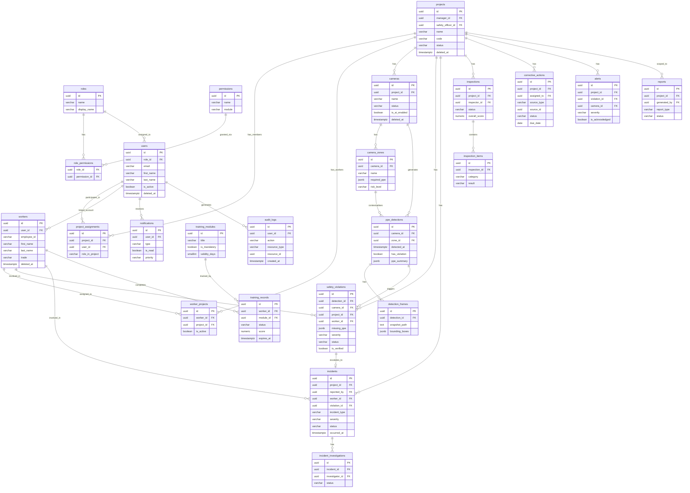

# ConstructSafe AI — Database Design

> **Document Version:** 2.0 (Updated: Architecture Decision Change)  
> **Status:** Approved MongoDB Document Architecture  
> **Primary Database:** MongoDB Community Edition 7.0+  
> **Driver:** PyMongo 4.9+ Asynchronous API (`AsyncMongoClient`)  
> **Validation & Schema Layer:** Pydantic v2 (`MongoBaseModel`, `PyObjectId`)  
> **Previous Design Reference:** Relational PostgreSQL 16 (Preserved below for historical lineage)

---

## Architecture Change Decision (ADR-001)

> [!IMPORTANT]
> **Approved Architecture Change:** Prior to starting Phase 2, the primary database architecture transitioned from PostgreSQL 16 to **MongoDB Community Edition**.
> 
> **Key Architecture Decisions:**
> 1. **Native Document Model:** Inspection checklists, detection bounding boxes, incident investigation notes, and role permission lists are stored as native **embedded subdocuments** rather than relational junction tables, drastically reducing query latency and eliminating expensive multi-table JOINs on high-frequency safety feeds.
> 2. **Official PyMongo Async Driver:** Replaced SQLAlchemy and Motor with the official, actively-supported **PyMongo 4.9+ asynchronous API** (`from pymongo import AsyncMongoClient`).
> 3. **Pydantic v2 Document Modeling:** Built with `PyObjectId` integration providing type-safe validation, native `_id` mapping, and JSON schema compatibility.
> 4. **Automated TTL Indexes:** Used for automatic token expiration in `refresh_tokens` and data retention management in `audit_logs`.
> 5. **Containerization:** Containerized via official `mongo:7.0` image with healthcheck and persistent `mongodb_data` volume in `docker-compose.yml`.

---

## Approved MongoDB Collections & Schema Specification

### 1. MongoDB Document Conventions
* **Collection Names:** Lowercase snake_case, plural (e.g. `users`, `projects`, `ppe_detections`).
* **Primary Key:** `_id` of type `ObjectId` (mapped to `id: PyObjectId` in Pydantic).
* **Timestamps:** UTC `datetime` objects (`created_at`, `updated_at`, `deleted_at`).
* **Soft Deletes:** `deleted_at: Optional[datetime] = None`. Active documents queried with `{"deleted_at": None}`.
* **Denormalization:** Frequently accessed readonly labels (e.g., `role_name` in `users`, `project_name` in `cameras`) are denormalized for sub-millisecond query performance.

### 2. Collection Directory (16 Core Collections)

| Collection | Model Class | Primary Query Pattern / Purpose | Indexes |
|---|---|---|---|
| `users` | `UserDocument` | User auth, role permissions, project assignments | `email` (unique), `role_id` |
| `roles` | `RoleDocument` | RBAC roles with embedded permission keys | `name` (unique) |
| `permissions` | `PermissionDocument` | Granular permission registry | `name` (unique), `module` |
| `projects` | `ProjectDocument` | Construction jobsites, coordinates, safety goals | `code` (unique), `status` |
| `project_assignments` | `ProjectAssignmentDocument` | Worker/manager assignment to sites | `project_id`, `user_id` |
| `workers` | `WorkerDocument` | Worker profiles, trade, badge ID, induction | `employee_id` (unique), `current_project_id` |
| `cameras` | `CameraDocument` | RTSP streams, camera zones, FPS, AI classes | `project_id`, `status` |
| `ppe_detections` | `PPEDetectionDocument` | Live frame inference, embedded bounding boxes | `(camera_id, timestamp DESC)`, `has_violation` |
| `safety_violations` | `SafetyViolationDocument` | Recorded violations, review queue, snapshots | `violation_code` (unique), `(project_id, status)` |
| `incidents` | `IncidentDocument` | Incident tracking with embedded investigation | `incident_number` (unique), `project_id` |
| `inspections` | `InspectionDocument` | Safety audits with embedded checklist items | `inspection_number` (unique), `project_id` |
| `corrective_actions` | `CorrectiveActionDocument` | Remediation workflows, assignees, deadlines | `action_number` (unique), `project_id` |
| `training_records` | `TrainingRecordDocument` | Safety certifications and course logs | `worker_id` |
| `notifications` | `NotificationDocument` | Push notifications and in-app alerts | `(recipient_id, is_read)` |
| `audit_logs` | `AuditLogDocument` | Security audit trail, IP tracking, changes | `created_at` (range index), `actor_id` |
| `refresh_tokens` | `RefreshTokenDocument` | JWT refresh tokens with auto-purge TTL | `expires_at` (TTL: 0s), `token_hash` (unique), `user_id` |

---

## Table of Contents

1. [Database Conventions](#1-database-conventions)
2. [Soft-Delete Strategy](#2-soft-delete-strategy)
3. [Audit Trail Design](#3-audit-trail-design)
4. [Complete Schema](#4-complete-schema)
   - Users, Roles, Permissions, RolePermissions
   - Projects, ProjectAssignments
   - Workers, WorkerProjects
   - Cameras, CameraZones
   - PPEDetections, DetectionFrames
   - SafetyViolations
   - Incidents, IncidentInvestigations
   - Inspections, InspectionItems, CorrectiveActions
   - TrainingModules, TrainingRecords
   - Notifications, Alerts
   - AuditLogs, Reports
5. [Foreign Key Relationships & Cascade Rules](#5-foreign-key-relationships--cascade-rules)
6. [Indexes](#6-indexes)
7. [Partitioning Strategy](#7-partitioning-strategy)
8. [ER Diagram](#8-er-diagram)
9. [Sample Seed Data](#9-sample-seed-data)

---

## 1. Database Conventions

| Convention | Rule |
|---|---|
| **Table names** | `snake_case`, plural (e.g., `users`, `ppe_detections`) |
| **Column names** | `snake_case` (e.g., `created_at`, `project_id`) |
| **Primary keys** | `id` — UUID v4 (stored as `UUID` type, default `gen_random_uuid()`) |
| **Foreign keys** | `<referenced_table_singular>_id` (e.g., `project_id`, `user_id`) |
| **Boolean columns** | Named with `is_` prefix (e.g., `is_active`, `is_verified`) |
| **Timestamps** | All stored as `TIMESTAMPTZ` (UTC) |
| **Enumerations** | PostgreSQL native `ENUM` types or `VARCHAR(50)` with CHECK constraint |
| **Soft deletes** | `deleted_at TIMESTAMPTZ NULL` on all business entity tables |
| **Text fields** | `TEXT` for variable-length, `VARCHAR(n)` only where there is a meaningful max |
| **Money/scores** | `NUMERIC(10,4)` for confidence scores; `NUMERIC(15,2)` for any monetary fields |
| **JSON metadata** | `JSONB` for extensible metadata columns |

---

## 2. Soft-Delete Strategy

Every business entity table includes a `deleted_at` column (nullable `TIMESTAMPTZ`). Records are **never hard-deleted** except for temporary/log data.

**Query convention:** All application queries must include `WHERE deleted_at IS NULL` (enforced via SQLAlchemy global filter on base model class).

**SQLAlchemy base model:**
```python
class SoftDeleteMixin:
    deleted_at: Mapped[Optional[datetime]] = mapped_column(TIMESTAMPTZ, nullable=True)

    def soft_delete(self):
        self.deleted_at = datetime.utcnow()

    @classmethod
    def active(cls):
        return cls.deleted_at.is_(None)
```

**Cascading soft deletes:**
- Deleting a `Project` soft-deletes associated `Cameras`, `Inspections`, `Incidents`
- Deleting a `Camera` soft-deletes associated `PPEDetections`, `Alerts`
- Deleting a `User` sets `deleted_at` on user, preserving all activity records for audit

---

## 3. Audit Trail Design

The `audit_logs` table captures every create/update/delete operation on sensitive entities.

Audit events are written by:
1. **SQLAlchemy event hooks** (`after_insert`, `after_update`, `after_delete`) on watched models
2. **FastAPI middleware** for auth events (login, logout, failed login)

Each audit log entry captures: who, what table, what record, what changed (old vs new as JSONB diff), when, and from which IP.

---

## 4. Complete Schema

---

### 4.1 `roles`

Defines the named roles in the system.

| Column | Type | Constraints | Description |
|---|---|---|---|
| `id` | UUID | PK, DEFAULT gen_random_uuid() | Role ID |
| `name` | VARCHAR(50) | NOT NULL, UNIQUE | Role name: `super_admin`, `admin`, `project_manager`, `safety_inspector`, `worker`, `client` |
| `display_name` | VARCHAR(100) | NOT NULL | Human-friendly label |
| `description` | TEXT | NULL | Role description |
| `created_at` | TIMESTAMPTZ | NOT NULL, DEFAULT now() | Creation timestamp |
| `updated_at` | TIMESTAMPTZ | NOT NULL, DEFAULT now() | Last update |

---

### 4.2 `permissions`

Granular permission tokens.

| Column | Type | Constraints | Description |
|---|---|---|---|
| `id` | UUID | PK | Permission ID |
| `name` | VARCHAR(100) | NOT NULL, UNIQUE | e.g., `incidents:read`, `cameras:write` |
| `module` | VARCHAR(50) | NOT NULL | Grouping module (projects, cameras, incidents, etc.) |
| `description` | TEXT | NULL | What this permission allows |
| `created_at` | TIMESTAMPTZ | NOT NULL, DEFAULT now() | — |

---

### 4.3 `role_permissions`

Junction table: role ↔ permission (many-to-many).

| Column | Type | Constraints | Description |
|---|---|---|---|
| `role_id` | UUID | PK (composite), FK → roles.id ON DELETE CASCADE | Role reference |
| `permission_id` | UUID | PK (composite), FK → permissions.id ON DELETE CASCADE | Permission reference |
| `granted_at` | TIMESTAMPTZ | NOT NULL, DEFAULT now() | When this permission was granted to the role |

---

### 4.4 `users`

Application user accounts.

| Column | Type | Constraints | Description |
|---|---|---|---|
| `id` | UUID | PK | User ID |
| `role_id` | UUID | NOT NULL, FK → roles.id | Assigned role |
| `email` | VARCHAR(255) | NOT NULL, UNIQUE | Login email |
| `password_hash` | VARCHAR(255) | NOT NULL | Bcrypt hash |
| `first_name` | VARCHAR(100) | NOT NULL | — |
| `last_name` | VARCHAR(100) | NOT NULL | — |
| `phone` | VARCHAR(20) | NULL | Contact number |
| `avatar_path` | TEXT | NULL | Relative path under /storage/avatars/ |
| `is_active` | BOOLEAN | NOT NULL, DEFAULT TRUE | Account enabled flag |
| `is_verified` | BOOLEAN | NOT NULL, DEFAULT FALSE | Email verified |
| `last_login_at` | TIMESTAMPTZ | NULL | Last successful login |
| `failed_login_count` | SMALLINT | NOT NULL, DEFAULT 0 | Consecutive failed attempts |
| `locked_until` | TIMESTAMPTZ | NULL | Account lockout expiry |
| `metadata` | JSONB | NULL | Extensible extra fields |
| `created_at` | TIMESTAMPTZ | NOT NULL, DEFAULT now() | — |
| `updated_at` | TIMESTAMPTZ | NOT NULL, DEFAULT now() | — |
| `deleted_at` | TIMESTAMPTZ | NULL | Soft delete |

---

### 4.5 `projects`

Construction site projects.

| Column | Type | Constraints | Description |
|---|---|---|---|
| `id` | UUID | PK | Project ID |
| `name` | VARCHAR(200) | NOT NULL | Project name |
| `code` | VARCHAR(50) | NOT NULL, UNIQUE | Short project code (e.g., CS-2026-001) |
| `description` | TEXT | NULL | Project description |
| `location` | VARCHAR(300) | NULL | Site address |
| `latitude` | NUMERIC(10,7) | NULL | GPS latitude |
| `longitude` | NUMERIC(10,7) | NULL | GPS longitude |
| `status` | VARCHAR(50) | NOT NULL, DEFAULT 'planning' | Enum: `planning`, `active`, `on_hold`, `completed`, `cancelled` |
| `start_date` | DATE | NULL | Planned start date |
| `end_date` | DATE | NULL | Planned end date |
| `actual_start_date` | DATE | NULL | Actual start date |
| `actual_end_date` | DATE | NULL | Actual end date |
| `client_name` | VARCHAR(200) | NULL | Client organisation name |
| `contract_value` | NUMERIC(15,2) | NULL | Contract value |
| `safety_officer_id` | UUID | NULL, FK → users.id | Assigned safety officer |
| `manager_id` | UUID | NULL, FK → users.id | Project manager |
| `metadata` | JSONB | NULL | Extra fields |
| `created_by` | UUID | NOT NULL, FK → users.id | Creator user |
| `created_at` | TIMESTAMPTZ | NOT NULL, DEFAULT now() | — |
| `updated_at` | TIMESTAMPTZ | NOT NULL, DEFAULT now() | — |
| `deleted_at` | TIMESTAMPTZ | NULL | Soft delete |

---

### 4.6 `project_assignments`

Links users (PM, Inspector, Client) to projects.

| Column | Type | Constraints | Description |
|---|---|---|---|
| `id` | UUID | PK | — |
| `project_id` | UUID | NOT NULL, FK → projects.id ON DELETE CASCADE | — |
| `user_id` | UUID | NOT NULL, FK → users.id ON DELETE CASCADE | — |
| `role_in_project` | VARCHAR(50) | NOT NULL | e.g., `manager`, `inspector`, `client_viewer` |
| `assigned_at` | TIMESTAMPTZ | NOT NULL, DEFAULT now() | — |
| `assigned_by` | UUID | NULL, FK → users.id | Who made the assignment |
| — | — | UNIQUE(project_id, user_id) | One assignment per user per project |

---

### 4.7 `workers`

On-site workers (may or may not have user accounts).

| Column | Type | Constraints | Description |
|---|---|---|---|
| `id` | UUID | PK | Worker ID |
| `user_id` | UUID | NULL, FK → users.id | Linked user account (optional) |
| `employee_id` | VARCHAR(50) | NOT NULL, UNIQUE | HR employee number |
| `first_name` | VARCHAR(100) | NOT NULL | — |
| `last_name` | VARCHAR(100) | NOT NULL | — |
| `trade` | VARCHAR(100) | NULL | Carpenter, electrician, plumber, etc. |
| `contractor_company` | VARCHAR(200) | NULL | Subcontractor company name |
| `ppe_profile` | JSONB | NULL | Required PPE items for this worker's role |
| `photo_path` | TEXT | NULL | Worker photo for recognition |
| `is_active` | BOOLEAN | NOT NULL, DEFAULT TRUE | Currently on-site flag |
| `hire_date` | DATE | NULL | — |
| `emergency_contact` | JSONB | NULL | Name + phone |
| `created_at` | TIMESTAMPTZ | NOT NULL, DEFAULT now() | — |
| `updated_at` | TIMESTAMPTZ | NOT NULL, DEFAULT now() | — |
| `deleted_at` | TIMESTAMPTZ | NULL | Soft delete |

---

### 4.8 `worker_projects`

Links workers to projects (many-to-many, with dates).

| Column | Type | Constraints | Description |
|---|---|---|---|
| `id` | UUID | PK | — |
| `worker_id` | UUID | NOT NULL, FK → workers.id ON DELETE CASCADE | — |
| `project_id` | UUID | NOT NULL, FK → projects.id ON DELETE CASCADE | — |
| `start_date` | DATE | NULL | Assignment start |
| `end_date` | DATE | NULL | Assignment end |
| `is_active` | BOOLEAN | NOT NULL, DEFAULT TRUE | Currently assigned |
| — | — | UNIQUE(worker_id, project_id) | — |

---

### 4.9 `hazard_reports`

Stores inspector-submitted hazard photographs, AI-suggested non-conformances, inspector confirmation, admin review decisions, and audit history. Replaces legacy `cameras` table.

```json
{
  "_id": {"$oid": "6afc3571cd965bcd7da9abfe"},
  "report_number": "HAZ-2026-0001",
  "project_id": {"$oid": "6afc3f692527fffffb098a61"},
  "location_details": "Floor 14 - West Perimeter Deck",
  "photo_url": "/api/v1/storage/files/a1b2c3d4e5.jpg",
  "image_metadata": {
    "filename": "deck14_edge.jpg",
    "size_bytes": 2450122,
    "content_type": "image/jpeg",
    "width": 1920,
    "height": 1080
  },
  "category": "falling_object",
  "severity": "high",
  "description": "Unsecured 2x4 framing lumber resting on slab edge without toe-boards.",
  "notes": "Observed during afternoon safety audit.",
  "ai_analysis": {
    "model_version": "yolov8-construction-v1.0",
    "analyzed_at": "2026-11-17T12:00:00Z",
    "confidence_score": 0.892,
    "suggested_hazards": [
      {
        "category": "edge_protection_defect",
        "label": "Missing Toe-board",
        "confidence": 0.912,
        "bbox": [120, 340, 480, 560]
      },
      {
        "category": "falling_object",
        "label": "Unsecured Material at Height",
        "confidence": 0.872,
        "bbox": [210, 410, 390, 490]
      }
    ]
  },
  "inspector_confirmation": {
    "confirmed_by": {"$oid": "6afc3571cd965bcd7da9abfc"},
    "confirmed_at": "2026-11-17T12:05:00Z",
    "confirmed_categories": ["edge_protection_defect", "falling_object"],
    "inspector_comments": "Verified on site; immediate fall hazard for deck below."
  },
  "admin_review": {
    "status": "pending_admin_review",
    "reviewed_by": null,
    "reviewed_at": null,
    "admin_notes": null,
    "rejection_reason": null
  },
  "corrective_action_id": null,
  "audit_trail": [
    {
      "action": "analyzed_by_ai",
      "performed_by": null,
      "timestamp": "2026-11-17T12:00:00Z",
      "details": "AI suggested 2 hazards with 89.2% confidence"
    },
    {
      "action": "submitted_to_admin",
      "performed_by": {"$oid": "6afc3571cd965bcd7da9abfc"},
      "timestamp": "2026-11-17T12:06:00Z",
      "details": "Report submitted for administrative review"
    }
  ],
  "created_at": "2026-11-17T12:06:00Z",
  "updated_at": "2026-11-17T12:06:00Z",
  "deleted_at": null
}
```

---

### 4.10 `camera_zones` (DEPRECATED - OMITTED)

Configures required PPE for areas covered by a camera.

| Column | Type | Constraints | Description |
|---|---|---|---|
| `id` | UUID | PK | Zone ID |
| `camera_id` | UUID | NOT NULL, FK → cameras.id ON DELETE CASCADE | Owning camera |
| `name` | VARCHAR(100) | NOT NULL | Zone name (e.g., "Excavation Area") |
| `required_ppe` | JSONB | NOT NULL | Array of required PPE: `["helmet","vest","boots"]` |
| `polygon_coords` | JSONB | NULL | Optional image-space polygon for zone boundary |
| `risk_level` | VARCHAR(20) | NOT NULL, DEFAULT 'medium' | `low`, `medium`, `high`, `critical` |
| `is_active` | BOOLEAN | NOT NULL, DEFAULT TRUE | — |
| `created_at` | TIMESTAMPTZ | NOT NULL, DEFAULT now() | — |
| `updated_at` | TIMESTAMPTZ | NOT NULL, DEFAULT now() | — |

---

### 4.11 `ppe_detections`

> **High-volume table — partitioned by month on `detected_at`**

Each row is one YOLO inference run against a frame.

| Column | Type | Constraints | Description |
|---|---|---|---|
| `id` | UUID | PK | Detection ID |
| `camera_id` | UUID | NOT NULL, FK → cameras.id | Source camera |
| `zone_id` | UUID | NULL, FK → camera_zones.id | Matched zone |
| `detected_at` | TIMESTAMPTZ | NOT NULL | Inference timestamp (partition key) |
| `frame_sequence` | BIGINT | NOT NULL | Frame counter from camera stream |
| `person_count` | SMALLINT | NOT NULL, DEFAULT 0 | Number of persons detected |
| `ppe_summary` | JSONB | NOT NULL | `{ helmet: 2, vest: 1, missing_helmet: 1, ... }` |
| `has_violation` | BOOLEAN | NOT NULL, DEFAULT FALSE | Quick filter flag |
| `raw_predictions` | JSONB | NULL | Full YOLO output (all classes + scores) |
| `inference_latency_ms` | SMALLINT | NULL | YOLO model latency |
| `model_version` | VARCHAR(50) | NULL | e.g., `yolov8n-ppe-v2` |
| `created_at` | TIMESTAMPTZ | NOT NULL, DEFAULT now() | — |

---

### 4.12 `detection_frames`

Stores snapshot metadata for individual annotated frames.

| Column | Type | Constraints | Description |
|---|---|---|---|
| `id` | UUID | PK | Frame ID |
| `detection_id` | UUID | NOT NULL, FK → ppe_detections.id ON DELETE CASCADE | Parent detection |
| `snapshot_path` | TEXT | NOT NULL | Relative path to annotated JPEG |
| `bounding_boxes` | JSONB | NOT NULL | Array of `{ class, confidence, x1, y1, x2, y2 }` |
| `frame_width` | SMALLINT | NULL | — |
| `frame_height` | SMALLINT | NULL | — |
| `is_evidence` | BOOLEAN | NOT NULL, DEFAULT FALSE | Flagged as evidence (retained longer) |
| `created_at` | TIMESTAMPTZ | NOT NULL, DEFAULT now() | — |

---

### 4.13 `safety_violations`

A verified violation event (one or more workers without required PPE).

| Column | Type | Constraints | Description |
|---|---|---|---|
| `id` | UUID | PK | Violation ID |
| `detection_id` | UUID | NOT NULL, FK → ppe_detections.id | Source detection |
| `camera_id` | UUID | NOT NULL, FK → cameras.id | — |
| `project_id` | UUID | NOT NULL, FK → projects.id | — |
| `worker_id` | UUID | NULL, FK → workers.id | Identified worker (if matched) |
| `missing_ppe` | JSONB | NOT NULL | List of missing PPE items: `["helmet","vest"]` |
| `severity` | VARCHAR(20) | NOT NULL, DEFAULT 'medium' | `low`, `medium`, `high`, `critical` |
| `status` | VARCHAR(30) | NOT NULL, DEFAULT 'open' | `open`, `acknowledged`, `resolved`, `disputed` |
| `snapshot_path` | TEXT | NULL | Evidence frame path |
| `confidence_score` | NUMERIC(5,4) | NULL | AI confidence (0.0–1.0) |
| `is_verified` | BOOLEAN | NOT NULL, DEFAULT FALSE | Human-verified flag |
| `verified_by` | UUID | NULL, FK → users.id | Who verified |
| `verified_at` | TIMESTAMPTZ | NULL | — |
| `notes` | TEXT | NULL | Inspector notes |
| `resolved_at` | TIMESTAMPTZ | NULL | — |
| `resolved_by` | UUID | NULL, FK → users.id | — |
| `created_at` | TIMESTAMPTZ | NOT NULL, DEFAULT now() | — |
| `updated_at` | TIMESTAMPTZ | NOT NULL, DEFAULT now() | — |
| `deleted_at` | TIMESTAMPTZ | NULL | Soft delete |

---

### 4.14 `incidents`

Formal safety incident records.

| Column | Type | Constraints | Description |
|---|---|---|---|
| `id` | UUID | PK | Incident ID |
| `project_id` | UUID | NOT NULL, FK → projects.id | Owning project |
| `reported_by` | UUID | NOT NULL, FK → users.id | Reporter |
| `worker_id` | UUID | NULL, FK → workers.id | Involved worker |
| `violation_id` | UUID | NULL, FK → safety_violations.id | Related violation |
| `title` | VARCHAR(300) | NOT NULL | — |
| `description` | TEXT | NOT NULL | Full incident description |
| `incident_type` | VARCHAR(80) | NOT NULL | e.g., `near_miss`, `first_aid`, `lost_time`, `fatality`, `property_damage` |
| `severity` | VARCHAR(20) | NOT NULL | `minor`, `moderate`, `serious`, `critical` |
| `status` | VARCHAR(30) | NOT NULL, DEFAULT 'reported' | `reported`, `under_investigation`, `corrective_action`, `closed` |
| `location` | TEXT | NULL | Where on site |
| `occurred_at` | TIMESTAMPTZ | NOT NULL | When the incident happened |
| `reported_at` | TIMESTAMPTZ | NOT NULL, DEFAULT now() | When it was formally reported |
| `closed_at` | TIMESTAMPTZ | NULL | — |
| `root_cause` | TEXT | NULL | Root cause analysis summary |
| `attachments` | JSONB | NULL | Array of file paths |
| `created_at` | TIMESTAMPTZ | NOT NULL, DEFAULT now() | — |
| `updated_at` | TIMESTAMPTZ | NOT NULL, DEFAULT now() | — |
| `deleted_at` | TIMESTAMPTZ | NULL | Soft delete |

---

### 4.15 `incident_investigations`

Investigation steps and findings for an incident.

| Column | Type | Constraints | Description |
|---|---|---|---|
| `id` | UUID | PK | — |
| `incident_id` | UUID | NOT NULL, FK → incidents.id ON DELETE CASCADE | — |
| `investigator_id` | UUID | NOT NULL, FK → users.id | Assigned investigator |
| `findings` | TEXT | NULL | Investigation findings |
| `recommendations` | TEXT | NULL | Recommended actions |
| `status` | VARCHAR(30) | NOT NULL, DEFAULT 'in_progress' | `in_progress`, `complete` |
| `started_at` | TIMESTAMPTZ | NOT NULL, DEFAULT now() | — |
| `completed_at` | TIMESTAMPTZ | NULL | — |
| `created_at` | TIMESTAMPTZ | NOT NULL, DEFAULT now() | — |
| `updated_at` | TIMESTAMPTZ | NOT NULL, DEFAULT now() | — |

---

### 4.16 `inspections`

Formal safety inspections (scheduled or ad hoc).

| Column | Type | Constraints | Description |
|---|---|---|---|
| `id` | UUID | PK | Inspection ID |
| `project_id` | UUID | NOT NULL, FK → projects.id | — |
| `inspector_id` | UUID | NOT NULL, FK → users.id | Assigned inspector |
| `title` | VARCHAR(200) | NOT NULL | e.g., "Weekly Site Safety Walk" |
| `inspection_type` | VARCHAR(80) | NOT NULL | `routine`, `special`, `audit`, `regulatory` |
| `status` | VARCHAR(30) | NOT NULL, DEFAULT 'scheduled' | `scheduled`, `in_progress`, `completed`, `cancelled` |
| `scheduled_at` | TIMESTAMPTZ | NULL | Planned date/time |
| `started_at` | TIMESTAMPTZ | NULL | Actual start |
| `completed_at` | TIMESTAMPTZ | NULL | Actual completion |
| `overall_score` | NUMERIC(5,2) | NULL | Computed compliance score 0–100 |
| `notes` | TEXT | NULL | Inspector notes |
| `attachments` | JSONB | NULL | Photo/document paths |
| `created_at` | TIMESTAMPTZ | NOT NULL, DEFAULT now() | — |
| `updated_at` | TIMESTAMPTZ | NOT NULL, DEFAULT now() | — |
| `deleted_at` | TIMESTAMPTZ | NULL | Soft delete |

---

### 4.17 `inspection_items`

Checklist items within an inspection.

| Column | Type | Constraints | Description |
|---|---|---|---|
| `id` | UUID | PK | — |
| `inspection_id` | UUID | NOT NULL, FK → inspections.id ON DELETE CASCADE | — |
| `category` | VARCHAR(100) | NOT NULL | e.g., `PPE`, `Scaffolding`, `Electrical`, `Fire Safety` |
| `description` | TEXT | NOT NULL | What to check |
| `result` | VARCHAR(20) | NULL | `pass`, `fail`, `na`, `observation` |
| `score` | NUMERIC(5,2) | NULL | Item score |
| `notes` | TEXT | NULL | Inspector notes for this item |
| `photo_paths` | JSONB | NULL | Array of photo file paths |
| `order_index` | SMALLINT | NOT NULL, DEFAULT 0 | Display order |
| `created_at` | TIMESTAMPTZ | NOT NULL, DEFAULT now() | — |

---

### 4.18 `corrective_actions`

Actions arising from violations, inspections, or incidents.

| Column | Type | Constraints | Description |
|---|---|---|---|
| `id` | UUID | PK | — |
| `source_type` | VARCHAR(30) | NOT NULL | `violation`, `inspection`, `incident` |
| `source_id` | UUID | NOT NULL | ID of the source record |
| `project_id` | UUID | NOT NULL, FK → projects.id | — |
| `assigned_to` | UUID | NULL, FK → users.id | Responsible person |
| `title` | VARCHAR(300) | NOT NULL | — |
| `description` | TEXT | NOT NULL | What action to take |
| `priority` | VARCHAR(20) | NOT NULL, DEFAULT 'medium' | `low`, `medium`, `high`, `urgent` |
| `status` | VARCHAR(30) | NOT NULL, DEFAULT 'open' | `open`, `in_progress`, `completed`, `overdue`, `cancelled` |
| `due_date` | DATE | NULL | — |
| `completed_at` | TIMESTAMPTZ | NULL | — |
| `completion_notes` | TEXT | NULL | — |
| `evidence_paths` | JSONB | NULL | Photos/documents of remediation |
| `created_by` | UUID | NOT NULL, FK → users.id | — |
| `created_at` | TIMESTAMPTZ | NOT NULL, DEFAULT now() | — |
| `updated_at` | TIMESTAMPTZ | NOT NULL, DEFAULT now() | — |
| `deleted_at` | TIMESTAMPTZ | NULL | Soft delete |

---

### 4.19 `training_modules`

Library of safety training course definitions.

| Column | Type | Constraints | Description |
|---|---|---|---|
| `id` | UUID | PK | — |
| `title` | VARCHAR(200) | NOT NULL | Training course title |
| `description` | TEXT | NULL | — |
| `category` | VARCHAR(100) | NULL | e.g., `PPE Usage`, `Fire Safety`, `Working at Heights` |
| `duration_minutes` | SMALLINT | NULL | Expected duration |
| `is_mandatory` | BOOLEAN | NOT NULL, DEFAULT FALSE | Required for all workers |
| `validity_days` | SMALLINT | NULL | Days until re-certification needed |
| `content_path` | TEXT | NULL | Path to training material PDF/video |
| `passing_score` | NUMERIC(5,2) | NULL | Minimum pass score (%) |
| `created_by` | UUID | NULL, FK → users.id | — |
| `created_at` | TIMESTAMPTZ | NOT NULL, DEFAULT now() | — |
| `updated_at` | TIMESTAMPTZ | NOT NULL, DEFAULT now() | — |
| `deleted_at` | TIMESTAMPTZ | NULL | Soft delete |

---

### 4.20 `training_records`

Tracks completion of training modules by workers.

| Column | Type | Constraints | Description |
|---|---|---|---|
| `id` | UUID | PK | — |
| `worker_id` | UUID | NOT NULL, FK → workers.id ON DELETE CASCADE | — |
| `module_id` | UUID | NOT NULL, FK → training_modules.id | — |
| `project_id` | UUID | NULL, FK → projects.id | Project context (optional) |
| `status` | VARCHAR(30) | NOT NULL, DEFAULT 'enrolled' | `enrolled`, `in_progress`, `passed`, `failed`, `expired` |
| `score` | NUMERIC(5,2) | NULL | Assessment score (%) |
| `completed_at` | TIMESTAMPTZ | NULL | — |
| `expires_at` | TIMESTAMPTZ | NULL | Computed from module.validity_days |
| `certificate_path` | TEXT | NULL | Path to generated certificate |
| `attempts` | SMALLINT | NOT NULL, DEFAULT 1 | Number of attempts |
| `created_at` | TIMESTAMPTZ | NOT NULL, DEFAULT now() | — |
| `updated_at` | TIMESTAMPTZ | NOT NULL, DEFAULT now() | — |

---

### 4.21 `notifications`

In-app notification records.

| Column | Type | Constraints | Description |
|---|---|---|---|
| `id` | UUID | PK | — |
| `user_id` | UUID | NOT NULL, FK → users.id ON DELETE CASCADE | Recipient |
| `type` | VARCHAR(60) | NOT NULL | `violation_alert`, `incident_created`, `action_due`, `inspection_scheduled`, `training_expired`, `system` |
| `title` | VARCHAR(200) | NOT NULL | — |
| `message` | TEXT | NOT NULL | — |
| `reference_type` | VARCHAR(50) | NULL | e.g., `violation`, `incident` |
| `reference_id` | UUID | NULL | ID of referenced record |
| `is_read` | BOOLEAN | NOT NULL, DEFAULT FALSE | — |
| `read_at` | TIMESTAMPTZ | NULL | — |
| `priority` | VARCHAR(20) | NOT NULL, DEFAULT 'normal' | `low`, `normal`, `high`, `critical` |
| `created_at` | TIMESTAMPTZ | NOT NULL, DEFAULT now() | — |

---

### 4.22 `alerts`

Active real-time safety alerts (from AI violations).

| Column | Type | Constraints | Description |
|---|---|---|---|
| `id` | UUID | PK | Alert ID |
| `violation_id` | UUID | NULL, FK → safety_violations.id | Source violation |
| `project_id` | UUID | NOT NULL, FK → projects.id | — |
| `camera_id` | UUID | NULL, FK → cameras.id | — |
| `type` | VARCHAR(60) | NOT NULL | `ppe_missing`, `camera_offline`, `zone_breach`, `critical_incident` |
| `severity` | VARCHAR(20) | NOT NULL | `info`, `warning`, `danger`, `critical` |
| `message` | TEXT | NOT NULL | Alert message |
| `is_acknowledged` | BOOLEAN | NOT NULL, DEFAULT FALSE | — |
| `acknowledged_by` | UUID | NULL, FK → users.id | — |
| `acknowledged_at` | TIMESTAMPTZ | NULL | — |
| `auto_resolved` | BOOLEAN | NOT NULL, DEFAULT FALSE | Resolved automatically (PPE worn again) |
| `resolved_at` | TIMESTAMPTZ | NULL | — |
| `created_at` | TIMESTAMPTZ | NOT NULL, DEFAULT now() | — |

---

### 4.23 `audit_logs`

> **High-volume table — partitioned by month on `created_at`**

| Column | Type | Constraints | Description |
|---|---|---|---|
| `id` | UUID | PK | — |
| `user_id` | UUID | NULL, FK → users.id | Acting user (NULL for system actions) |
| `action` | VARCHAR(60) | NOT NULL | `CREATE`, `UPDATE`, `DELETE`, `LOGIN`, `LOGOUT`, `LOGIN_FAILED`, `EXPORT` |
| `resource_type` | VARCHAR(60) | NOT NULL | Table/entity name (e.g., `projects`, `incidents`) |
| `resource_id` | UUID | NULL | Affected record ID |
| `old_values` | JSONB | NULL | Snapshot before change |
| `new_values` | JSONB | NULL | Snapshot after change |
| `ip_address` | VARCHAR(45) | NULL | Client IP |
| `user_agent` | TEXT | NULL | Browser user agent |
| `correlation_id` | UUID | NULL | Request correlation ID |
| `created_at` | TIMESTAMPTZ | NOT NULL, DEFAULT now() | Partition key |

---

### 4.24 `reports`

Generated report metadata records.

| Column | Type | Constraints | Description |
|---|---|---|---|
| `id` | UUID | PK | Report ID |
| `project_id` | UUID | NULL, FK → projects.id | Scoped project (NULL = cross-project) |
| `generated_by` | UUID | NOT NULL, FK → users.id | — |
| `report_type` | VARCHAR(80) | NOT NULL | `daily_summary`, `weekly_safety`, `violation_log`, `incident_report`, `inspection_report`, `training_compliance` |
| `title` | VARCHAR(200) | NOT NULL | — |
| `parameters` | JSONB | NULL | Report filter params (date range, project, etc.) |
| `file_path` | TEXT | NULL | Generated file path under /storage/reports/ |
| `file_format` | VARCHAR(10) | NULL | `pdf`, `xlsx`, `csv` |
| `status` | VARCHAR(20) | NOT NULL, DEFAULT 'pending' | `pending`, `generating`, `ready`, `failed` |
| `generated_at` | TIMESTAMPTZ | NULL | When generation completed |
| `expires_at` | TIMESTAMPTZ | NULL | File retention expiry |
| `created_at` | TIMESTAMPTZ | NOT NULL, DEFAULT now() | — |

---

## 5. Foreign Key Relationships & Cascade Rules

| Child Table | Column | References | On Delete | On Update |
|---|---|---|---|---|
| `users` | `role_id` | `roles.id` | RESTRICT | CASCADE |
| `role_permissions` | `role_id` | `roles.id` | CASCADE | CASCADE |
| `role_permissions` | `permission_id` | `permissions.id` | CASCADE | CASCADE |
| `projects` | `manager_id` | `users.id` | SET NULL | CASCADE |
| `projects` | `safety_officer_id` | `users.id` | SET NULL | CASCADE |
| `projects` | `created_by` | `users.id` | RESTRICT | CASCADE |
| `project_assignments` | `project_id` | `projects.id` | CASCADE | CASCADE |
| `project_assignments` | `user_id` | `users.id` | CASCADE | CASCADE |
| `workers` | `user_id` | `users.id` | SET NULL | CASCADE |
| `worker_projects` | `worker_id` | `workers.id` | CASCADE | CASCADE |
| `worker_projects` | `project_id` | `projects.id` | CASCADE | CASCADE |
| `cameras` | `project_id` | `projects.id` | CASCADE | CASCADE |
| `camera_zones` | `camera_id` | `cameras.id` | CASCADE | CASCADE |
| `ppe_detections` | `camera_id` | `cameras.id` | RESTRICT | CASCADE |
| `ppe_detections` | `zone_id` | `camera_zones.id` | SET NULL | CASCADE |
| `detection_frames` | `detection_id` | `ppe_detections.id` | CASCADE | CASCADE |
| `safety_violations` | `detection_id` | `ppe_detections.id` | RESTRICT | CASCADE |
| `safety_violations` | `camera_id` | `cameras.id` | RESTRICT | CASCADE |
| `safety_violations` | `project_id` | `projects.id` | RESTRICT | CASCADE |
| `safety_violations` | `worker_id` | `workers.id` | SET NULL | CASCADE |
| `incidents` | `project_id` | `projects.id` | RESTRICT | CASCADE |
| `incidents` | `reported_by` | `users.id` | RESTRICT | CASCADE |
| `incidents` | `violation_id` | `safety_violations.id` | SET NULL | CASCADE |
| `incident_investigations` | `incident_id` | `incidents.id` | CASCADE | CASCADE |
| `inspections` | `project_id` | `projects.id` | CASCADE | CASCADE |
| `inspection_items` | `inspection_id` | `inspections.id` | CASCADE | CASCADE |
| `corrective_actions` | `project_id` | `projects.id` | RESTRICT | CASCADE |
| `training_records` | `worker_id` | `workers.id` | CASCADE | CASCADE |
| `training_records` | `module_id` | `training_modules.id` | RESTRICT | CASCADE |
| `notifications` | `user_id` | `users.id` | CASCADE | CASCADE |
| `alerts` | `project_id` | `projects.id` | CASCADE | CASCADE |
| `alerts` | `violation_id` | `safety_violations.id` | SET NULL | CASCADE |
| `audit_logs` | `user_id` | `users.id` | SET NULL | CASCADE |
| `reports` | `generated_by` | `users.id` | RESTRICT | CASCADE |

---

## 6. Indexes

| Table | Index Name | Columns | Type | Purpose |
|---|---|---|---|---|
| `users` | `idx_users_email` | `email` | BTREE UNIQUE | Login lookup |
| `users` | `idx_users_role_id` | `role_id` | BTREE | Role-based queries |
| `users` | `idx_users_deleted_at` | `deleted_at` | BTREE PARTIAL (`WHERE deleted_at IS NULL`) | Soft-delete filter |
| `projects` | `idx_projects_status` | `status` | BTREE | Filter by status |
| `projects` | `idx_projects_manager` | `manager_id` | BTREE | Manager's projects |
| `projects` | `idx_projects_deleted_at` | `deleted_at` | BTREE PARTIAL | Soft-delete filter |
| `cameras` | `idx_cameras_project` | `project_id` | BTREE | Cameras per project |
| `cameras` | `idx_cameras_status` | `status` | BTREE | Online/offline filter |
| `ppe_detections` | `idx_detections_camera_time` | `(camera_id, detected_at DESC)` | BTREE | Camera feed queries |
| `ppe_detections` | `idx_detections_violation` | `has_violation` | BTREE PARTIAL (`WHERE has_violation = TRUE`) | Violation-only queries |
| `ppe_detections` | `idx_detections_time` | `detected_at` | BTREE | Partition pruning |
| `safety_violations` | `idx_violations_project_status` | `(project_id, status)` | BTREE | Dashboard queries |
| `safety_violations` | `idx_violations_camera` | `camera_id` | BTREE | Per-camera violations |
| `safety_violations` | `idx_violations_worker` | `worker_id` | BTREE | Per-worker violations |
| `safety_violations` | `idx_violations_created` | `created_at DESC` | BTREE | Recency ordering |
| `incidents` | `idx_incidents_project_status` | `(project_id, status)` | BTREE | Dashboard queries |
| `incidents` | `idx_incidents_occurred_at` | `occurred_at DESC` | BTREE | Chronological listing |
| `inspections` | `idx_inspections_project` | `project_id` | BTREE | Per-project inspections |
| `inspections` | `idx_inspections_inspector` | `inspector_id` | BTREE | Inspector's queue |
| `corrective_actions` | `idx_ca_project_status` | `(project_id, status)` | BTREE | Open actions dashboard |
| `corrective_actions` | `idx_ca_due_date` | `due_date` | BTREE | Overdue detection |
| `notifications` | `idx_notifications_user_unread` | `(user_id, is_read)` | BTREE PARTIAL (`WHERE is_read = FALSE`) | Unread count |
| `alerts` | `idx_alerts_project_active` | `(project_id, is_acknowledged)` | BTREE | Active alerts |
| `audit_logs` | `idx_audit_user_time` | `(user_id, created_at DESC)` | BTREE | User activity history |
| `audit_logs` | `idx_audit_resource` | `(resource_type, resource_id)` | BTREE | Record history |
| `audit_logs` | `idx_audit_time` | `created_at` | BTREE | Partition pruning |
| `training_records` | `idx_training_worker` | `worker_id` | BTREE | Worker training status |
| `training_records` | `idx_training_expires` | `expires_at` | BTREE | Expiry alerts |

---

## 7. Partitioning Strategy

### 7.1 `ppe_detections` — Monthly Range Partitioning

The `ppe_detections` table is expected to grow at ~50,000–500,000 rows per day for a multi-camera deployment. It is partitioned by month on `detected_at` using PostgreSQL declarative partitioning.

```sql
CREATE TABLE ppe_detections (
    ...
    detected_at TIMESTAMPTZ NOT NULL
) PARTITION BY RANGE (detected_at);

-- Partitions created monthly by Alembic migration or admin script:
CREATE TABLE ppe_detections_2026_11
    PARTITION OF ppe_detections
    FOR VALUES FROM ('2026-11-01') TO ('2026-12-01');

CREATE TABLE ppe_detections_2026_12
    PARTITION OF ppe_detections
    FOR VALUES FROM ('2026-12-01') TO ('2027-01-01');
```

**Retention policy:** Partitions older than 12 months are detached and optionally dropped or archived to cold storage.

### 7.2 `audit_logs` — Monthly Range Partitioning

Same approach as `ppe_detections`, partitioned on `created_at`.

```sql
CREATE TABLE audit_logs (
    ...
    created_at TIMESTAMPTZ NOT NULL DEFAULT now()
) PARTITION BY RANGE (created_at);

CREATE TABLE audit_logs_2026_11
    PARTITION OF audit_logs
    FOR VALUES FROM ('2026-11-01') TO ('2026-12-01');
```

**Retention policy:** Audit logs are retained for 3 years per regulatory requirements. Partitions older than 3 years are archived to compressed flat files and dropped.

### 7.3 Partition Management

A Celery Beat job (`create_monthly_partitions`) runs on the 25th of each month to pre-create the following month's partitions for both tables, preventing runtime partition-creation overhead.

---

## 8. ER Diagram



---

## 9. Sample Seed Data

### 9.1 Roles (6 rows)

| name | display_name |
|---|---|
| `super_admin` | Super Administrator |
| `admin` | System Administrator |
| `project_manager` | Project Manager |
| `safety_inspector` | Safety Inspector |
| `worker` | Site Worker |
| `client` | Client Viewer |

### 9.2 Permissions (sample subset)

```
projects:read, projects:write, projects:delete
cameras:read, cameras:write
detections:read
violations:read, violations:write, violations:verify
incidents:read, incidents:write, incidents:close
inspections:read, inspections:write, inspections:complete
training:read, training:write
reports:read, reports:generate
users:read, users:write, users:delete
audit:read
```

### 9.3 Default Users

| Email | Role | Password |
|---|---|---|
| `superadmin@constructsafe.local` | super_admin | Hashed "Admin@1234" |
| `admin@constructsafe.local` | admin | Hashed "Admin@1234" |
| `pm@constructsafe.local` | project_manager | Hashed "Test@1234" |
| `inspector@constructsafe.local` | safety_inspector | Hashed "Test@1234" |
| `client@constructsafe.local` | client | Hashed "Test@1234" |

### 9.4 Sample Project

```
name: "City Centre Tower Block A"
code: "CS-2026-001"
status: "active"
location: "123 Main St, Cityville"
start_date: 2026-01-15
manager: pm@constructsafe.local
safety_officer: inspector@constructsafe.local
```

### 9.5 Training Modules (sample)

| Title | Mandatory | Validity (days) |
|---|---|---|
| PPE Awareness & Correct Usage | Yes | 365 |
| Working at Heights Safety | Yes | 180 |
| Fire Safety & Evacuation | Yes | 365 |
| Scaffolding Inspection | No | 365 |
| Electrical Safety Basics | No | 730 |
| Manual Handling & Ergonomics | Yes | 365 |

> [!NOTE]
> Seed data is applied via an Alembic data migration (`alembic/versions/xxxx_seed_initial_data.py`) and is idempotent — it uses `INSERT ... ON CONFLICT DO NOTHING` to allow re-runs safely.

> [!TIP]
> Use `TRUNCATE ... CASCADE` only in development/test environments to reset seed data. Never in production — use soft deletes or audit-safe updates.

---

*End of DATABASE_DESIGN.md*
