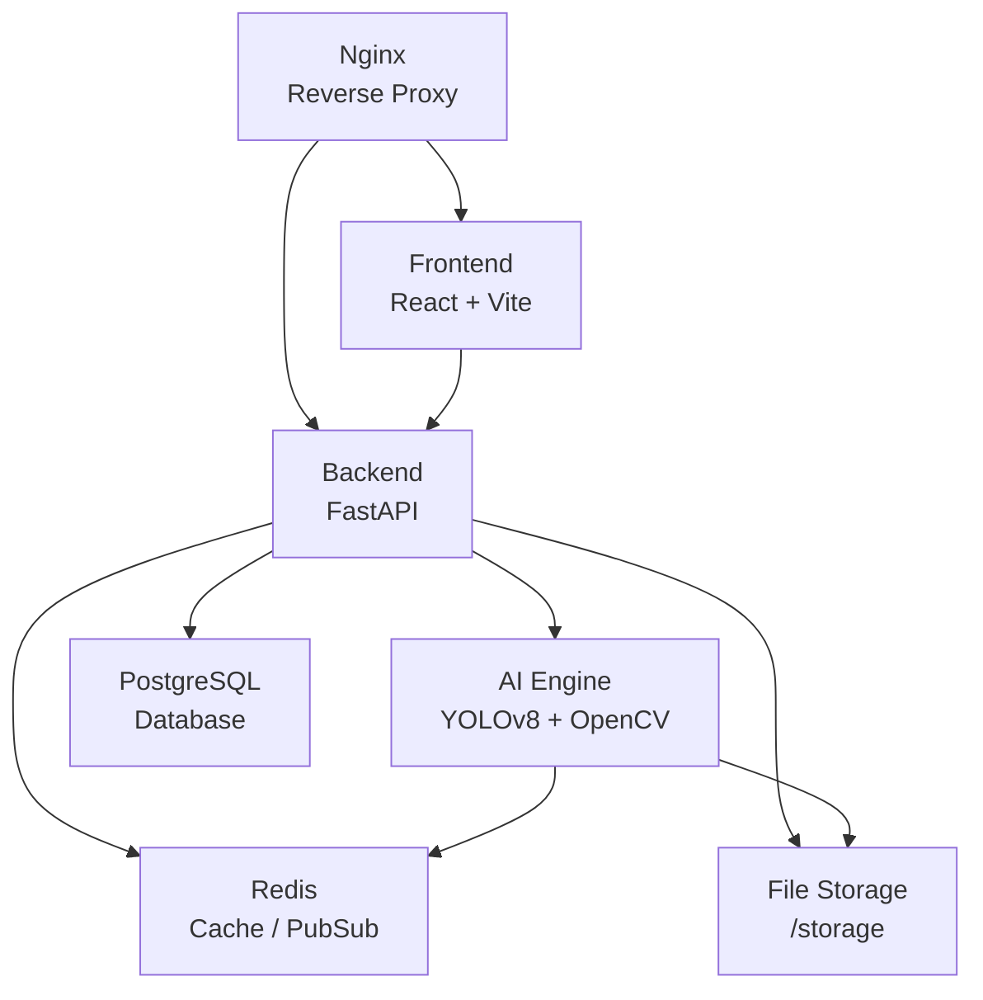

# ConstructSafe AI — Development Roadmap

> **Project:** ConstructSafe AI — AI-Powered Construction Safety Management Software  
> **Document version:** 1.0  
> **Status:** Living document — updated at each phase gate  
> **Last updated:** 2026-11-17

---

## Table of Contents

1. [Project Overview](#project-overview)
2. [Complete Folder Structure](#complete-folder-structure)
3. [Phase Dependency Graph](#phase-dependency-graph)
4. [Roadmap Gantt (Flowchart)](#roadmap-gantt-flowchart)
5. [Component Dependency Diagram](#component-dependency-diagram)
6. [Risk Register](#risk-register)
7. [Phase Specifications](#phase-specifications)
   - [Phase 0: Audit & Planning](#phase-0-audit--planning)
   - [Phase 1: Project Foundation](#phase-1-project-foundation)
   - [Phase 2: Authentication & User Roles](#phase-2-authentication--user-roles)
   - [Phase 3: Project & Worker Management](#phase-3-project--worker-management)
   - [Phase 4: Safety Inspections & Incidents](#phase-4-safety-inspections--incidents)
   - [Phase 5: AI-Assisted Photo Hazard Analysis](#phase-5-ai-assisted-photo-hazard-analysis)
   - [Phase 6: Admin Hazard Review & Multi-Stage Approval](#phase-6-admin-hazard-review--multi-stage-approval)
   - [Phase 7: Analytics, Notifications & Reports](#phase-7-analytics-notifications--reports)
   - [Phase 8: Security & Testing](#phase-8-security--testing)
   - [Phase 9: Deployment](#phase-9-deployment)

---

## Project Overview

ConstructSafe AI is a full-stack, AI-enhanced construction safety management platform. It provides role-based dashboards for Admins, Project Managers, Safety Inspectors, Workers and Clients; automated PPE detection via YOLOv8; real-time CCTV/RTSP camera monitoring; incident and inspection workflows; analytics; and PDF report export — all deployable locally via Docker Compose.

---

## Complete Folder Structure

```
construction_project/
├── docs/                              # All planning and reference documents
│   ├── PROJECT_OVERVIEW.md
│   ├── REQUIREMENTS.md
│   ├── SYSTEM_ARCHITECTURE.md
│   ├── DATABASE_DESIGN.md
│   ├── API_SPECIFICATION.md
│   ├── UI_UX_DESIGN_GUIDE.md
│   ├── AI_ML_STRATEGY.md
│   ├── SECURITY_PLAN.md
│   ├── DEPLOYMENT_GUIDE.md
│   ├── DEVELOPMENT_ROADMAP.md         # ← this file
│   └── TESTING_PLAN.md
│
├── backend/                           # FastAPI Python backend
│   ├── main.py                        # App entry point, router registration
│   ├── database.py                    # SQLAlchemy engine, session factory
│   ├── requirements.txt
│   ├── alembic.ini
│   ├── alembic/
│   │   ├── env.py
│   │   └── versions/
│   ├── core/
│   │   ├── config.py                  # Settings (pydantic BaseSettings)
│   │   ├── security.py                # JWT, bcrypt helpers
│   │   ├── dependencies.py            # FastAPI Depends() factories
│   │   ├── middleware.py              # CORS, logging, rate-limit middleware
│   │   └── exceptions.py             # Custom HTTP exception handlers
│   ├── models/
│   │   ├── __init__.py
│   │   ├── user.py
│   │   ├── role.py
│   │   ├── project.py
│   │   ├── worker.py
│   │   ├── inspection.py
│   │   ├── incident.py
│   │   ├── violation.py
│   │   ├── corrective_action.py
│   │   ├── camera.py
│   │   ├── detection.py
│   │   ├── notification.py
│   │   └── report.py
│   ├── schemas/
│   │   ├── auth.py
│   │   ├── user.py
│   │   ├── project.py
│   │   ├── worker.py
│   │   ├── inspection.py
│   │   ├── incident.py
│   │   ├── detection.py
│   │   ├── camera.py
│   │   ├── analytics.py
│   │   └── notification.py
│   ├── routers/
│   │   ├── auth.py
│   │   ├── users.py
│   │   ├── projects.py
│   │   ├── workers.py
│   │   ├── inspections.py
│   │   ├── incidents.py
│   │   ├── detections.py
│   │   ├── cameras.py
│   │   ├── analytics.py
│   │   ├── notifications.py
│   │   └── reports.py
│   ├── services/
│   │   ├── auth_service.py
│   │   ├── detection_service.py
│   │   ├── notification_service.py
│   │   ├── report_service.py
│   │   └── analytics_service.py
│   ├── websocket_manager.py
│   ├── storage/                       # Uploaded files (video, images)
│   │   ├── videos/
│   │   ├── snapshots/
│   │   └── reports/
│   └── tests/
│       ├── conftest.py
│       ├── test_auth.py
│       ├── test_projects.py
│       ├── test_workers.py
│       ├── test_inspections.py
│       ├── test_incidents.py
│       ├── test_detections.py
│       ├── test_cameras.py
│       └── test_analytics.py
│
├── frontend/                          # React + Vite + Tailwind frontend
│   ├── package.json
│   ├── vite.config.ts
│   ├── tailwind.config.ts
│   ├── tsconfig.json
│   ├── index.html
│   ├── public/
│   │   └── logo.svg
│   └── src/
│       ├── main.tsx
│       ├── App.tsx
│       ├── api/                       # Axios instances and query functions
│       │   ├── axiosInstance.ts
│       │   ├── authApi.ts
│       │   ├── projectsApi.ts
│       │   ├── inspectionsApi.ts
│       │   ├── detectionsApi.ts
│       │   └── analyticsApi.ts
│       ├── store/
│       │   ├── authStore.ts           # Zustand auth slice
│       │   ├── notificationStore.ts
│       │   └── uiStore.ts
│       ├── hooks/
│       │   ├── useAuth.ts
│       │   ├── useWebSocket.ts
│       │   ├── useDetection.ts
│       │   └── useInspection.ts
│       ├── components/
│       │   ├── layout/
│       │   │   ├── Sidebar.tsx
│       │   │   ├── Navbar.tsx
│       │   │   └── PageWrapper.tsx
│       │   ├── ui/
│       │   │   ├── Button.tsx
│       │   │   ├── Badge.tsx
│       │   │   ├── Modal.tsx
│       │   │   ├── Table.tsx
│       │   │   ├── Card.tsx
│       │   │   ├── Input.tsx
│       │   │   └── Spinner.tsx
│       │   ├── charts/
│       │   │   ├── IncidentTrendChart.tsx
│       │   │   ├── PPEComplianceChart.tsx
│       │   │   ├── InspectionStatusChart.tsx
│       │   │   └── WorkerActivityChart.tsx
│       │   ├── detection/
│       │   │   ├── BoundingBoxViewer.tsx
│       │   │   ├── DetectionResultCard.tsx
│       │   │   └── HumanVerificationPanel.tsx
│       │   └── notifications/
│       │       ├── NotificationBell.tsx
│       │       └── NotificationDrawer.tsx
│       ├── pages/
│       │   ├── Login.tsx
│       │   ├── Unauthorized.tsx
│       │   ├── admin/
│       │   │   ├── Dashboard.tsx
│       │   │   ├── Projects.tsx
│       │   │   ├── Workers.tsx
│       │   │   ├── Analytics.tsx
│       │   │   └── Reports.tsx
│       │   ├── manager/
│       │   │   ├── Dashboard.tsx
│       │   │   └── ProjectDetail.tsx
│       │   ├── inspector/
│       │   │   ├── Dashboard.tsx
│       │   │   ├── Inspections.tsx
│       │   │   ├── PPEDetection.tsx
│       │   │   ├── CameraMonitor.tsx
│       │   │   └── IncidentReport.tsx
│       │   ├── worker/
│       │   │   └── Dashboard.tsx
│       │   └── client/
│       │       └── Dashboard.tsx
│       ├── routes/
│       │   ├── AppRouter.tsx
│       │   └── ProtectedRoute.tsx
│       ├── types/
│       │   └── index.ts               # Shared TypeScript interfaces
│       └── utils/
│           ├── formatters.ts
│           └── validators.ts
│
├── ai_engine/                         # Python AI microservice
│   ├── main.py                        # FastAPI app for AI endpoints
│   ├── detector.py                    # YOLOv8 inference wrapper
│   ├── video_processor.py             # OpenCV frame extraction
│   ├── rtsp_handler.py                # RTSP stream capture
│   ├── requirements.txt
│   ├── models/                        # YOLO weights (.pt files)
│   │   └── ppe_yolov8.pt
│   └── tests/
│       ├── test_detector.py
│       └── test_video_processor.py
│
├── nginx/
│   ├── nginx.conf                     # Development reverse proxy
│   └── nginx.prod.conf                # Production config
│
├── playwright/                        # E2E tests
│   ├── playwright.config.ts
│   └── tests/
│       ├── auth.spec.ts
│       ├── inspection.spec.ts
│       ├── ppe-detection.spec.ts
│       └── camera.spec.ts
│
├── .github/
│   └── workflows/
│       ├── ci.yml
│       └── deploy.yml
│
├── docker-compose.yml                 # Development compose
├── docker-compose.prod.yml            # Production compose
├── .env.example                       # Template environment variables
├── .gitignore
└── README.md
```

---

## Phase Dependency Graph

```
Phase 0 (Audit & Planning)
        │
        ▼
Phase 1 (Foundation)
        │
        ▼
Phase 2 (Auth & Roles)
        │
        ├──────────────┐
        ▼              ▼
Phase 3 (Projects)  Phase 4 (Inspections)
        │              │
        └──────┬────────┘
               ▼
Phase 5 (AI PPE Detection)
               │
               ▼
Phase 6 (CCTV & Cameras)
               │
               ▼
Phase 7 (Analytics & Notifications)
               │
               ▼
Phase 8 (Security & Testing)
               │
               ▼
Phase 9 (Deployment)
```

---

## Roadmap Gantt (Flowchart)

```mermaid
flowchart LR
    P0["Phase 0\nAudit & Planning\n1 week"]
    P1["Phase 1\nFoundation\n1 week"]
    P2["Phase 2\nAuth & Roles\n1.5 weeks"]
    P3["Phase 3\nProject & Worker Mgmt\n1.5 weeks"]
    P4["Phase 4\nInspections & Incidents\n2 weeks"]
    P5["Phase 5\nAI PPE Detection\n2.5 weeks"]
    P6["Phase 6\nCCTV & Cameras\n1.5 weeks"]
    P7["Phase 7\nAnalytics & Reports\n2 weeks"]
    P8["Phase 8\nSecurity & Testing\n2 weeks"]
    P9["Phase 9\nDeployment\n1 week"]

    P0 --> P1 --> P2 --> P3 --> P4 --> P5 --> P6 --> P7 --> P8 --> P9
```



**Total estimated duration: ~16 weeks**

---

## Component Dependency Diagram



---

## Risk Register

| ID | Risk | Probability | Impact | Mitigation Strategy |
|----|------|-------------|--------|---------------------|
| R-01 | YOLOv8 model accuracy insufficient for construction PPE | Medium | High | Train custom model on construction-specific dataset; augment with public hard-hat datasets; keep human-verification flow as fallback |
| R-02 | RTSP stream latency too high for real-time use | Medium | High | Use OpenCV multi-threading; consider MJPEG fallback; buffer frames; tune camera bitrate |
| R-03 | PostgreSQL schema changes break existing data | Low | High | Strict Alembic migration discipline; never drop columns without deprecation cycle; maintain migration tests |
| R-04 | JWT tokens compromised/leaked | Low | Critical | Short-lived access tokens (15 min); secure HttpOnly refresh cookie; token rotation on refresh; revocation list in Redis |
| R-05 | File storage fills up with uploaded video evidence | Medium | Medium | Implement retention policy (90-day auto-archive); store only key frames for long videos; quota per project |
| R-06 | WebSocket connections scale poorly under load | Medium | Medium | Redis pub/sub fan-out; horizontal scaling behind Nginx; connection limits per user |
| R-07 | Frontend bundle size too large (Recharts + heavy deps) | Low | Medium | Code-splitting by route; lazy-load chart components; audit bundle with vite-bundle-analyzer |
| R-08 | bcrypt hashing too slow under load | Low | Medium | Use work factor 12; offload to background tasks for bulk operations; cache hashed tokens in Redis |
| R-09 | CCTV camera RTSP credentials exposed in DB | Low | Critical | Encrypt RTSP URLs at rest using Fernet; never log RTSP URIs; store keys outside DB |
| R-10 | AI engine memory exhaustion on concurrent video uploads | Medium | High | Queue-based processing (Redis queue); concurrent upload limit per user; GPU memory guard |
| R-11 | Scope creep adding unapproved modules mid-development | Medium | Medium | Strict phase gate sign-off; change request process; keep backlog separate from active sprint |
| R-12 | Docker networking issues between services | Low | Medium | Explicit service names and ports in compose; health checks on all services; integration smoke tests in CI |

---

## Phase Specifications

---

### Phase 0: Audit & Planning

**Status:** ✅ IN PROGRESS

#### Overview
Establish all planning, design, and documentation before writing a single line of production code. This ensures every subsequent phase has clear acceptance criteria, reducing rework.

#### Tasks
1. Inspect the empty project directory structure
2. Create `docs/` folder
3. Write `PROJECT_OVERVIEW.md` — executive summary, feature modules, tech stack
4. Write `REQUIREMENTS.md` — functional (FR-001–FR-060+) and non-functional requirements
5. Write `SYSTEM_ARCHITECTURE.md` — layered architecture, Mermaid diagrams
6. Write `DATABASE_DESIGN.md` — full schema, ERD, migration strategy
7. Write `API_SPECIFICATION.md` — OpenAPI-style endpoint reference
8. Write `UI_UX_DESIGN_GUIDE.md` — design system, component library, color tokens
9. Write `AI_ML_STRATEGY.md` — model selection, training plan, evaluation metrics
10. Write `SECURITY_PLAN.md` — threat model, OWASP mapping, auth strategy
11. Write `DEPLOYMENT_GUIDE.md` — Docker Compose, environment setup, production checklist
12. Write `DEVELOPMENT_ROADMAP.md` — this file
13. Write `TESTING_PLAN.md` — full testing strategy across all layers

#### Files to Create
```
docs/PROJECT_OVERVIEW.md
docs/REQUIREMENTS.md
docs/SYSTEM_ARCHITECTURE.md
docs/DATABASE_DESIGN.md
docs/API_SPECIFICATION.md
docs/UI_UX_DESIGN_GUIDE.md
docs/AI_ML_STRATEGY.md
docs/SECURITY_PLAN.md
docs/DEPLOYMENT_GUIDE.md
docs/DEVELOPMENT_ROADMAP.md
docs/TESTING_PLAN.md
```

#### Dependencies
- None (first phase)

#### Expected Outputs
- 10 comprehensive planning documents in `docs/`
- Project audit report (this roadmap serves as the audit)
- Team alignment on architecture, roles, and conventions

#### Testing Requirements
- Peer review of all documents before Phase 1 begins
- Verify all Mermaid diagrams render correctly
- Cross-reference requirements against all 12 feature modules

#### Completion Criteria
- All 10+ docs present in `docs/`
- Each document reviewed and approved
- No unanswered architectural questions
- Folder structure agreed upon

#### Estimated Duration
**1 week**

---

### Phase 1: Project Foundation

#### Overview
Stand up the full monorepo skeleton: Docker Compose environment, FastAPI backend scaffold, React/Vite frontend scaffold, PostgreSQL connected, Alembic initialized, Redis running, and shared environment configuration in place.

#### Tasks
1. Initialize Git repository with `.gitignore`
2. Create root `README.md` with setup instructions
3. Write `docker-compose.yml` defining: `postgres`, `redis`, `backend`, `frontend`, `ai_engine` services
4. Write `.env.example` with all required environment variables
5. Scaffold `backend/` directory; create `requirements.txt`
6. Create `backend/main.py` (FastAPI app, health check endpoint)
7. Create `backend/database.py` (SQLAlchemy engine + session factory)
8. Create `backend/core/config.py` (pydantic `BaseSettings`)
9. Initialize Alembic: `alembic init alembic`; configure `alembic.ini` and `alembic/env.py`
10. Scaffold `frontend/` with Vite: `npm create vite@latest frontend -- --template react-ts`
11. Install Tailwind CSS: `npm install -D tailwindcss postcss autoprefixer`; create `tailwind.config.ts`
12. Configure `vite.config.ts` with proxy to backend
13. Create `frontend/src/main.tsx` and clean `App.tsx`
14. Scaffold `ai_engine/` directory with `main.py`, `requirements.txt`
15. Write `nginx/nginx.conf` for dev routing
16. Verify all Docker services start and communicate

#### Files to Create
| File | Purpose |
|------|---------|
| `docker-compose.yml` | Orchestrates all 5 services |
| `.env.example` | Environment variable template |
| `backend/main.py` | FastAPI application entry point |
| `backend/database.py` | DB engine, `SessionLocal`, `Base` |
| `backend/requirements.txt` | Python dependencies |
| `backend/core/config.py` | Settings from env vars |
| `backend/alembic.ini` | Alembic configuration |
| `frontend/package.json` | Node.js dependencies |
| `frontend/vite.config.ts` | Vite + proxy config |
| `frontend/tailwind.config.ts` | Tailwind theme config |
| `frontend/src/main.tsx` | React entry point |
| `ai_engine/main.py` | AI service FastAPI app |
| `nginx/nginx.conf` | Dev reverse proxy |

#### Dependencies
- Phase 0 complete (docs available)
- Docker Desktop installed on development machines
- Node.js 20+ and Python 3.11+ available

#### Expected Outputs
- `docker-compose up` starts all 5 services without errors
- `GET /api/v1/health` returns `200 OK`
- Frontend dev server renders placeholder page
- Alembic can run `upgrade head` against the connected PostgreSQL

#### Testing Requirements
- Smoke test: all Docker containers reach `healthy` state
- Database connectivity test: SQLAlchemy `engine.connect()` succeeds
- Frontend loads in browser without console errors
- Run `alembic current` — no errors

#### Completion Criteria
- All listed files created and committed
- `docker-compose up --build` succeeds end-to-end
- Health endpoint returns JSON `{"status": "ok"}`
- Alembic migration baseline committed

#### Estimated Duration
**1 week**

---

### Phase 2: Authentication & User Roles

#### Overview
Implement the full authentication system: JWT access + refresh tokens, bcrypt password hashing, RBAC model, login/logout/refresh/me endpoints, and the React login page with auth context, protected routes, and role-based navigation.

#### Tasks
1. Create `backend/models/role.py` — `Role` table with predefined roles: Admin, Manager, Inspector, Worker, Client
2. Create `backend/models/user.py` — `User` table with FK to `Role`, hashed password, active status, timestamps
3. Write `backend/core/security.py` — `create_access_token()`, `create_refresh_token()`, `verify_password()`, `get_password_hash()`
4. Write `backend/core/dependencies.py` — `get_current_user()`, `require_role()` Depends factories
5. Create `backend/routers/auth.py` — `POST /login`, `POST /logout`, `POST /refresh`, `GET /me`
6. Create `backend/routers/users.py` — admin CRUD for users
7. Write Alembic migration for `roles` and `users` tables
8. Seed default roles and admin user in `alembic/versions/`
9. Create `frontend/src/store/authStore.ts` — Zustand store: `user`, `token`, `login()`, `logout()`
10. Create `frontend/src/api/authApi.ts` — Axios functions for auth endpoints
11. Create `frontend/src/api/axiosInstance.ts` — base Axios instance with interceptors (attach token, handle 401 refresh)
12. Create `frontend/src/pages/Login.tsx` — login form, validation, error handling
13. Create `frontend/src/routes/ProtectedRoute.tsx` — redirects unauthenticated users
14. Create `frontend/src/routes/AppRouter.tsx` — React Router v6 config with role-based routing
15. Create `frontend/src/pages/Unauthorized.tsx` — 403 page

#### Files to Create
| File | Purpose |
|------|---------|
| `backend/models/user.py` | User ORM model |
| `backend/models/role.py` | Role ORM model |
| `backend/routers/auth.py` | Auth endpoints |
| `backend/core/security.py` | JWT + bcrypt utilities |
| `backend/core/dependencies.py` | FastAPI dependency injection |
| `frontend/src/pages/Login.tsx` | Login form UI |
| `frontend/src/store/authStore.ts` | Zustand auth state |
| `frontend/src/routes/ProtectedRoute.tsx` | Route guard component |
| `frontend/src/routes/AppRouter.tsx` | App-wide routing |
| `frontend/src/api/axiosInstance.ts` | Axios base instance |

#### Dependencies
- Phase 1 complete (database connection, FastAPI app running)

#### Expected Outputs
- Working login/logout with JWT
- Access token lifetime: 15 minutes; refresh token lifetime: 7 days
- Role-based route protection in frontend (Admin → `/admin/*`, Inspector → `/inspector/*`, etc.)
- All auth endpoints covered by Alembic migration + seed data

#### Testing Requirements
- Unit tests: `test_auth.py` — login success, wrong password, expired token, refresh flow
- Unit tests: role enforcement (`require_role` dependency)
- Frontend component test: login form renders, submission calls API
- Manual: login as each of the 5 roles, verify correct dashboard redirect

#### Completion Criteria
- All 5 user roles seeded in DB
- Login returns valid JWT pair
- Protected routes redirect unauthenticated users to `/login`
- 401/403 responses handled gracefully in frontend

#### Estimated Duration
**1.5 weeks**

---

### Phase 3: Project & Worker Management

#### Overview
Build the core project and worker management module: backend CRUD API for Projects and Workers with many-to-many assignment, and admin/manager frontend pages with data tables, forms, and the shared Sidebar + Navbar layout.

#### Tasks
1. Create `backend/models/project.py` — `Project` with name, location, status, start/end dates, manager FK
2. Create `backend/models/worker.py` — `Worker` with personal info, certifications, status, user FK
3. Create `backend/models/project_worker.py` — association table for project↔worker assignments
4. Write `backend/schemas/project.py` and `backend/schemas/worker.py` — Pydantic request/response schemas
5. Create `backend/routers/projects.py` — CRUD + worker assignment endpoints
6. Create `backend/routers/workers.py` — CRUD endpoints, filter by project
7. Write Alembic migration for new tables
8. Create `frontend/src/components/layout/Sidebar.tsx` — role-aware navigation links
9. Create `frontend/src/components/layout/Navbar.tsx` — top bar with user info, notifications bell
10. Create `frontend/src/components/layout/PageWrapper.tsx` — layout wrapper
11. Create `frontend/src/components/ui/` — Table, Card, Button, Badge, Modal, Input, Spinner
12. Create `frontend/src/pages/admin/Projects.tsx` — project list, create/edit modal, status badges
13. Create `frontend/src/pages/admin/Workers.tsx` — worker list, assignment modal, cert display
14. Wire up React Query hooks for project/worker data fetching

#### Files to Create
| File | Purpose |
|------|---------|
| `backend/models/project.py` | Project ORM model |
| `backend/models/worker.py` | Worker ORM model |
| `backend/routers/projects.py` | Project CRUD endpoints |
| `backend/routers/workers.py` | Worker CRUD endpoints |
| `frontend/src/components/layout/Sidebar.tsx` | Navigation sidebar |
| `frontend/src/components/layout/Navbar.tsx` | Top navigation bar |
| `frontend/src/pages/admin/Projects.tsx` | Project management page |
| `frontend/src/pages/admin/Workers.tsx` | Worker management page |

#### Dependencies
- Phase 2 complete (auth + RBAC working)

#### Expected Outputs
- Admins and Managers can create/edit/delete projects
- Workers can be created and assigned to projects
- Shared layout (Sidebar + Navbar) wraps all protected pages

#### Testing Requirements
- Unit tests: CRUD operations on projects and workers
- Unit tests: RBAC — only Admin can delete a project
- Component tests: Projects table renders with mock data
- Integration test: create project → assign worker → verify assignment

#### Completion Criteria
- All CRUD endpoints return correct status codes
- Assignment endpoint prevents duplicate assignments
- Sidebar shows correct links per role
- Pagination working on worker/project lists

#### Estimated Duration
**1.5 weeks**

---

### Phase 4: Safety Inspections & Incidents

#### Overview
Implement the inspection and incident management workflows: checklist-based inspections, violation recording, corrective actions, and incident reporting forms — the core operational safety module.

#### Tasks
1. Create `backend/models/inspection.py` — `Inspection` with project FK, inspector FK, checklist items JSON, status, scores
2. Create `backend/models/incident.py` — `Incident` with project FK, severity, type, description, evidence paths, timestamps
3. Create `backend/models/violation.py` — `Violation` linked to inspection or incident
4. Create `backend/models/corrective_action.py` — action with due date, assigned worker, status, resolution notes
5. Write Pydantic schemas for all 4 models
6. Create `backend/routers/inspections.py` — CRUD, submit, close, checklist update endpoints
7. Create `backend/routers/incidents.py` — CRUD, attach evidence, severity escalation endpoints
8. Write Alembic migration for 4 new tables
9. Create `frontend/src/pages/inspector/Dashboard.tsx` — inspector home with pending inspections, recent incidents widgets
10. Create `frontend/src/pages/inspector/Inspections.tsx` — checklist UI, submit inspection, view history
11. Create `frontend/src/pages/inspector/IncidentReport.tsx` — incident form with photo/video upload, severity selector

#### Files to Create
| File | Purpose |
|------|---------|
| `backend/models/inspection.py` | Inspection ORM model |
| `backend/models/incident.py` | Incident ORM model |
| `backend/models/violation.py` | Violation ORM model |
| `backend/models/corrective_action.py` | Corrective action model |
| `backend/routers/inspections.py` | Inspection endpoints |
| `backend/routers/incidents.py` | Incident endpoints |
| `frontend/src/pages/inspector/Dashboard.tsx` | Inspector home page |
| `frontend/src/pages/inspector/Inspections.tsx` | Checklist UI |
| `frontend/src/pages/inspector/IncidentReport.tsx` | Incident report form |

#### Dependencies
- Phase 3 complete (projects and workers exist in DB)

#### Expected Outputs
- Inspectors can create, fill out, and submit inspection checklists
- Violations automatically generate corrective actions
- Incidents can be filed with severity classification and evidence upload

#### Testing Requirements
- Unit tests: inspection submission changes status to `completed`
- Unit tests: violation creation auto-generates corrective action record
- Unit tests: incident severity escalation triggers notification hook
- Component tests: checklist renders all items; submit disabled until required fields filled

#### Completion Criteria
- Full CRUD for all 4 models
- Evidence file upload stores files under `backend/storage/`
- Corrective actions have due-date reminders (stored in DB)
- Inspector dashboard shows real data

#### Estimated Duration
**2 weeks**

---

### Phase 5: AI-Assisted Photo Hazard Analysis & Verification Pipeline

#### Overview
Build the AI microservice for construction hazard and PPE detection on uploaded static photographs: YOLOv8 inference, bounding box detection, category suggestions with confidence scores, local evidence storage, and inspector human-in-the-loop confirmation.

> [!IMPORTANT]
> **Scope Update:** Live CCTV/RTSP camera monitoring, continuous surveillance, and camera device management are removed per architectural directive. AI processing evaluates uploaded inspection photographs exclusively.

#### Tasks
1. Set up `ai_engine/` environment with `ultralytics`, `fastapi`, `torch`, `Pillow`, `uvicorn`.
2. Create `ai_engine/detector.py` — `HazardDetector` class loading YOLOv8 weights and exposing `detect_hazards(image_bytes)` returning bounding boxes, detected classes, and confidence scores.
3. Create `ai_engine/main.py` — FastAPI service with `POST /analyze/image` and `GET /health` endpoints.
4. Create `backend/app/schemas/hazard.py` and MongoDB document schema `HazardReportDocument`.
5. Create `backend/app/routers/hazards.py` — endpoint `POST /api/v1/hazards/analyze`: upload photo to `storage/evidence/`, forward to AI engine, return suggested hazard classes and confidence scores.
6. Create `frontend/src/api/hazards.ts` — API client for hazard photo upload, AI analysis, and report submission.
7. Create `frontend/src/pages/hazards/HazardReportPage.tsx` — Inspector photo upload zone, preview canvas with AI bounding boxes and suggested hazard pills, inspector category confirmation, severity rating, and notes.
8. Enforce Human-in-the-Loop policy: AI suggestions are advisory only and must be reviewed and confirmed by the Safety Inspector before submission.

#### Expected Outputs
- Static photo upload triggers YOLOv8 inference.
- Detected PPE defects and hazard categories shown with confidence scores.
- Inspector can confirm, modify, or reject AI suggestions before submitting.
- Photo and analysis metadata stored safely under `storage/evidence/` and MongoDB.

#### Testing Requirements
- Unit tests: `ai_engine` inference returns valid JSON schema with bounding boxes and confidence scores.
- Unit tests: backend validation rejects files > 10MB or invalid MIME types.
- Integration tests: photo upload → AI analysis → inspector confirmation schema validation.

---

### Phase 6: Admin Hazard Review, Multi-Stage Approval & CAPA Escalation

#### Overview
Implement the centralized hazard review and approval workflow for Administrators: in-app notification triggers, photo and AI suggestion audit review, one-click Approval, Rejection with rationale, or Corrective Action assignment, with complete status tracking for Inspectors and Project Managers.

#### Tasks
1. Inspector submits confirmed hazard report to Admin (`POST /api/v1/hazards`).
2. Trigger automated in-app notification for Administrators (`recipient_id: admin_id`, severity: `warning`).
3. Create Admin Hazard Review Dashboard (`/hazards/review`):
   - Photo evidence viewer with side-by-side AI findings vs Inspector confirmed categories.
   - Severity and location indicators.
   - Project details and inspector account.
4. Implement review actions (`PATCH /api/v1/hazards/{id}/review`):
   - **Approve**: Confirm hazard report as verified site condition.
   - **Reject**: Mark report rejected with required administrative reason.
   - **Assign Corrective Action**: Directly spawn linked CAPA record in `corrective_actions` assigned to the Project Manager.
5. Create immutable audit log trail (`audit_logs`) recording each state change: submitted, reviewed, approved, rejected, action_created.
6. Real-time status tracking for Safety Inspector and Project Manager (`pending_admin_review` → `approved` / `rejected` / `action_assigned`).

#### Expected Outputs
- Admin receives notification on report submission.
- Complete approval/rejection/CAPA escalation interface for Admin.
- Audit trail preserved in MongoDB for legal and safety compliance.
- Inspector and PM can track status updates in real time.

#### Testing Requirements
- Unit tests: Admin approval updates status and logs audit entry.
- Unit tests: Admin rejection requires rejection reason.
- Integration test: Inspector submits → Admin notified → Admin assigns CAPA → CAPA created with back-link.

---

### Phase 7: Analytics, Safety Reporting & PDF Generation (COMPLETED & VERIFIED)

#### Overview
Enterprise-grade analytics engine, safety reporting, automated ReportLab PDF generation, OpenPyXL XLSX/CSV tabular data exports, dynamic Recharts visualizations, and audit document center. Implemented using pure MongoDB Community Edition aggregation pipelines, role-based scoping, and client confidentiality redaction.

#### Implemented Deliverables
1. **MongoDB Aggregation Pipelines & Routers**:
   - `backend/app/routers/analytics.py` — High-performance aggregation pipelines computing live KPIs:
     - `total_projects`, `total_workers`, `total_hazard_reports`, `pending_admin_reviews`, `approved_hazards`, `rejected_hazards`
     - `open_corrective_actions`, `completed_corrective_actions`, `total_incidents`
     - `safety_inspection_pass_rate` (`passed_items / total_scorable_items * 100`)
     - `average_capa_resolution_time_days` (`avg(closed_at - created_at)` in days)
     - `monthly_hazard_trends`, `incident_severity_distribution`, `hazard_category_distribution`, `capa_status_distribution`, `project_safety_comparisons`
   - Zero-division prevention, empty dataset handling, dynamic date filters (`7d`, `30d`, `90d`, `1y`, `all`), and project scoping.
2. **Role-Based Scoping & Redaction**:
   - `admin`: Organization-wide dashboard across all projects.
   - `project_manager`: Scoped strictly to assigned projects.
   - `safety_inspector`: Scoped to assigned projects and inspection workflows.
   - `client`: Read-only authorized project scope with internal notes, worker identities, and witness statements stripped.
   - `worker`: Strict 403 Forbidden enforcement on organization-wide analytics.
3. **Automated PDF Report Generation (`ReportLab`)**:
   - `backend/app/services/pdf_report_service.py` — Two-pass `NumberedCanvas` ("Page X of Y"), corporate headers/footers, metadata tables, executive KPI callouts:
     - `GET /api/v1/reports/project/{project_id}/pdf` — Comprehensive Project Safety Performance Report.
     - `GET /api/v1/reports/incidents/pdf` — Incident Log & Investigation Summary Report.
     - `GET /api/v1/reports/inspections/pdf` — Safety Inspection Audit & Compliance Report.
     - `GET /api/v1/reports/capa/pdf` — Corrective & Preventive Action (CAPA) Closure Report.
4. **Tabular Data Exports (`OpenPyXL` & CSV)**:
   - `backend/app/services/export_service.py` & `backend/app/routers/reports.py`:
     - `GET /api/v1/exports/{report_type}/csv` — Formatted streaming CSV export.
     - `GET /api/v1/exports/{report_type}/xlsx` — Styled OpenPyXL Excel workbook with navy headers, thin borders, alternating zebra rows, and auto-fit column widths.
     - Supported datasets: `hazards`, `incidents`, `inspections`, `capa`, `projects`.
5. **Frontend Executive Dashboard & Reports Center**:
   - `frontend/src/pages/Dashboard.tsx` — Full executive safety dashboard with 11 live KPI cards, Recharts visualizations (Monthly Hazard Trends AreaChart, Incident Severity PieChart, Hazard Category BarChart, CAPA Status DonutChart), dynamic date range selector, project filter, project safety scorecard table, and quick export modal.
   - `frontend/src/pages/ReportsPage.tsx` — Enterprise Audit Report Center at `/reports` with one-click PDF generation, custom CSV/XLSX export builder with dataset & date pickers, and safety formula methodology card.
   - `frontend/src/api/analytics.ts` — Full TypeScript client with blob download triggers.
6. **Pre-Implementation Quality Fixes**:
   - Unique partial index on `db.corrective_actions` (`source_type="hazard"`, `source_id`, `deleted_at=None`) to guarantee idempotency and prevent duplicate CAPA assignments even under race conditions.
   - Handled duplicate CAPA conflict gracefully (`DuplicateKeyError` -> HTTP 400).
   - Ensured UI badges and buttons recognize `pending_admin_review`.
7. **Verification & Testing**:
   - `backend/tests/test_analytics_reports.py`: 7 comprehensive integration tests covering KPIs, sub-analytics, RBAC, PDF generation, CSV, and XLSX exports.
   - Full backend test suite: **55/55 passed (100% green)**.
   - Frontend production build: **0 errors (`tsc && vite build` in 11.76s)**.

---

### Phase 8: Security Hardening, Rate Limiting & Comprehensive Testing (COMPLETED & VERIFIED)

#### Overview
Enterprise security hardening, multi-instance rate limiting, brute-force defense, cryptographic file validation, spreadsheet formula injection defense (CWE-1236), bundle optimization via code-splitting, and exhaustive automated test suite (62/62 tests passing).

#### Implemented Deliverables
1. **Full Security Audit**:
   - Comprehensive vulnerability assessment across Frontend, Backend, MongoDB, Auth/RBAC, AI Inference, Evidence Storage, Analytics, and Notifications.
   - Published security audit artifact: `PHASE_8_SECURITY_AUDIT_REPORT.md`.
2. **Distributed Rate Limiting Engine (`backend/app/core/rate_limiter.py`)**:
   - MongoDB-backed atomic sliding window counters with automatic TTL eviction (`rate_limits` collection).
   - Dedicated rate limiting dependencies:
     - `rate_limit_login` (10 req/min)
     - `rate_limit_refresh` (30 req/min)
     - `rate_limit_password_change` (5 req/min)
     - `rate_limit_ai_analysis` (15 req/min)
     - `rate_limit_upload` (30 req/min)
     - `rate_limit_exports` (20 req/min)
     - `rate_limit_general` (120 req/min)
   - Emits RFC-compliant `HTTP 429 Too Many Requests` with `Retry-After`, `X-RateLimit-Limit`, and `X-RateLimit-Reset` headers.
3. **Authentication Hardening & Brute-Force Lockout (`backend/app/routers/auth.py`)**:
   - Atomic tracking of consecutive failed login attempts in MongoDB.
   - Account lockout enforcement: accounts temporarily locked for 15 minutes after 5 consecutive failures.
   - New password change endpoint: `POST /api/v1/auth/change-password` with current password verification, enterprise complexity validation, Argon2id re-hashing, session token revocation, and security audit logging.
   - Production mode protection: One-click demo credentials and demo role switcher strictly disabled in production builds (`import.meta.env.PROD`).
4. **File Signature & Cryptographic Upload Security (`backend/app/routers/storage.py`)**:
   - Magic bytes / header signature validation for PNG (`\x89PNG\r\n\x1a\n`), JPEG (`\xFF\xD8\xFF`), WebP (`RIFF...WEBP`), and PDF (`%PDF-`).
   - Image decoding integrity verification with Pillow (`img.verify()`).
   - Filename sanitization with UUID4 generation and regex validation against path traversal (`^[a-zA-Z0-9_\-\.]+$`).
   - Strict Broken Object-Level Authorization (BOLA) defense: unauthenticated and unauthorized cross-project evidence access returns HTTP 401/403.
5. **Spreadsheet Formula Injection Defense (`backend/app/services/export_service.py`)**:
   - Sanitization of all exported cells starting with `=`, `+`, `-`, `@`, `\t`, `\r` (CWE-1236) by prepending a leading quote `'` to prevent DDE and formula execution.
   - Client confidentiality redaction preserved.
6. **Frontend Code-Splitting & Performance Optimization**:
   - Replaced monolithic 963 KB bundle with `React.lazy()` route-based code splitting and `<Suspense>`.
   - Optimized Vite build via manual chunking (`vendor`, `charts`, `icons`).
   - Reduced initial main bundle from 963 KB to **85.93 KB** (gzip: 30.38 KB).
7. **Automated Testing & Performance Verification**:
   - Expanded test suite: **62/62 tests passing (100% green)** in `backend/tests`.
   - Measured SLAs: Dashboard query (< 650 ms), Excel export (~200 ms), PDF compilation (~55 ms), concurrent requests verified.
   - Prepared MongoDB Disaster Recovery runbook: `docs/MONGODB_BACKUP_RESTORE.md`.
   - Prepared production environment template: `.env.example`.

---

### Phase 9: Deployment

#### Overview
Prepare production-ready Docker Compose with Nginx reverse proxy, environment hardening, CI/CD GitHub Actions workflows, and final documentation polish.

#### Tasks
1. Write `docker-compose.prod.yml` — production overrides: resource limits, restart policies, volume mounts
2. Write `nginx/nginx.prod.conf` — SSL termination, gzip, rate limiting, security headers
3. Write `.github/workflows/ci.yml` — lint + test + build on PR
4. Write `.github/workflows/deploy.yml` — build images, push to registry, deploy on merge to `main`
5. Create production `.env` template with all required secrets documented
6. Finalize `README.md` with full setup guide for development and production
7. Create database backup script `scripts/backup_db.sh`
8. Verify all services start cleanly in production mode
9. Run final smoke test against production compose stack

#### Files to Create
| File | Purpose |
|------|---------|
| `docker-compose.prod.yml` | Production Docker Compose |
| `nginx/nginx.prod.conf` | Production Nginx config |
| `.github/workflows/ci.yml` | CI pipeline |
| `.github/workflows/deploy.yml` | CD pipeline |
| `README.md` | Final project documentation |

#### Dependencies
- Phase 8 complete (all tests passing, security hardened)

#### Expected Outputs
- Single `docker-compose -f docker-compose.prod.yml up -d` deploys entire stack
- GitHub Actions CI runs on every PR
- README guides a new developer from zero to running app in < 30 minutes

#### Testing Requirements
- Production compose smoke test: all health checks pass
- CI pipeline runs all test suites and blocks merge on failure
- Deployment pipeline successfully builds and pushes Docker images

#### Completion Criteria
- Production stack runs for 24 hours without crash
- CI/CD pipeline documented and verified
- All docs final and up to date

#### Estimated Duration
**1 week**

---

## Summary Table

| Phase | Name | Duration | Key Deliverables |
|-------|------|----------|-----------------|
| 0 | Audit & Planning | 1 week | 10 planning documents |
| 1 | Foundation | 1 week | Docker stack, FastAPI + React scaffold |
| 2 | Auth & Roles | 1.5 weeks | JWT auth, RBAC, login UI |
| 3 | Project & Worker Mgmt | 1.5 weeks | CRUD APIs, admin UI, shared layout |
| 4 | Inspections & Incidents | 2 weeks | Checklist workflow, incident filing |
| 5 | AI PPE Detection | 2.5 weeks | YOLOv8 pipeline, bounding box UI |
| 6 | CCTV & Cameras | 1.5 weeks | RTSP streams, camera monitor UI |
| 7 | Analytics & Reports | 2 weeks | Charts, WebSocket alerts, PDF export |
| 8 | Security & Testing | 2 weeks | ≥80% coverage, E2E suite, security audit |
| 9 | Deployment | 1 week | Prod Docker, CI/CD, final docs |
| **Total** | | **~16 weeks** | |

> [!NOTE]
> Durations assume a small team of 2–3 developers working full-time. Solo developers should roughly double estimates for phases 4–8.

> [!IMPORTANT]
> Phase gate reviews must be completed before starting the next phase. No features should be built on an unstable foundation.
