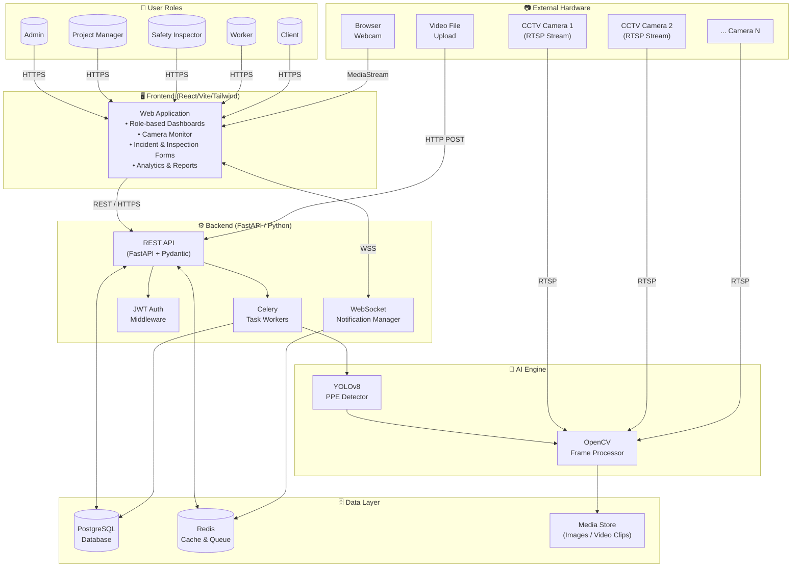
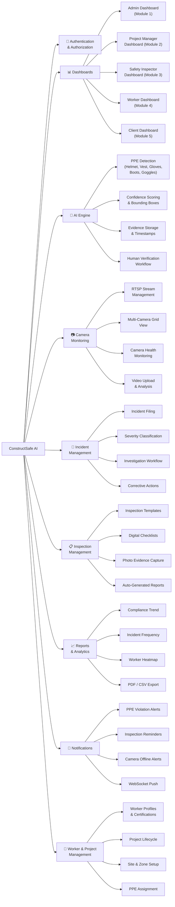

# ConstructSafe AI — Project Overview

> **Document Type:** Project Overview & Vision  
> **Version:** 1.0.0  
> **Status:** Approved for Development  
> **Last Updated:** 2026-11-17

---

## Table of Contents

1. [Executive Summary](#1-executive-summary)
2. [Product Vision & Goals](#2-product-vision--goals)
3. [Target Users](#3-target-users)
4. [Core Feature Modules](#4-core-feature-modules)
5. [Technology Stack](#5-technology-stack)
6. [System Capabilities Overview](#6-system-capabilities-overview)
7. [System Context Diagram](#7-system-context-diagram)
8. [Feature Module Map](#8-feature-module-map)
9. [Key Constraints & Assumptions](#9-key-constraints--assumptions)
10. [Project Milestones](#10-project-milestones)

---

## 1. Executive Summary

**ConstructSafe AI** is a comprehensive, AI-powered Construction Safety Management platform designed to reduce workplace injuries, enforce regulatory compliance, and streamline safety operations across active construction sites. The platform combines real-time computer vision—powered by YOLO-based PPE (Personal Protective Equipment) detection—with a full-featured web application that serves five distinct user roles: Administrators, Project Managers, Safety Inspectors, Workers, and Clients.

The system ingests live video feeds from CCTV cameras and uploaded footage, automatically detecting whether workers are wearing mandatory safety equipment (helmets, high-visibility vests, gloves, safety boots, and goggles). Violations are flagged instantly, evidence is stored with timestamps and bounding-box annotations, and responsible personnel are alerted in real time via WebSocket-driven notifications. Beyond AI detection, the platform provides structured workflows for recording and resolving safety incidents, scheduling and tracking safety inspections, managing worker certifications, and generating rich analytics reports for stakeholders.

ConstructSafe AI is built entirely on free, open-source, locally deployable software and requires no paid external API services, making it economically accessible for small-to-mid-size construction firms while remaining scalable for enterprise deployments via Docker Compose.

---

## 2. Product Vision & Goals

### Vision Statement

> *To be the most practical and affordable AI-driven safety management platform for the construction industry, turning passive CCTV infrastructure into an active safety enforcement tool that saves lives.*

### Strategic Goals

| # | Goal | Success Metric |
|---|------|---------------|
| G-01 | **Reduce PPE non-compliance incidents** | ≥ 80% reduction in undetected violations within 3 months of deployment |
| G-02 | **Accelerate incident response** | Average time-to-notification < 30 seconds from detection |
| G-03 | **Improve inspection coverage** | 100% of scheduled inspections digitally tracked and auditable |
| G-04 | **Empower data-driven safety decisions** | Managers can generate compliance reports in < 2 minutes |
| G-05 | **Lower total cost of safety management** | Zero dependency on paid SaaS APIs; runs on-premise or local server |
| G-06 | **Ensure regulatory readiness** | All incidents, inspections, and evidence archived for ≥ 5 years |

### Design Principles

- **Safety-First UX:** Critical alerts and violation indicators are always prominent; the interface is designed for high-stress environments where information must be absorbed quickly.
- **Role-Appropriate Simplicity:** Each user role sees only what they need; complexity is hidden behind appropriate permission layers.
- **Evidence-Based Accountability:** Every AI detection, incident report, and inspection generates timestamped, immutable records with supporting media.
- **Offline-Capable Core:** Core data entry functions remain available during network disruptions; sync occurs on reconnect.
- **Open Stack:** No vendor lock-in; all components are open-source and self-hostable.

---

## 3. Target Users

### 3.1 Administrator

**Primary Role:** System-wide configuration, user management, and audit oversight.

The Administrator has unrestricted access to all modules and data across all projects. This role is typically held by the IT or operations lead within the construction firm.

**Key Responsibilities:**
- Create, edit, deactivate, and assign roles to user accounts
- Configure system-wide settings (camera feeds, notification rules, PPE thresholds)
- Review audit logs and system health metrics
- Manage organizational structure (projects, sites, departments)
- Access and export all analytics and compliance reports across projects
- Oversee data retention and backup schedules

**Pain Points Solved:** Eliminates manual user provisioning spreadsheets; provides one authoritative view of compliance status across all active projects.

---

### 3.2 Project Manager

**Primary Role:** End-to-end safety governance for one or more assigned construction projects.

Project Managers are responsible for ensuring their projects meet safety targets, deadlines, and budgets. They coordinate Safety Inspectors and have visibility into all site activity.

**Key Responsibilities:**
- Monitor real-time dashboards for active project sites
- Review and approve/reject incident reports submitted by Safety Inspectors
- Schedule and track safety inspections
- Assign tasks and workers to projects
- Review PPE compliance trends and generate project-specific reports
- Communicate safety requirements to clients

**Pain Points Solved:** Replaces fragmented WhatsApp/email coordination with a structured, role-based workflow; gives real-time visibility without requiring physical presence on-site.

---

### 3.3 Safety Inspector

**Primary Role:** On-site safety enforcement, inspection execution, and incident documentation.

Safety Inspectors are the frontline users of the system. They work on-site with mobile or desktop access, logging violations, performing walkthroughs, and verifying AI-flagged detections.

**Key Responsibilities:**
- Receive and acknowledge real-time PPE violation alerts
- Confirm or dismiss AI-detected violations (human-in-the-loop verification)
- File detailed safety incident reports with photos and descriptions
- Conduct scheduled inspections and complete digital checklists
- Issue corrective actions and track resolution
- Monitor assigned camera feeds directly from the dashboard

**Pain Points Solved:** Eliminates paper-based incident forms; reduces missed violations through AI pre-screening; enables remote verification when inspectors cannot be everywhere simultaneously.

---

### 3.4 Worker

**Primary Role:** Personal safety compliance awareness and incident self-reporting.

Workers have the most limited access — a personal dashboard showing their own compliance record, assigned PPE requirements, and safety alerts relevant to their zone/project.

**Key Responsibilities:**
- View personal PPE compliance history and recent violations
- Acknowledge safety alerts and notifications
- Self-report near-miss incidents
- View upcoming safety training requirements and certifications
- Read safety bulletins and site-specific rules

**Pain Points Solved:** Gives workers ownership of their safety record; transparent feedback loop encourages voluntary compliance; provides a channel for near-miss reporting without fear of immediate reprisal.

---

### 3.5 Client

**Primary Role:** Read-only project safety oversight for project owners and stakeholders.

Clients are construction project owners or external stakeholders who have contracted the construction firm and require visibility into safety performance.

**Key Responsibilities:**
- View high-level safety performance dashboards for their projects
- Access summary compliance and incident reports
- Review inspection completion rates
- Download regulatory-ready safety reports

**Pain Points Solved:** Provides professional, branded safety reporting without manual report preparation by the PM; builds trust through transparency.

---

## 4. Core Feature Modules

The platform is organized into **12 core modules**, each addressing a distinct domain of construction safety management.

### Module 1 — Admin Dashboard
Central command center for system administrators. Displays system health (server status, camera feed status, AI engine uptime), user activity metrics, organization-wide compliance KPIs, recent audit log entries, and quick-access controls for user and project management.

### Module 2 — Project Manager Dashboard
Project-centric overview dashboard displaying active projects, real-time PPE compliance rates per site, open incident counts, upcoming inspection schedule, and notification feed. Includes drill-down navigation to individual project details.

### Module 3 — Safety Inspector Dashboard
Field-optimized dashboard surfacing active alerts requiring human verification, today's inspection schedule, recent detections with annotated thumbnails, and a live camera feed selector. Prioritizes actionable items in a task-list format.

### Module 4 — Worker Dashboard
Personal safety profile showing compliance score, PPE badge status, recent violation notices, upcoming training dates, and site-specific safety bulletins. Designed for minimal friction on shared worksite tablets.

### Module 5 — Client Dashboard
Read-only executive dashboard showing project safety KPIs, monthly compliance trend charts, incident summary, inspection completion rates, and downloadable reports. Branding reflects the construction firm's identity.

### Module 6 — AI PPE Detection Engine
The technical core of the platform. Uses a fine-tuned YOLOv8 model to detect the presence/absence of safety helmets, high-visibility vests, safety gloves, steel-toed boots, and safety goggles in video frames. Processes live RTSP streams, uploaded video files, and webcam feeds. Outputs per-frame bounding boxes, class labels, confidence scores, and violation flags. All detections are stored with source frame snapshots and metadata.

### Module 7 — CCTV & Camera Monitoring
Live camera feed management interface. Administrators add RTSP-enabled cameras by IP/URL. The monitoring view displays a configurable multi-camera grid (1×1, 2×2, 3×3 layouts) with real-time overlaid detection bounding boxes. Per-camera status indicators (online/offline/warning) and stream health metrics are displayed. Supports video upload for retrospective analysis.

### Module 8 — Safety Incident Management
Structured workflow for creating, assigning, escalating, and closing safety incidents. Each incident record captures type, severity, affected workers, location, description, photographs, and status history. Incidents flow through states: Open → Under Investigation → Corrective Action → Closed. Supports AI-originated incidents (auto-created from PPE violations above threshold) and manual incident filing.

### Module 9 — Safety Inspection Management
Digital checklist-based inspection system. Administrators and Project Managers create inspection templates for different inspection types (daily site walk, equipment check, fire safety, scaffold inspection, etc.). Inspectors execute assigned inspections on mobile-friendly forms, capturing pass/fail items with optional photo evidence. Inspection reports are auto-generated on submission.

### Module 10 — Reports & Analytics
Data visualization and export module powered by Recharts. Provides pre-built report types: PPE Compliance Trend, Incident Frequency by Type, Inspection Completion Rate, Worker Violation Heatmap, and Camera Coverage Analysis. All reports are filterable by project, date range, and site. Supports PDF and CSV export.

### Module 11 — Real-time Safety Notifications
WebSocket-driven push notification system delivering instant alerts to relevant user roles. Notification types include: PPE Violation Detected, Incident Reported, Inspection Due, Inspection Overdue, Camera Offline, and System Alert. Users configure notification preferences (in-app, desktop push). Notification history is stored and searchable.

### Module 12 — Worker & Project Management
Administrative module for managing the organizational hierarchy: Companies → Projects → Sites → Zones → Workers. Covers worker profiles (personal info, certifications, PPE assignments, project assignments), project lifecycle management (creation, status, timeline), and certification expiry tracking with automated renewal alerts.

---

## 5. Technology Stack

### Full Stack Summary

| Layer | Technology | Version | Purpose |
|-------|-----------|---------|---------|
| **Frontend Framework** | React | 18.x | Component-based SPA |
| **Build Tool** | Vite | 5.x | Fast HMR dev server & bundler |
| **CSS Framework** | Tailwind CSS | 3.x | Utility-first responsive styling |
| **Icon Library** | Lucide React | Latest | Consistent, accessible icon set |
| **Chart Library** | Recharts | 2.x | Composable data visualization |
| **State Management** | Zustand | 4.x | Lightweight global state |
| **HTTP Client** | Axios | 1.x | REST API calls with interceptors |
| **WebSocket Client** | Native WS / socket.io-client | — | Real-time notifications |
| **Backend Framework** | Python / FastAPI | 0.111+ | Async REST API server |
| **ORM** | SQLAlchemy | 2.x | Database abstraction |
| **Data Validation** | Pydantic | 2.x | Schema validation & serialization |
| **Task Queue** | Celery + Redis | — | Background AI job processing |
| **AI Detection** | YOLOv8 (Ultralytics) | 8.x | PPE object detection model |
| **Computer Vision** | OpenCV | 4.x | Frame capture, preprocessing |
| **Database** | PostgreSQL | 15.x | Primary relational datastore |
| **Cache / Broker** | Redis | 7.x | Session cache, task queue broker |
| **Authentication** | JWT (python-jose) | — | Stateless token auth |
| **Real-time** | WebSockets (FastAPI WS) | — | Push notification channels |
| **Containerization** | Docker + Docker Compose | — | Service orchestration |
| **Media Storage** | Local filesystem / MinIO | — | Evidence images & video clips |
| **API Docs** | FastAPI / OpenAPI (Swagger) | — | Auto-generated API documentation |

### Architecture Layers

```
┌─────────────────────────────────────────────────────┐
│                   Browser / Client                  │
│          React 18 + Vite + Tailwind CSS             │
│          Recharts · Lucide · Zustand · Axios        │
└──────────────────────┬──────────────────────────────┘
                       │ HTTPS / WSS
┌──────────────────────▼──────────────────────────────┐
│               FastAPI Backend (Python)               │
│         SQLAlchemy · Pydantic · JWT Auth            │
│         Celery Workers · WebSocket Manager          │
└────────┬─────────────┬──────────────┬───────────────┘
         │             │              │
    ┌────▼────┐  ┌──────▼──────┐ ┌───▼────────────┐
    │PostgreSQL│  │    Redis    │ │  AI Engine     │
    │  (data) │  │(cache/queue)│ │ YOLOv8+OpenCV  │
    └─────────┘  └─────────────┘ └────────────────┘
```

---

## 6. System Capabilities Overview

### 6.1 AI-Powered Detection Capabilities

| Capability | Detail |
|-----------|--------|
| PPE Classes Detected | Helmet, High-Vis Vest, Gloves, Safety Boots, Goggles |
| Input Sources | RTSP live stream, MP4/AVI upload, webcam (browser) |
| Detection Output | Bounding boxes, class labels, confidence score (0.0–1.0) |
| Processing Mode | Async (Celery job) for uploads; near-real-time for RTSP streams |
| Evidence Storage | JPEG frame snapshots with detection metadata (JSON) |
| Human Verification | Inspector confirm/dismiss workflow on each flagged frame |
| Model | YOLOv8n/s fine-tuned on construction PPE dataset |
| Minimum Confidence | Configurable per class (default 0.65) |

### 6.2 Real-Time Capabilities

- WebSocket channels per user role for targeted notification delivery
- Camera feed health polling every 30 seconds
- Violation alerts delivered within 10 seconds of frame processing
- Live detection overlay on camera monitoring grid

### 6.3 Reporting Capabilities

- 5 pre-built report templates (compliance, incidents, inspections, heatmap, coverage)
- Custom date range and project filters
- Recharts-rendered interactive charts (bar, line, pie, area)
- PDF export via browser print / server-side PDF generation
- CSV data export for all tabular data

### 6.4 Compliance & Audit

- Immutable incident and detection records (soft-delete only)
- Timestamped action log for every state change
- Role-based audit trail: who created, modified, or resolved each record
- 5-year data retention by default (configurable)

---

## 7. System Context Diagram



---

## 8. Feature Module Map



---

## 9. Key Constraints & Assumptions

### Technical Constraints

| Constraint | Detail |
|-----------|--------|
| **No paid APIs** | All AI models, services, and infrastructure must be free/open-source |
| **Local deployment** | System must run fully on-premise via Docker Compose with no cloud dependency |
| **Browser-only frontend** | No mobile native app; responsive web UI covers mobile use cases |
| **RTSP camera support** | Cameras must support RTSP; proprietary protocols are out of scope |
| **GPU optional** | AI detection must function on CPU; GPU accelerates but is not required |
| **Storage** | Evidence images stored locally (or MinIO); no external object storage required |

### Business Assumptions

| Assumption | Detail |
|-----------|--------|
| Single organization | The system serves one construction firm; multi-tenant is out of scope for v1.0 |
| English-only UI | v1.0 targets English-speaking markets; i18n scaffolding may be added in v2.0 |
| Helmet as mandatory baseline | All 5 PPE types are tracked, but helmet is the minimum enforced item |
| Inspector reviews within 1 hour | SLA for human verification of AI-flagged violations is defined as 60 minutes |
| Internet optional | Core functionality does not require internet; external email alerts are optional |
| PostgreSQL on same host | For v1.0, DB and backend run on the same Docker network |
| Pre-trained base model | YOLOv8 base weights are downloaded once during setup; fine-tuning is optional |

### Regulatory Assumptions

- Compliance with OSHA 29 CFR 1926 (US construction safety) is a design reference
- System serves as an audit aid; legal compliance determination remains with the firm's safety officers
- Worker PPE violation records may be subject to local labor law; administrators must configure data retention accordingly

---

## 10. Project Milestones

| Phase | Milestone | Key Deliverables |
|-------|-----------|-----------------|
| **Phase 0** | Foundation | Docs, DB schema, Docker Compose, Auth scaffold |
| **Phase 1** | Core Backend | FastAPI CRUD for all entities, JWT auth, WebSocket server |
| **Phase 2** | AI Integration | YOLOv8 integration, Celery workers, evidence storage pipeline |
| **Phase 3** | Frontend — Dashboards | All 5 role dashboards, navigation, responsive layout |
| **Phase 4** | Frontend — Modules | Incident, Inspection, Camera monitor, Notifications UI |
| **Phase 5** | Analytics & Reports | Recharts dashboards, PDF/CSV export |
| **Phase 6** | QA & Hardening | End-to-end testing, security audit, performance tuning |
| **Phase 7** | Deployment | Docker Compose production config, documentation, demo dataset |

---

*Document maintained by the ConstructSafe AI Architecture Team. For questions, contact the lead architect.*
