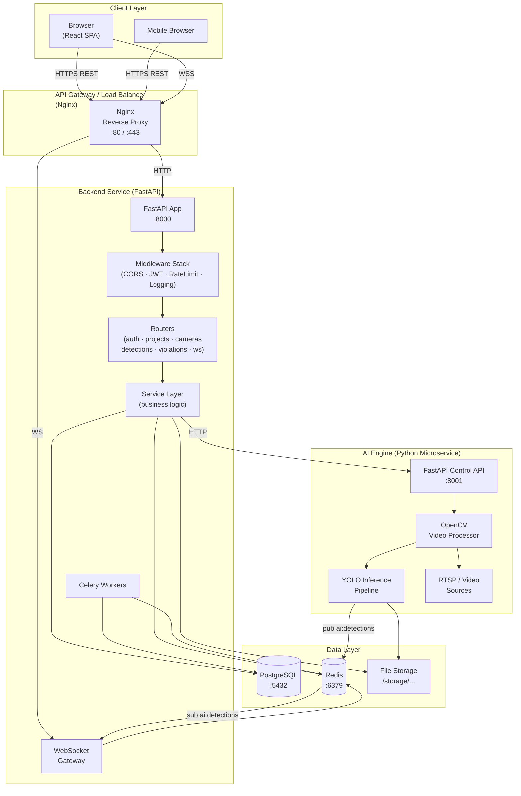
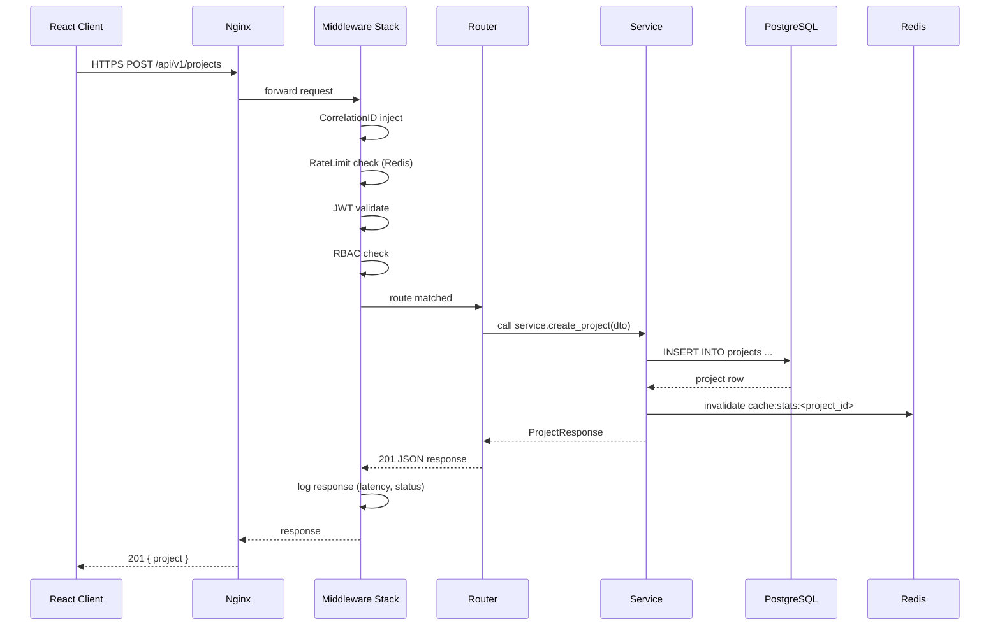
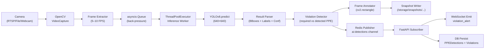
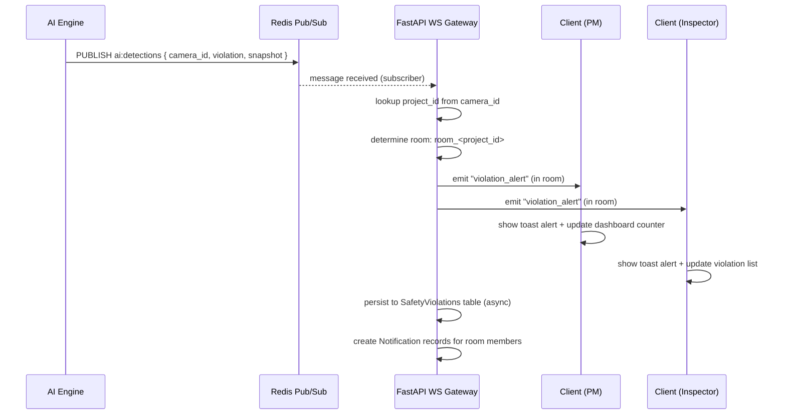

# ConstructSafe AI — System Architecture

> **Document Version:** 1.0  
> **Status:** Planning / Greenfield  
> **Audience:** Engineering team, DevOps, Technical leads

---

## Table of Contents

1. [Architecture Overview & Principles](#1-architecture-overview--principles)
2. [Frontend Architecture](#2-frontend-architecture)
3. [Backend Architecture](#3-backend-architecture)
4. [AI Engine Architecture](#4-ai-engine-architecture)
5. [Database Layer](#5-database-layer)
6. [Caching Layer](#6-caching-layer)
7. [File Storage](#7-file-storage)
8. [Authentication Flow](#8-authentication-flow)
9. [WebSocket Architecture](#9-websocket-architecture)
10. [System Diagrams](#10-system-diagrams)
11. [Project Folder Structure](#11-project-folder-structure)
12. [API Versioning Strategy](#12-api-versioning-strategy)
13. [Error Handling Strategy](#13-error-handling-strategy)
14. [Logging & Monitoring](#14-logging--monitoring)

---

## 1. Architecture Overview & Principles

### 1.1 Architectural Style

ConstructSafe AI follows a **layered microservices-lite** architecture. The system is composed of three independently deployable services — a React frontend SPA, a FastAPI backend monolith (modular), and a Python AI microservice — connected through REST APIs, WebSockets, and a Redis pub/sub bus. All services run inside Docker containers orchestrated via Docker Compose for local/on-premise deployment.

### 1.2 Core Design Principles

| Principle | Application in ConstructSafe AI |
|---|---|
| **Separation of Concerns** | Frontend, API, AI, and DB layers have clear boundaries and independent deployability |
| **Single Responsibility** | Each FastAPI router owns exactly one domain (projects, cameras, detections, etc.) |
| **Domain-Driven Design (lite)** | Models, schemas, services, and routers are co-located by domain within the backend |
| **Fail-Safe Defaults** | Unauthenticated requests are rejected at middleware before reaching business logic |
| **Defense in Depth** | JWT validation + role-based checks + row-level ownership checks |
| **Offline-First Storage** | All video evidence and snapshots stored on local filesystem; no paid cloud dependency |
| **Observability** | Structured JSON logs at every service boundary; correlation IDs on every request |
| **Idempotency** | Background task retries are safe; detection results keyed by frame hash |

### 1.3 High-Level Service Map (Photo Hazard Analysis Workflow)

```
Browser (React SPA - Tailwind CSS + Lucide)
    │  REST (JSON/HTTPS) + Multipart Image Uploads
    ▼
FastAPI Backend (v1 API)
    │
    ├── MongoDB Community Edition (PyMongo AsyncMongoClient)
    ├── Local Evidence Storage (storage/evidence/)
    └── AI Inference Service (FastAPI / PyTorch YOLOv8)
            │
        Static Construction Hazard & PPE Image Inference
        (Bounding Boxes, Categories, Confidence Scores)
```

---

## 2. Frontend Architecture

### 2.1 Technology Stack

| Concern | Library / Tool | Version |
|---|---|---|
| Framework | React | 18.x |
| Build tool | Vite | 5.x |
| Styling | Tailwind CSS | 3.x |
| Icons | Lucide React | latest |
| Charts | Recharts | 2.x |
| Routing | React Router | v6 |
| State management | Zustand | 4.x |
| Server state | TanStack React Query | v5 |
| HTTP client | Axios | 1.x |
| Real-time | Socket.IO client | 4.x |
| Form handling | React Hook Form + Zod | latest |
| Date utilities | date-fns | 3.x |

### 2.2 React Component Hierarchy

```
App
├── AuthProvider (Zustand auth store + route guard)
├── SocketProvider (Socket.IO connection lifecycle)
├── QueryClientProvider (React Query global client)
│
├── layouts/
│   ├── AuthLayout          ← Login / Register pages
│   └── AppLayout           ← Authenticated shell
│       ├── Sidebar          ← Role-aware navigation
│       ├── TopBar           ← Notifications bell, user menu
│       └── <Outlet />       ← Page content
│
├── pages/
│   ├── Dashboard/           ← Role-specific dashboard (Admin, PM, Inspector, Worker, Client)
│   ├── Projects/            ← Project list, detail, create/edit
│   ├── Workers/             ← Worker list, profile, training
│   ├── Hazards/             ← Photo upload, AI suggestions, inspector confirmation
│   ├── HazardReview/        ← Admin review, approval & CAPA dispatch
│   ├── Detections/          ← PPE detection log, frame viewer
│   ├── Violations/          ← Safety violation list + detail
│   ├── Incidents/           ← Incident management
│   ├── Inspections/         ← Inspection list, checklist runner
│   ├── Reports/             ← Analytics, downloadable reports
│   ├── Notifications/       ← Notification center
│   ├── Training/            ← Training modules + records
│   └── Settings/            ← User profile, system settings
│
├── components/
│   ├── ui/                  ← Buttons, Inputs, Badges, Cards, Modals, Tables (atomic)
│   ├── charts/              ← Recharts wrappers (BarChart, LineChart, PieChart, AreaChart)
│   ├── hazards/             ← HazardPhotoUploader, BoundingBoxCanvas, AISuggestionPills
│   ├── detection/           ← DetectionCard, BoundingBoxOverlay, ConfidenceBar
│   ├── forms/               ← Reusable form composites (ProjectForm, WorkerForm, etc.)
│   └── shared/              ← DataTable, Pagination, SearchBar, FilterPanel, StatusBadge
│
└── hooks/                   ← useAuth, useSocket, useDetections, useNotifications, etc.
```

### 2.3 Routing Strategy (React Router v6)

All routes use `createBrowserRouter` with loader-based data fetching patterns. Protected routes use a `<ProtectedRoute>` wrapper that reads Zustand auth state.

```
/                           → redirect to /dashboard
/login                      → AuthLayout > LoginPage
/register                   → AuthLayout > RegisterPage
/dashboard                  → AppLayout > Dashboard (role-aware)
/projects                   → ProjectListPage
/projects/:id               → ProjectDetailPage
/projects/:id/cameras       → ProjectCamerasPage
/workers                    → WorkerListPage
/workers/:id                → WorkerProfilePage
/hazards                   → HazardReportPage (Inspector)
/hazards/:id               → HazardDetailPage
/hazards/review             → AdminHazardReviewPage
/detections                 → DetectionLogPage
/detections/:id             → DetectionDetailPage
/violations                 → ViolationListPage
/incidents                  → IncidentListPage
/incidents/:id              → IncidentDetailPage
/inspections                → InspectionListPage
/inspections/:id/run        → InspectionRunnerPage
/reports                    → ReportsPage
/training                   → TrainingModulesPage
/notifications              → NotificationCenterPage
/settings                   → SettingsPage
/admin/*                    → Admin sub-routes (users, roles, audit)
```

### 2.4 State Management (Zustand)

Three top-level stores:

| Store | Responsibility |
|---|---|
| `authStore` | JWT tokens, current user, role, login/logout actions |
| `notificationStore` | Unread count, notification list, real-time push from socket |
| `alertStore` | Active safety alerts (live violation events from WebSocket) |

React Query handles all server state (projects, workers, detections, etc.) with automatic caching, stale-while-revalidate, and optimistic updates.

### 2.5 API Layer (Axios + React Query)

A central `apiClient` Axios instance is configured with:
- `baseURL`: `/api/v1`
- Request interceptor: attaches `Authorization: Bearer <access_token>` header
- Response interceptor: on 401, attempts silent refresh via `/auth/refresh`; on second failure, dispatches logout
- Global error normalisation to a standard `ApiError` shape

React Query hooks live in `src/api/hooks/` grouped by domain (`useProjects`, `useCameras`, `useDetections`, etc.).

### 2.6 WebSocket Client (Socket.IO)

The `SocketProvider` connects to the FastAPI WebSocket gateway on mount (after authentication) and manages:
- Event subscription: `violation_alert`, `detection_result`, `camera_status`, `notification`
- Reconnect with exponential backoff
- Room joining: users join their project rooms for scoped alerts

---

## 3. Backend Architecture

### 3.1 Technology Stack

| Concern | Library / Tool |
|---|---|
| Framework | FastAPI 0.111+ |
| ASGI server | Uvicorn |
| ORM | SQLAlchemy 2.x (async) |
| Migrations | Alembic |
| Validation | Pydantic v2 |
| Auth | python-jose (JWT) + passlib (bcrypt) |
| Caching | Redis (aioredis) |
| Background tasks | Celery 5.x + Redis broker |
| WebSocket | FastAPI native WebSocket + python-socketio |
| HTTP client | httpx (async) |
| Task queue | Celery Beat for periodic reports |

### 3.2 FastAPI Application Structure

```
backend/
├── app/
│   ├── main.py              ← FastAPI app factory, lifespan events, router registration
│   ├── config.py            ← Settings (pydantic-settings, .env driven)
│   ├── database.py          ← Async SQLAlchemy engine + session factory
│   ├── dependencies.py      ← Shared DI: get_db, get_current_user, get_redis
│   │
│   ├── middleware/
│   │   ├── cors.py          ← CORSMiddleware config
│   │   ├── auth.py          ← JWT token extraction + user injection
│   │   ├── logging.py       ← Request/response structured log + correlation ID
│   │   └── rate_limit.py    ← Redis-backed sliding-window rate limiter
│   │
│   ├── routers/
│   │   ├── auth.py          ← /auth/login, /auth/refresh, /auth/logout
│   │   ├── users.py         ← /users CRUD + role assignment
│   │   ├── projects.py      ← /projects CRUD + assignments
│   │   ├── workers.py       ← /workers CRUD + project links
│   │   ├── cameras.py       ← /cameras CRUD + zone config
│   │   ├── detections.py    ← /detections log + frames
│   │   ├── violations.py    ← /violations CRUD + status
│   │   ├── incidents.py     ← /incidents CRUD + investigations
│   │   ├── inspections.py   ← /inspections CRUD + items + corrective actions
│   │   ├── training.py      ← /training modules + records
│   │   ├── notifications.py ← /notifications list + mark-read
│   │   ├── reports.py       ← /reports generate + download
│   │   ├── alerts.py        ← /alerts active + ack
│   │   ├── audit.py         ← /audit-logs (admin only)
│   │   └── ws.py            ← WebSocket endpoint gateway
│   │
│   ├── models/              ← SQLAlchemy ORM models (one file per domain)
│   ├── schemas/             ← Pydantic request/response schemas (one file per domain)
│   ├── services/            ← Business logic layer (one file per domain)
│   ├── tasks/               ← Celery task definitions
│   └── utils/               ← JWT helpers, file storage, pagination, validators
```

### 3.3 Middleware Stack (Execution Order)

Middleware executes in registration order (last-in, first-executed for ASGI):

```
Request →
  [1] TrustedHostMiddleware       ← Host header validation
  [2] CorrelationIDMiddleware     ← Injects X-Correlation-ID header
  [3] RequestLoggingMiddleware    ← Structured log on request start
  [4] RateLimitMiddleware         ← Redis sliding window; 429 on breach
  [5] CORSMiddleware              ← Preflight + CORS headers
  [6] Route Matching (FastAPI)
  [7] JWTAuthDependency           ← Per-route DI; extracts + validates JWT
  [8] RBACDependency              ← Per-route DI; role/permission check
  [9] Business Logic (service)
  [10] ResponseLoggingMiddleware  ← Log response status + latency
← Response
```

### 3.4 Dependency Injection Pattern

```python
# dependencies.py
async def get_db() -> AsyncGenerator[AsyncSession, None]:
    async with AsyncSessionLocal() as session:
        yield session

async def get_current_user(
    token: str = Depends(oauth2_scheme),
    db: AsyncSession = Depends(get_db),
) -> User:
    ...  # decode JWT, load user from DB

def require_role(*roles: str):
    def checker(user: User = Depends(get_current_user)):
        if user.role.name not in roles:
            raise HTTPException(403, "Insufficient permissions")
        return user
    return checker
```

### 3.5 Background Tasks

| Task | Mechanism | Schedule |
|---|---|---|
| Generate daily safety report PDF | Celery Beat | Daily 06:00 |
| Send overdue corrective action reminders | Celery Beat | Every 4 hours |
| Clean up old temp video chunks | Celery Beat | Weekly |
| Publish AI detection results to WebSocket | Celery worker (triggered by AI service) | On-demand |
| Send email/SMS notification on critical alert | Celery worker | On-demand |

---

## 4. AI Engine Architecture

### 4.1 Overview

The AI Engine is a **standalone Python microservice** that runs independently from the FastAPI backend. It communicates via:
- **Inbound:** REST API calls from FastAPI (start/stop stream, submit video file)
- **Outbound:** Publishes detection results to Redis pub/sub channel `ai:detections`
- **FastAPI backend** subscribes to the Redis channel and pushes results to WebSocket clients and persists to DB

### 4.2 Technology Stack

| Concern | Library |
|---|---|
| Framework | FastAPI (lightweight control API) |
| Object detection | Ultralytics YOLOv8 |
| Video processing | OpenCV (`cv2`) |
| Numerical | NumPy |
| Redis client | redis-py |
| RTSP streaming | OpenCV `VideoCapture` with RTSP URI |
| Async I/O | asyncio + concurrent.futures (CPU-bound inference in thread pool) |

### 4.3 Static Photo Hazard Analysis Pipeline

```
Safety Inspector Photo Upload (JPG / PNG / WEBP)
    │
    ▼
FastAPI Backend (/api/v1/ai/analyze-hazard-photo)
    │  validate file format, size (max 10MB), store in storage/evidence/
    ▼
AI Inference Service (POST http://ai_engine:8001/analyze/image)
    │  YOLOv8 image inference on static construction hazard photo
    ▼
Result Parser & Hazard Classifier
    │  extract bounding boxes, class labels, confidence scores
    │  identify missing PPE, fall risks, tripping hazards, electrical exposures
    ▼
AI Suggestions Payload Returned to Inspector
    │  { photo_url, detections: [...], suggested_hazards: [...], confidence: 0.88 }
    ▼
Inspector Human-in-the-Loop Review
    │  Inspector reviews AI suggestions, accepts/modifies/rejects findings
    ▼
Submission to Admin for Approval & Corrective Action
    └─→ MongoDB: hazard_reports (status: pending_admin_review) + Admin In-App Notification
```

### 4.4 Supported Detection Classes

| Class ID | PPE Item | Detection Colour |
|---|---|---|
| 0 | Hard Hat / Helmet | Green (present) / Red (absent) |
| 1 | Safety Vest | Green / Red |
| 2 | Safety Gloves | Green / Red |
| 3 | Safety Boots | Green / Red |
| 4 | Safety Goggles | Green / Red |

### 4.5 AI Engine Endpoints

| Method | Path | Description |
|---|---|---|
| `POST` | `/analyze/image` | Submit an uploaded hazard photograph for AI inference |
| `POST` | `/analyze/batch` | Batch process multiple inspection photos |
| `GET` | `/health` | AI Engine health check and model status |
| `GET` | `/models/info` | List loaded YOLOv8 weights and hazard class mappings |

---

## 5. Database Layer

### 5.1 Technology Stack

| Component | Choice |
|---|---|
| RDBMS | PostgreSQL 16 |
| ORM | SQLAlchemy 2.x (async, `asyncpg` driver) |
| Migrations | Alembic |
| Connection pooling | SQLAlchemy built-in async pool (pool_size=10, max_overflow=20) |

### 5.2 SQLAlchemy Async Setup

```python
# database.py
from sqlalchemy.ext.asyncio import AsyncSession, create_async_engine, async_sessionmaker

engine = create_async_engine(
    settings.DATABASE_URL,          # postgresql+asyncpg://...
    pool_size=10,
    max_overflow=20,
    pool_pre_ping=True,             # validate connections before use
    echo=settings.DB_ECHO,
)

AsyncSessionLocal = async_sessionmaker(
    engine, class_=AsyncSession, expire_on_commit=False
)
```

### 5.3 Base Model Pattern

```python
class TimestampMixin:
    created_at: Mapped[datetime] = mapped_column(default=func.now())
    updated_at: Mapped[datetime] = mapped_column(default=func.now(), onupdate=func.now())
    deleted_at: Mapped[Optional[datetime]] = mapped_column(nullable=True)  # soft delete
```

### 5.4 Alembic Migration Workflow

```bash
alembic revision --autogenerate -m "add_camera_zones"
alembic upgrade head
alembic downgrade -1
alembic history
```

---

## 6. Caching Layer

### 6.1 Redis Use Cases

| Use Case | Redis Data Structure | Key Pattern | TTL |
|---|---|---|---|
| JWT refresh token storage | String | `auth:refresh:<user_id>` | 7 days |
| Rate limit counters | Sorted Set (sliding window) | `ratelimit:<ip>:<endpoint>` | 1 minute |
| Active user sessions | Hash | `session:<session_id>` | 24 hours |
| AI detection pub/sub | Pub/Sub channel | `ai:detections` | — |
| WebSocket room membership | Set | `ws:room:<room_id>` | — |
| Dashboard stats cache | String (JSON) | `cache:stats:<project_id>` | 5 minutes |
| Camera snapshot URL cache | String | `cache:snapshot:<camera_id>` | 30 seconds |

### 6.2 Rate Limiting Algorithm

Sliding window counter using Redis Sorted Sets:
1. Add current timestamp as member with score = timestamp
2. Remove members older than window (e.g., 60 seconds)
3. Count remaining members
4. If count ≥ limit → 429; else proceed and increment

---

## 7. File Storage

### 7.1 Storage Root

```
/storage/                              ← Mounted volume (Docker bind mount)
├── videos/
│   ├── uploads/                       ← Raw uploaded video files
│   │   └── <project_id>/<uuid>.mp4
│   └── processed/                     ← AI-processed output videos
│       └── <project_id>/<uuid>_analyzed.mp4
├── snapshots/                         ← YOLO annotated frame snapshots
│   └── <YYYY-MM-DD>/<camera_id>/<frame_uuid>.jpg
├── reports/                           ← Generated PDF/Excel reports
│   └── <project_id>/<report_uuid>.pdf
└── avatars/                           ← User / worker profile photos
    └── <user_id>.jpg
```

### 7.2 File Naming & Access

- All filenames use UUIDs to prevent enumeration
- File paths stored in DB (relative to storage root)
- FastAPI serves files via `/files/<path>` endpoint with JWT auth check
- Snapshots are referenced in `DetectionFrames.snapshot_path`

---

## 8. Authentication Flow

### 8.1 JWT Token Strategy

| Token | Lifetime | Storage (client) | Purpose |
|---|---|---|---|
| Access Token | 15 minutes | Memory (Zustand store) | API authentication |
| Refresh Token | 7 days | HttpOnly Cookie | Silent token refresh |

### 8.2 Login Flow

```
1. POST /api/v1/auth/login { email, password }
2. Backend: bcrypt.verify(password, user.password_hash)
3. Backend: generate access_token (15 min) + refresh_token (7 days)
4. Backend: store refresh_token hash in Redis (auth:refresh:<user_id>)
5. Response: { access_token } in body + refresh_token in HttpOnly Cookie
6. Frontend: store access_token in Zustand authStore
7. All subsequent requests: Authorization: Bearer <access_token>
```

### 8.3 Token Refresh Flow

```
1. Axios interceptor catches 401 on any request
2. POST /api/v1/auth/refresh (browser sends HttpOnly cookie automatically)
3. Backend: validate refresh token from cookie vs Redis
4. Backend: issue new access_token (rotation)
5. Frontend: update Zustand store with new access_token
6. Retry original request with new token
7. If refresh also fails → dispatch logout, redirect to /login
```

### 8.4 Role-Based Access Control (RBAC)

```
Roles: super_admin > admin > project_manager > safety_inspector > worker > client

Permission check flow:
  User → has Role → Role has Permissions (many-to-many)
  Route dependency: require_role("admin", "project_manager")
  Fine-grained: require_permission("incidents:write")
```

---

## 9. WebSocket Architecture

### 9.1 Connection Lifecycle

```
1. Client connects: ws://host/ws?token=<access_token>
2. Server: validate JWT token; reject if invalid
3. Server: determine user's project rooms from DB
4. Server: add socket to rooms: room_<project_id> for each project
5. Client connected; server emits "connected" event
6. AI Engine publishes to Redis ai:detections channel
7. Backend subscriber receives message, determines affected camera/project
8. Backend emits to room_<project_id>: "violation_alert" | "detection_result"
9. All clients in that room receive the event
10. On disconnect: remove from all rooms, cleanup
```

### 9.2 WebSocket Event Types

| Event | Direction | Payload |
|---|---|---|
| `violation_alert` | Server → Client | `{ camera_id, worker_id, missing_ppe, snapshot_url, severity, timestamp }` |
| `detection_result` | Server → Client | `{ camera_id, frame_id, detections: [...], timestamp }` |
| `camera_status` | Server → Client | `{ camera_id, status: "online"\|"offline"\|"error" }` |
| `notification` | Server → Client | `{ id, type, title, message, timestamp }` |
| `incident_created` | Server → Client | `{ incident_id, project_id, severity, timestamp }` |
| `join_room` | Client → Server | `{ room: "project_<id>" }` |
| `leave_room` | Client → Server | `{ room: "project_<id>" }` |

---

## 10. System Diagrams

### 10.1 Full System Architecture



### 10.2 Request Lifecycle Flow



### 10.3 AI Detection Pipeline Flow



### 10.4 WebSocket Real-Time Notification Flow



---

## 11. Project Folder Structure

```
construction_project/
├── docs/                             ← Architecture, requirements, database design
│   ├── PROJECT_OVERVIEW.md
│   ├── REQUIREMENTS.md
│   ├── SYSTEM_ARCHITECTURE.md        ← this file
│   └── DATABASE_DESIGN.md
│
├── frontend/                         ← React + Vite SPA
│   ├── public/
│   ├── src/
│   │   ├── api/
│   │   │   ├── client.ts             ← Axios instance + interceptors
│   │   │   └── hooks/                ← React Query hooks by domain
│   │   ├── assets/                   ← Images, fonts
│   │   ├── components/
│   │   │   ├── ui/                   ← Atomic UI components
│   │   │   ├── charts/
│   │   │   ├── hazards/             ← HazardPhotoUploader, BoundingBoxCanvas, AISuggestionPills
│   │   │   ├── detection/
│   │   │   ├── forms/
│   │   │   └── shared/
│   │   ├── hooks/                    ← Custom React hooks
│   │   ├── layouts/                  ← AuthLayout, AppLayout
│   │   ├── pages/                    ← Route-level page components
│   │   ├── providers/                ← AuthProvider, SocketProvider, QueryProvider
│   │   ├── stores/                   ← Zustand stores
│   │   ├── types/                    ← TypeScript interfaces
│   │   ├── utils/                    ← Formatters, validators, helpers
│   │   ├── App.tsx
│   │   └── main.tsx
│   ├── index.html
│   ├── vite.config.ts
│   ├── tailwind.config.ts
│   └── package.json
│
├── backend/                          ← FastAPI application
│   ├── app/
│   │   ├── main.py
│   │   ├── config.py
│   │   ├── database.py
│   │   ├── dependencies.py
│   │   ├── middleware/
│   │   ├── routers/
│   │   ├── models/
│   │   ├── schemas/
│   │   ├── services/
│   │   ├── tasks/                    ← Celery tasks
│   │   └── utils/
│   ├── alembic/
│   │   ├── env.py
│   │   └── versions/
│   ├── tests/
│   ├── alembic.ini
│   ├── requirements.txt
│   └── Dockerfile
│
├── ai_engine/                        ← Python AI microservice
│   ├── app/
│   │   ├── main.py                   ← FastAPI control API
│   │   ├── config.py
│   │   ├── inference/
│   │   │   ├── yolo_pipeline.py      ← YOLO inference loop
│   │   │   ├── frame_processor.py   ← OpenCV preprocessing
│   │   │   └── violation_detector.py
│   │   ├── streaming/
│   │   │   ├── rtsp_reader.py
│   │   │   └── video_reader.py
│   │   ├── publishers/
│   │   │   └── redis_publisher.py
│   │   └── utils/
│   ├── models/
│   │   └── yolov8_ppe.pt             ← Trained YOLO weights
│   ├── requirements.txt
│   └── Dockerfile
│
├── storage/                          ← Persistent file storage (Docker volume)
│   ├── videos/
│   ├── snapshots/
│   ├── reports/
│   └── avatars/
│
└── docker/
    ├── docker-compose.yml            ← All services + volumes
    ├── docker-compose.dev.yml        ← Dev overrides (hot reload)
    ├── nginx/
    │   └── nginx.conf
    └── postgres/
        └── init.sql                  ← DB init script
```

---

## 12. API Versioning Strategy

### 12.1 URL-Based Versioning

All API endpoints are prefixed with `/api/v1/`. This allows future breaking changes to be introduced under `/api/v2/` without affecting existing clients.

```
Base URL: /api/v1/

Resource routes:
  /api/v1/auth/...
  /api/v1/users/...
  /api/v1/projects/...
  /api/v1/cameras/...
  /api/v1/detections/...
  /api/v1/violations/...
  /api/v1/incidents/...
  /api/v1/inspections/...
  /api/v1/training/...
  /api/v1/notifications/...
  /api/v1/reports/...
  /api/v1/alerts/...
  /api/v1/audit-logs/...
```

### 12.2 Versioning Rules

- Minor, backward-compatible changes (new fields, new endpoints) are added within `v1` without bumping the version
- Breaking changes (removed fields, changed response shapes) require a new version prefix `v2`
- Deprecated `v1` routes remain active for a minimum 6-month deprecation window with `Deprecation` response header
- FastAPI routers are mounted via `app.include_router(router, prefix="/api/v1")`

---

## 13. Error Handling Strategy

### 13.1 Standard Error Response Shape

All errors return a consistent JSON envelope:

```json
{
  "error": {
    "code": "VALIDATION_ERROR",
    "message": "Request validation failed",
    "details": [
      { "field": "email", "message": "Invalid email format" }
    ],
    "correlation_id": "550e8400-e29b-41d4-a716-446655440000",
    "timestamp": "2026-11-17T10:00:00Z"
  }
}
```

### 13.2 HTTP Status Code Conventions

| Status | Usage |
|---|---|
| `200 OK` | Successful read/update |
| `201 Created` | Successful resource creation |
| `204 No Content` | Successful delete |
| `400 Bad Request` | Malformed request or business rule violation |
| `401 Unauthorized` | Missing or invalid JWT |
| `403 Forbidden` | Valid JWT but insufficient permissions |
| `404 Not Found` | Resource does not exist (or soft-deleted) |
| `409 Conflict` | Duplicate resource (e.g. duplicate email) |
| `422 Unprocessable Entity` | Pydantic validation failure |
| `429 Too Many Requests` | Rate limit exceeded |
| `500 Internal Server Error` | Unhandled exception (details hidden in prod) |

### 13.3 Global Exception Handler (FastAPI)

```python
@app.exception_handler(AppException)
async def app_exception_handler(request, exc):
    return JSONResponse(status_code=exc.status_code, content={"error": exc.to_dict()})

@app.exception_handler(RequestValidationError)
async def validation_handler(request, exc):
    # normalize Pydantic errors to standard shape
    ...

@app.exception_handler(Exception)
async def unhandled_handler(request, exc):
    logger.exception("Unhandled error", correlation_id=request.state.correlation_id)
    return JSONResponse(status_code=500, content={"error": {"code": "INTERNAL_ERROR"}})
```

---

## 14. Logging & Monitoring

### 14.1 Logging Strategy

| Layer | Format | Library |
|---|---|---|
| FastAPI | Structured JSON | `structlog` |
| AI Engine | Structured JSON | `structlog` |
| Celery | Structured JSON | `structlog` |
| Nginx | Combined log format | Built-in |

Every log entry includes:
- `timestamp` (ISO 8601)
- `level` (DEBUG / INFO / WARNING / ERROR / CRITICAL)
- `service` (backend / ai_engine / celery)
- `correlation_id` (from X-Correlation-ID header)
- `user_id` (when authenticated)
- `method`, `path`, `status_code`, `latency_ms` (on HTTP logs)

### 14.2 Log Levels by Environment

| Environment | Minimum Level |
|---|---|
| Development | DEBUG |
| Staging | INFO |
| Production | WARNING (ERROR alerts to operators) |

### 14.3 Key Metrics to Track

| Metric | Description |
|---|---|
| `api_request_latency_ms` | P50/P95/P99 per endpoint |
| `api_error_rate` | 4xx / 5xx percentage |
| `ai_inference_latency_ms` | YOLO inference time per frame |
| `ai_frames_per_second` | Throughput per camera stream |
| `violation_detection_count` | Total alerts raised per hour |
| `ws_connected_clients` | Active WebSocket connections |
| `db_query_latency_ms` | Slow query detection (>500ms) |
| `redis_hit_rate` | Cache efficiency |
| `celery_task_queue_depth` | Background task backlog |

### 14.4 Health Check Endpoints

| Endpoint | Service | Checks |
|---|---|---|
| `GET /health` | FastAPI | DB ping, Redis ping |
| `GET /health` | AI Engine | Model loaded, Redis ping |
| `GET /health` | Nginx | Upstream reachability |

### 14.5 Monitoring Stack (Local / On-Premise)

```
Logs → stdout (Docker) → collected by log aggregator if desired
Metrics → expose /metrics (Prometheus-compatible) via prometheus-fastapi-instrumentator
Optional: Grafana dashboard consuming Prometheus metrics
```

> [!NOTE]
> The initial deployment targets Docker Compose on-premise. No paid monitoring service is required. Prometheus + Grafana can be added to the Docker Compose stack as optional containers for production observability.

---

*End of SYSTEM_ARCHITECTURE.md*
