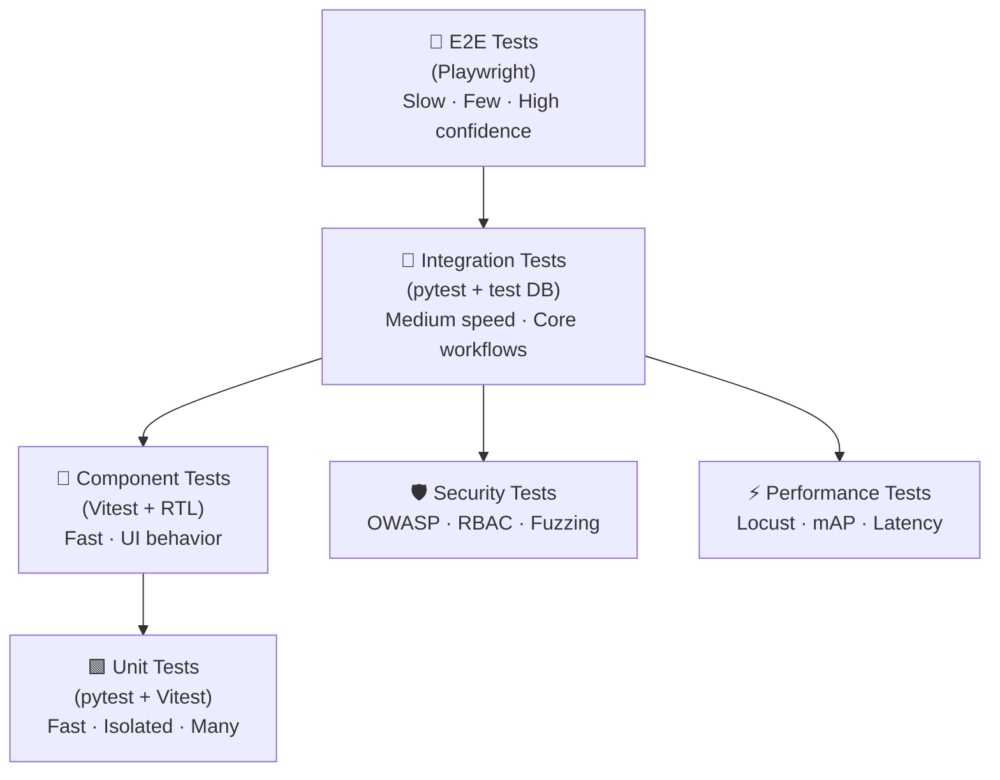
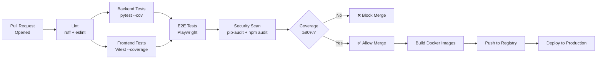

# ConstructSafe AI — Testing Plan

> **Project:** ConstructSafe AI — AI-Powered Construction Safety Management Software  
> **Document version:** 1.0  
> **Status:** Active reference — updated as new test suites are added  
> **Last updated:** 2026-11-17

---

## Table of Contents

1. [Testing Strategy Overview](#testing-strategy-overview)
2. [Test Environment Setup](#test-environment-setup)
3. [Backend Testing — pytest](#backend-testing--pytest)
4. [Frontend Testing — Vitest + React Testing Library](#frontend-testing--vitest--react-testing-library)
5. [E2E Testing — Playwright](#e2e-testing--playwright)
6. [AI Model Testing](#ai-model-testing)
7. [API Testing — Bruno/Postman](#api-testing--brunopostman)
8. [Performance Testing — Locust](#performance-testing--locust)
9. [Security Testing Checklist](#security-testing-checklist)
10. [Test Data Management](#test-data-management)
11. [CI/CD Test Pipeline](#cicd-test-pipeline)
12. [Bug Severity Classification](#bug-severity-classification)
13. [Reporting & Tracking](#reporting--tracking)

---

## Testing Strategy Overview

ConstructSafe AI follows a **defense-in-depth testing approach** that mirrors the testing pyramid: a large base of fast unit tests, a solid layer of integration tests, and a focused set of E2E and performance tests at the top.



### Layer Responsibilities

| Layer | Tool | Scope | Speed | Coverage Target |
|-------|------|-------|-------|-----------------|
| Unit | pytest, Vitest | Functions, classes, components in isolation | < 5ms/test | ≥ 80% backend, ≥ 70% frontend |
| Integration | pytest + TestClient | API endpoints with real DB (SQLite in-memory) | < 500ms/test | All critical endpoints |
| Component | Vitest + RTL | React components with mocked API | < 100ms/test | All page-level components |
| E2E | Playwright | Full user flows in real browser | 5–30s/test | All critical user journeys |
| AI Model | Ultralytics eval | mAP, per-class metrics | Minutes | mAP@50 ≥ 0.80 |
| Performance | Locust | API throughput, latency | Hours | P95 < 200ms |
| Security | Manual + scripts | OWASP Top 10, RBAC | Varies | 100% checklist |

---

## Test Environment Setup

### Backend Test Environment

```bash
# 1. Create a separate test virtual environment (optional, or use the same venv)
cd backend
python -m venv .venv-test
source .venv-test/Scripts/activate   # Windows: .venv-test\Scripts\activate

# 2. Install dependencies including test deps
pip install -r requirements.txt
pip install pytest pytest-asyncio pytest-cov httpx factory-boy faker

# 3. Create test environment file
cp ../.env.example .env.test
# Edit .env.test: set TEST_DATABASE_URL=sqlite:///./test.db (or postgres test DB)

# 4. Run tests
pytest backend/tests/ -v --cov=backend --cov-report=html
```

### Frontend Test Environment

```bash
cd frontend

# Install test dependencies (should already be in package.json devDependencies)
npm install -D vitest @testing-library/react @testing-library/jest-dom \
  @testing-library/user-event jsdom @vitejs/plugin-react msw

# Run unit/component tests
npm run test

# Run with coverage
npm run test -- --coverage

# Run in watch mode (development)
npm run test:watch
```

### E2E Test Environment

```bash
# Install Playwright and browsers
npm install -D @playwright/test
npx playwright install chromium firefox webkit

# Ensure the full Docker stack is running before E2E tests
docker-compose up -d

# Run E2E tests
npx playwright test

# Run with UI (debugging)
npx playwright test --ui

# Generate report
npx playwright show-report
```

### Environment Variables for Testing

```ini
# .env.test
DATABASE_URL=sqlite:///./test_constructsafe.db
REDIS_URL=redis://localhost:6379/1
SECRET_KEY=test-secret-key-not-for-production-use
ACCESS_TOKEN_EXPIRE_MINUTES=15
REFRESH_TOKEN_EXPIRE_DAYS=7
AI_ENGINE_URL=http://localhost:8001
STORAGE_PATH=./test_storage
LOG_LEVEL=WARNING
```

---

## Backend Testing — pytest

### Directory Structure

```
backend/tests/
├── conftest.py              # Shared fixtures, DB setup, factory classes
├── test_auth.py             # Authentication & token management
├── test_users.py            # User CRUD, role assignment
├── test_projects.py         # Project CRUD, worker assignment
├── test_workers.py          # Worker CRUD, certification management
├── test_inspections.py      # Inspection lifecycle, checklist submission
├── test_incidents.py        # Incident filing, severity escalation
├── test_violations.py       # Violation creation, corrective action linking
├── test_detections.py       # AI detection upload, result storage
├── test_cameras.py          # Camera CRUD, encrypted URL storage
├── test_analytics.py        # Aggregation endpoints, date filters
├── test_notifications.py    # WebSocket notification delivery
└── test_security.py         # Rate limiting, input validation, auth bypass
```

### `conftest.py` — Fixtures & Test Database

```python
# backend/tests/conftest.py
import pytest
from fastapi.testclient import TestClient
from sqlalchemy import create_engine
from sqlalchemy.orm import sessionmaker
from sqlalchemy.pool import StaticPool

from backend.main import app
from backend.database import Base, get_db
from backend.models.role import Role
from backend.models.user import User
from backend.core.security import get_password_hash

TEST_DATABASE_URL = "sqlite://"  # In-memory SQLite

engine = create_engine(
    TEST_DATABASE_URL,
    connect_args={"check_same_thread": False},
    poolclass=StaticPool,
)
TestingSessionLocal = sessionmaker(autocommit=False, autoflush=False, bind=engine)


@pytest.fixture(scope="function")
def db():
    """Create fresh DB tables for each test, then drop."""
    Base.metadata.create_all(bind=engine)
    session = TestingSessionLocal()
    try:
        yield session
    finally:
        session.close()
        Base.metadata.drop_all(bind=engine)


@pytest.fixture(scope="function")
def client(db):
    """TestClient with overridden DB dependency."""
    def override_get_db():
        try:
            yield db
        finally:
            pass
    app.dependency_overrides[get_db] = override_get_db
    with TestClient(app) as c:
        yield c
    app.dependency_overrides.clear()


@pytest.fixture
def seed_roles(db):
    """Seed the five roles into the test DB."""
    roles = ["Admin", "Manager", "Inspector", "Worker", "Client"]
    for name in roles:
        db.add(Role(name=name))
    db.commit()
    return {r: db.query(Role).filter_by(name=r).first() for r in roles}


@pytest.fixture
def admin_user(db, seed_roles):
    """Create an admin user and return (user, plain_password)."""
    user = User(
        email="admin@test.com",
        hashed_password=get_password_hash("AdminPass123!"),
        full_name="Test Admin",
        role_id=seed_roles["Admin"].id,
        is_active=True,
    )
    db.add(user)
    db.commit()
    db.refresh(user)
    return user, "AdminPass123!"


@pytest.fixture
def admin_token(client, admin_user):
    """Return a valid JWT for the admin user."""
    user, password = admin_user
    resp = client.post("/api/v1/auth/login", json={
        "email": user.email, "password": password
    })
    return resp.json()["access_token"]


@pytest.fixture
def auth_headers(admin_token):
    return {"Authorization": f"Bearer {admin_token}"}
```

### Test Categories & Example Test Cases

#### `test_auth.py` — Authentication

```python
class TestLogin:
    def test_login_success(self, client, admin_user):
        user, password = admin_user
        resp = client.post("/api/v1/auth/login", json={
            "email": user.email, "password": password
        })
        assert resp.status_code == 200
        data = resp.json()
        assert "access_token" in data
        assert "refresh_token" in data
        assert data["token_type"] == "bearer"

    def test_login_wrong_password(self, client, admin_user):
        user, _ = admin_user
        resp = client.post("/api/v1/auth/login", json={
            "email": user.email, "password": "WrongPassword!"
        })
        assert resp.status_code == 401
        assert resp.json()["detail"] == "Invalid credentials"

    def test_login_nonexistent_user(self, client):
        resp = client.post("/api/v1/auth/login", json={
            "email": "ghost@nowhere.com", "password": "any"
        })
        assert resp.status_code == 401

    def test_refresh_token(self, client, admin_user):
        user, password = admin_user
        login = client.post("/api/v1/auth/login", json={
            "email": user.email, "password": password
        })
        refresh = client.post("/api/v1/auth/refresh", json={
            "refresh_token": login.json()["refresh_token"]
        })
        assert refresh.status_code == 200
        assert "access_token" in refresh.json()

    def test_me_endpoint(self, client, auth_headers, admin_user):
        user, _ = admin_user
        resp = client.get("/api/v1/auth/me", headers=auth_headers)
        assert resp.status_code == 200
        assert resp.json()["email"] == user.email

    def test_me_requires_auth(self, client):
        resp = client.get("/api/v1/auth/me")
        assert resp.status_code == 401

    def test_expired_token_rejected(self, client):
        expired_token = "eyJhbGciOiJIUzI1NiIsInR5cCI6IkpXVCJ9.expired.sig"
        resp = client.get("/api/v1/auth/me", headers={
            "Authorization": f"Bearer {expired_token}"
        })
        assert resp.status_code == 401


class TestRBAC:
    def test_admin_can_delete_user(self, client, auth_headers):
        # ... create a user, then delete
        pass

    def test_inspector_cannot_delete_user(self, client, inspector_token):
        resp = client.delete("/api/v1/users/1", headers={
            "Authorization": f"Bearer {inspector_token}"
        })
        assert resp.status_code == 403
```

#### `test_projects.py` — Project Management

```python
class TestProjectCRUD:
    def test_create_project(self, client, auth_headers):
        resp = client.post("/api/v1/projects/", json={
            "name": "Site Alpha",
            "location": "123 Main St",
            "status": "active",
            "start_date": "2026-01-01",
        }, headers=auth_headers)
        assert resp.status_code == 201
        assert resp.json()["name"] == "Site Alpha"

    def test_list_projects_paginated(self, client, auth_headers):
        # Create 15 projects
        for i in range(15):
            client.post("/api/v1/projects/", json={
                "name": f"Project {i}", "location": "X"
            }, headers=auth_headers)
        resp = client.get("/api/v1/projects/?page=1&limit=10", headers=auth_headers)
        assert resp.status_code == 200
        assert len(resp.json()["items"]) == 10
        assert resp.json()["total"] == 15

    def test_update_project(self, client, auth_headers):
        create = client.post("/api/v1/projects/", json={
            "name": "Old Name", "location": "X"
        }, headers=auth_headers)
        pid = create.json()["id"]
        resp = client.patch(f"/api/v1/projects/{pid}", json={
            "name": "New Name"
        }, headers=auth_headers)
        assert resp.status_code == 200
        assert resp.json()["name"] == "New Name"

    def test_delete_project(self, client, auth_headers):
        create = client.post("/api/v1/projects/", json={
            "name": "ToDelete", "location": "X"
        }, headers=auth_headers)
        pid = create.json()["id"]
        resp = client.delete(f"/api/v1/projects/{pid}", headers=auth_headers)
        assert resp.status_code == 204

    def test_assign_worker_to_project(self, client, auth_headers):
        # Create project + worker, then assign
        pass

    def test_duplicate_assignment_rejected(self, client, auth_headers):
        # Assign same worker twice → 409
        pass
```

#### `test_inspections.py` — Inspection Workflow

```python
class TestInspections:
    def test_create_inspection(self, client, auth_headers, project):
        resp = client.post("/api/v1/inspections/", json={
            "project_id": project.id,
            "checklist_items": [
                {"item": "Hard hats worn", "required": True},
                {"item": "Safety vests visible", "required": True},
            ]
        }, headers=auth_headers)
        assert resp.status_code == 201
        assert resp.json()["status"] == "pending"

    def test_submit_inspection_completes_it(self, client, auth_headers, inspection):
        resp = client.post(f"/api/v1/inspections/{inspection.id}/submit",
                          json={"checklist_responses": [{"item_id": 1, "passed": True}]},
                          headers=auth_headers)
        assert resp.status_code == 200
        assert resp.json()["status"] == "completed"

    def test_violation_created_on_failed_item(self, client, auth_headers, inspection):
        resp = client.post(f"/api/v1/inspections/{inspection.id}/submit",
                          json={"checklist_responses": [
                              {"item_id": 1, "passed": False, "note": "No hard hat"}
                          ]},
                          headers=auth_headers)
        assert resp.status_code == 200
        violations = client.get("/api/v1/violations/", headers=auth_headers)
        assert len(violations.json()["items"]) > 0
```

#### `test_detections.py` — AI Detection

```python
class TestDetections:
    def test_upload_image_triggers_detection(self, client, auth_headers, mock_ai_engine):
        with open("backend/tests/fixtures/sample_frame.jpg", "rb") as f:
            resp = client.post("/api/v1/detections/upload",
                              files={"file": ("frame.jpg", f, "image/jpeg")},
                              headers=auth_headers)
        assert resp.status_code == 202
        assert "job_id" in resp.json()

    def test_detection_result_stored(self, client, auth_headers, completed_detection):
        resp = client.get(f"/api/v1/detections/{completed_detection.id}",
                         headers=auth_headers)
        assert resp.status_code == 200
        result = resp.json()
        assert "bounding_boxes" in result
        assert "confidence_scores" in result

    def test_human_verification_accept(self, client, auth_headers, completed_detection):
        resp = client.post(f"/api/v1/detections/{completed_detection.id}/verify",
                          json={"verified": True, "notes": "Confirmed violation"},
                          headers=auth_headers)
        assert resp.status_code == 200
        assert resp.json()["human_verified"] is True
```

### pytest Configuration

```ini
# backend/pytest.ini
[pytest]
asyncio_mode = auto
testpaths = tests
python_files = test_*.py
python_classes = Test*
python_functions = test_*
addopts =
    -v
    --tb=short
    --cov=backend
    --cov-report=term-missing
    --cov-report=html:coverage-report
    --cov-fail-under=80

[coverage:run]
omit =
    tests/*
    alembic/*
    */migrations/*
```

### Coverage Targets

| Module | Target |
|--------|--------|
| `backend/core/security.py` | 95% |
| `backend/routers/auth.py` | 90% |
| `backend/routers/projects.py` | 85% |
| `backend/routers/inspections.py` | 85% |
| `backend/routers/detections.py` | 80% |
| `backend/services/` | 80% |
| **Overall** | **≥ 80%** |

---

## Frontend Testing — Vitest + React Testing Library

### Configuration

```typescript
// frontend/vite.config.ts (test section)
import { defineConfig } from 'vite'
import react from '@vitejs/plugin-react'

export default defineConfig({
  plugins: [react()],
  test: {
    globals: true,
    environment: 'jsdom',
    setupFiles: './src/__tests__/setup.ts',
    coverage: {
      provider: 'v8',
      reporter: ['text', 'html', 'lcov'],
      thresholds: { lines: 70, functions: 70, branches: 65, statements: 70 },
      exclude: ['src/main.tsx', 'src/types/**', 'src/__tests__/**'],
    },
  },
})
```

```typescript
// frontend/src/__tests__/setup.ts
import '@testing-library/jest-dom'
import { afterEach } from 'vitest'
import { cleanup } from '@testing-library/react'
import { server } from './mocks/server'

beforeAll(() => server.listen())
afterEach(() => { cleanup(); server.resetHandlers() })
afterAll(() => server.close())
```

### Mock Service Worker (MSW) Setup

```typescript
// frontend/src/__tests__/mocks/handlers.ts
import { http, HttpResponse } from 'msw'

export const handlers = [
  http.post('/api/v1/auth/login', () => {
    return HttpResponse.json({
      access_token: 'mock-access-token',
      refresh_token: 'mock-refresh-token',
      token_type: 'bearer',
    })
  }),
  http.get('/api/v1/projects/', () => {
    return HttpResponse.json({
      items: [{ id: 1, name: 'Site Alpha', status: 'active' }],
      total: 1,
    })
  }),
  http.get('/api/v1/auth/me', () => {
    return HttpResponse.json({
      id: 1, email: 'admin@test.com', role: 'Admin'
    })
  }),
]
```

### Component Test Examples

```typescript
// frontend/src/__tests__/Login.test.tsx
import { render, screen, fireEvent, waitFor } from '@testing-library/react'
import userEvent from '@testing-library/user-event'
import { MemoryRouter } from 'react-router-dom'
import Login from '../pages/Login'

const renderLogin = () =>
  render(<MemoryRouter><Login /></MemoryRouter>)

describe('Login page', () => {
  it('renders email and password fields', () => {
    renderLogin()
    expect(screen.getByLabelText(/email/i)).toBeInTheDocument()
    expect(screen.getByLabelText(/password/i)).toBeInTheDocument()
  })

  it('shows validation error for empty fields', async () => {
    renderLogin()
    await userEvent.click(screen.getByRole('button', { name: /sign in/i }))
    expect(await screen.findByText(/email is required/i)).toBeInTheDocument()
  })

  it('calls login API on valid submission', async () => {
    renderLogin()
    await userEvent.type(screen.getByLabelText(/email/i), 'admin@test.com')
    await userEvent.type(screen.getByLabelText(/password/i), 'Password123!')
    await userEvent.click(screen.getByRole('button', { name: /sign in/i }))
    // MSW intercepts; check store updated
    await waitFor(() => {
      expect(screen.queryByText(/invalid/i)).not.toBeInTheDocument()
    })
  })

  it('displays error message on failed login', async () => {
    // Override MSW handler for this test to return 401
    server.use(http.post('/api/v1/auth/login', () =>
      HttpResponse.json({ detail: 'Invalid credentials' }, { status: 401 })
    ))
    renderLogin()
    await userEvent.type(screen.getByLabelText(/email/i), 'x@x.com')
    await userEvent.type(screen.getByLabelText(/password/i), 'wrong')
    await userEvent.click(screen.getByRole('button', { name: /sign in/i }))
    expect(await screen.findByText(/invalid credentials/i)).toBeInTheDocument()
  })
})
```

```typescript
// frontend/src/__tests__/ProtectedRoute.test.tsx
it('redirects unauthenticated users to /login', () => {
  // Clear auth store
  useAuthStore.getState().logout()
  render(
    <MemoryRouter initialEntries={['/admin/projects']}>
      <AppRouter />
    </MemoryRouter>
  )
  expect(screen.getByText(/sign in/i)).toBeInTheDocument()
})

it('renders protected page when authenticated', async () => {
  useAuthStore.setState({ user: { role: 'Admin' }, token: 'mock-token' })
  render(
    <MemoryRouter initialEntries={['/admin/projects']}>
      <AppRouter />
    </MemoryRouter>
  )
  expect(await screen.findByText(/projects/i)).toBeInTheDocument()
})
```

### Hook Tests

```typescript
// frontend/src/__tests__/hooks/useWebSocket.test.ts
import { renderHook, act } from '@testing-library/react'
import { useWebSocket } from '../../hooks/useWebSocket'

it('receives and stores notification on WebSocket message', () => {
  const { result } = renderHook(() => useWebSocket())
  act(() => {
    // Simulate incoming WS message
    result.current.socket?.dispatchEvent(
      new MessageEvent('message', {
        data: JSON.stringify({ type: 'alert', message: 'PPE violation detected' })
      })
    )
  })
  expect(result.current.notifications).toHaveLength(1)
  expect(result.current.notifications[0].message).toMatch(/PPE violation/)
})
```

---

## E2E Testing — Playwright

### Configuration

```typescript
// playwright/playwright.config.ts
import { defineConfig, devices } from '@playwright/test'

export default defineConfig({
  testDir: './tests',
  fullyParallel: true,
  retries: process.env.CI ? 2 : 0,
  workers: process.env.CI ? 2 : undefined,
  reporter: [['html', { outputFolder: 'playwright-report' }]],
  use: {
    baseURL: 'http://localhost:3000',
    trace: 'on-first-retry',
    screenshot: 'only-on-failure',
    video: 'retain-on-failure',
  },
  projects: [
    { name: 'chromium', use: { ...devices['Desktop Chrome'] } },
    { name: 'firefox',  use: { ...devices['Desktop Firefox'] } },
  ],
  webServer: {
    command: 'docker-compose up -d && npm --prefix frontend run preview',
    url: 'http://localhost:3000',
    reuseExistingServer: !process.env.CI,
  },
})
```

### Critical User Flow: Login per Role

```typescript
// playwright/tests/auth.spec.ts
import { test, expect } from '@playwright/test'

const roles = [
  { email: 'admin@cs.ai', password: 'Admin123!', expectedPath: '/admin/dashboard' },
  { email: 'manager@cs.ai', password: 'Mgr123!', expectedPath: '/manager/dashboard' },
  { email: 'inspector@cs.ai', password: 'Insp123!', expectedPath: '/inspector/dashboard' },
  { email: 'worker@cs.ai', password: 'Work123!', expectedPath: '/worker/dashboard' },
]

for (const { email, password, expectedPath } of roles) {
  test(`login as ${email.split('@')[0]} redirects to correct dashboard`, async ({ page }) => {
    await page.goto('/login')
    await page.fill('[name="email"]', email)
    await page.fill('[name="password"]', password)
    await page.click('button[type="submit"]')
    await page.waitForURL(`**${expectedPath}`)
    expect(page.url()).toContain(expectedPath)
  })
}

test('logout clears session and redirects to login', async ({ page }) => {
  await page.goto('/login')
  await page.fill('[name="email"]', 'admin@cs.ai')
  await page.fill('[name="password"]', 'Admin123!')
  await page.click('button[type="submit"]')
  await page.waitForURL('**/admin/dashboard')
  await page.click('[data-testid="user-menu"]')
  await page.click('[data-testid="logout-btn"]')
  await page.waitForURL('**/login')
  expect(page.url()).toContain('/login')
})
```

### Critical User Flow: PPE Detection Upload

```typescript
// playwright/tests/ppe-detection.spec.ts
test('inspector can upload video and view detection results', async ({ page }) => {
  // Login as inspector
  await page.goto('/login')
  await page.fill('[name="email"]', 'inspector@cs.ai')
  await page.fill('[name="password"]', 'Insp123!')
  await page.click('button[type="submit"]')
  await page.waitForURL('**/inspector/dashboard')

  // Navigate to PPE Detection
  await page.click('[data-testid="nav-ppe-detection"]')
  await page.waitForURL('**/inspector/ppe-detection')

  // Upload a test video file
  const fileInput = page.locator('input[type="file"]')
  await fileInput.setInputFiles('playwright/fixtures/test_video.mp4')

  // Click detect button
  await page.click('[data-testid="btn-detect"]')

  // Wait for results (poll up to 30s)
  await expect(page.locator('[data-testid="detection-results"]')).toBeVisible({ timeout: 30000 })

  // Verify bounding box viewer is present
  await expect(page.locator('[data-testid="bounding-box-viewer"]')).toBeVisible()

  // Verify there is at least one detection card
  await expect(page.locator('[data-testid="detection-result-card"]').first()).toBeVisible()
})
```

### Critical User Flow: Incident Reporting

```typescript
// playwright/tests/inspection.spec.ts
test('inspector can file an incident report', async ({ page }) => {
  await loginAs(page, 'inspector@cs.ai', 'Insp123!')
  await page.click('[data-testid="nav-incidents"]')
  await page.click('[data-testid="btn-new-incident"]')

  await page.selectOption('[name="project_id"]', { label: 'Site Alpha' })
  await page.selectOption('[name="severity"]', 'high')
  await page.selectOption('[name="type"]', 'ppe_violation')
  await page.fill('[name="description"]', 'Worker observed without hard hat near crane.')
  await page.click('button[type="submit"]')

  await expect(page.locator('[data-testid="toast-success"]')).toBeVisible()
  await expect(page.locator('text=Worker observed without hard hat')).toBeVisible()
})
```

### Critical User Flow: Camera Management

```typescript
// playwright/tests/camera.spec.ts
test('admin can add a camera and see it in monitor', async ({ page }) => {
  await loginAs(page, 'admin@cs.ai', 'Admin123!')
  await page.goto('/admin/cameras')
  await page.click('[data-testid="btn-add-camera"]')
  await page.fill('[name="name"]', 'Gate Camera 1')
  await page.fill('[name="rtsp_url"]', 'rtsp://192.168.1.10:554/stream1')
  await page.selectOption('[name="project_id"]', { label: 'Site Alpha' })
  await page.click('button[type="submit"]')
  await expect(page.locator('text=Gate Camera 1')).toBeVisible()
})
```

---

## AI Model Testing

### Evaluation Metrics

| Metric | Target | Tool |
|--------|--------|------|
| mAP@50 | ≥ 0.80 | Ultralytics `model.val()` |
| mAP@50-95 | ≥ 0.60 | Ultralytics `model.val()` |
| Helmet precision | ≥ 0.85 | Per-class confusion matrix |
| Helmet recall | ≥ 0.80 | Per-class confusion matrix |
| Vest precision | ≥ 0.82 | Per-class confusion matrix |
| Inference time (CPU) | < 100ms/frame | `time.perf_counter()` benchmark |
| Inference time (GPU) | < 30ms/frame | CUDA event timer |

### Per-Class Requirements

| PPE Class | Min Precision | Min Recall |
|-----------|--------------|------------|
| `helmet` | 0.85 | 0.80 |
| `no_helmet` | 0.80 | 0.85 |
| `vest` | 0.82 | 0.78 |
| `no_vest` | 0.78 | 0.82 |
| `gloves` | 0.75 | 0.70 |
| `boots` | 0.75 | 0.70 |
| `goggles` | 0.72 | 0.68 |

### Test Dataset Requirements

- Minimum 500 labeled images per class
- Split: 70% train / 15% validation / 15% test
- Include: varied lighting, partial occlusion, multiple workers per frame, different construction contexts
- Format: YOLO annotation format (`.txt` per image, normalized coordinates)

### Evaluation Script

```python
# ai_engine/tests/test_detector.py
import pytest
from pathlib import Path
from ai_engine.detector import PPEDetector

@pytest.fixture(scope="module")
def detector():
    return PPEDetector(model_path="ai_engine/models/ppe_yolov8.pt")

def test_model_loads(detector):
    assert detector.model is not None

def test_single_image_inference(detector):
    import cv2
    frame = cv2.imread("ai_engine/tests/fixtures/sample_frame.jpg")
    results = detector.detect(frame)
    assert isinstance(results, list)
    for r in results:
        assert "class" in r
        assert "confidence" in r
        assert "bbox" in r
        assert 0.0 <= r["confidence"] <= 1.0

def test_inference_speed(detector):
    import cv2, time
    frame = cv2.imread("ai_engine/tests/fixtures/sample_frame.jpg")
    start = time.perf_counter()
    for _ in range(10):
        detector.detect(frame)
    avg_ms = (time.perf_counter() - start) / 10 * 1000
    assert avg_ms < 100, f"Inference too slow: {avg_ms:.1f}ms (limit: 100ms)"

def test_mAP_on_validation_set():
    """Run full val — only in CI nightly, skipped in unit runs."""
    pytest.importorskip("ultralytics")
    from ultralytics import YOLO
    model = YOLO("ai_engine/models/ppe_yolov8.pt")
    metrics = model.val(data="ai_engine/tests/dataset.yaml", verbose=False)
    assert metrics.box.map50 >= 0.80, f"mAP@50 too low: {metrics.box.map50:.3f}"
```

### Regression Testing

- After each model retrain, run `test_mAP_on_validation_set` before deploying new weights
- Store mAP history in `ai_engine/tests/mAP_history.json`
- Alert if mAP drops > 2% from previous version

---

## API Testing — Bruno/Postman

### Collection Structure

```
ConstructSafe_API/
├── Auth/
│   ├── POST Login (success)
│   ├── POST Login (wrong password) → expect 401
│   ├── GET Me (authenticated)
│   ├── GET Me (no token) → expect 401
│   ├── POST Refresh Token
│   └── POST Logout
├── Users/
│   ├── GET List Users (admin only)
│   ├── POST Create User
│   ├── GET User by ID
│   ├── PATCH Update User
│   └── DELETE User (admin only)
├── Projects/
│   ├── POST Create Project
│   ├── GET List Projects
│   ├── GET Project by ID
│   ├── PATCH Update Project
│   ├── DELETE Project
│   └── POST Assign Worker
├── Inspections/
│   ├── POST Create Inspection
│   ├── GET List Inspections (filtered by project)
│   ├── POST Submit Checklist
│   └── GET Violations by Inspection
├── Detections/
│   ├── POST Upload Image
│   ├── POST Upload Video
│   ├── GET Job Status
│   ├── GET Detection Results
│   └── POST Human Verify
└── WebSocket/
    └── WS /ws/notifications (manual test)
```

### Auth Flow in Bruno

```javascript
// Pre-request script: auto-attach token
const token = bru.getEnvVar('access_token')
req.setHeader('Authorization', `Bearer ${token}`)

// Post-request script on Login:
if (res.getStatus() === 200) {
  bru.setEnvVar('access_token', res.getBody().access_token)
  bru.setEnvVar('refresh_token', res.getBody().refresh_token)
}
```

### WebSocket Testing

Use `wscat` for manual WebSocket testing:
```bash
wscat -c "ws://localhost:8000/api/v1/ws/notifications" \
      -H "Authorization: Bearer <token>"
# Trigger a detection from another terminal and observe real-time alert
```

---

## Performance Testing — Locust

### Locust Configuration

```python
# backend/tests/performance/locustfile.py
from locust import HttpUser, task, between, events
import json

class ConstructSafeUser(HttpUser):
    wait_time = between(1, 3)
    token = None

    def on_start(self):
        resp = self.client.post("/api/v1/auth/login", json={
            "email": "loadtest@cs.ai", "password": "LoadTest123!"
        })
        self.token = resp.json()["access_token"]
        self.headers = {"Authorization": f"Bearer {self.token}"}

    @task(5)
    def view_projects(self):
        self.client.get("/api/v1/projects/", headers=self.headers)

    @task(3)
    def view_inspections(self):
        self.client.get("/api/v1/inspections/", headers=self.headers)

    @task(2)
    def view_analytics(self):
        self.client.get("/api/v1/analytics/summary", headers=self.headers)

    @task(1)
    def create_incident(self):
        self.client.post("/api/v1/incidents/", json={
            "project_id": 1, "severity": "low", "type": "near_miss",
            "description": "Load test incident"
        }, headers=self.headers)
```

### Performance Targets

| Endpoint | P50 | P95 | P99 |
|----------|-----|-----|-----|
| `GET /projects/` | < 50ms | < 200ms | < 500ms |
| `GET /analytics/summary` | < 100ms | < 300ms | < 800ms |
| `POST /auth/login` | < 100ms | < 300ms | < 500ms |
| `POST /detections/upload` | < 500ms | < 2000ms | < 5000ms |
| Dashboard initial load | < 1.5s | < 3s | < 5s |
| AI inference (per frame) | < 50ms | < 100ms | < 150ms |

### Running Performance Tests

```bash
# Start load test with 100 users, ramp up over 30s
locust -f backend/tests/performance/locustfile.py \
  --host http://localhost:8000 \
  --users 100 --spawn-rate 5 \
  --run-time 5m --headless \
  --html performance-report.html
```

---

## Security Testing Checklist

### OWASP Top 10 Mapping

| OWASP ID | Vulnerability | Test Method | Status |
|----------|--------------|-------------|--------|
| A01 | Broken Access Control | RBAC bypass attempts; access other users' data | Manual + automated |
| A02 | Cryptographic Failures | Check JWT algorithm (`alg: none` attack); HTTPS enforcement | Automated script |
| A03 | Injection | SQL injection via parameterized SQLAlchemy; NoSQL | Automated |
| A04 | Insecure Design | Threat model review; check for business logic flaws | Architecture review |
| A05 | Security Misconfiguration | Docker exposed ports; DEBUG mode off in prod; headers | Config audit |
| A06 | Vulnerable Components | `pip audit`; `npm audit` | CI pipeline |
| A07 | Auth & Session Failures | Brute force protection; token reuse after logout | Automated |
| A08 | Software Integrity | Verify Docker image digests; dependency pinning | CI pipeline |
| A09 | Logging Failures | Check sensitive data not logged; audit trails | Log review |
| A10 | SSRF | Test camera RTSP URL input for internal IP access | Manual |

### JWT Security Tests

```python
# backend/tests/test_security.py
def test_alg_none_attack_rejected(client):
    """Ensure tokens signed with 'none' algorithm are rejected."""
    # Craft token with alg:none
    import base64, json
    header = base64.urlsafe_b64encode(json.dumps({"alg":"none","typ":"JWT"}).encode()).decode().rstrip('=')
    payload = base64.urlsafe_b64encode(json.dumps({"sub":"1","role":"Admin"}).encode()).decode().rstrip('=')
    evil_token = f"{header}.{payload}."
    resp = client.get("/api/v1/auth/me", headers={"Authorization": f"Bearer {evil_token}"})
    assert resp.status_code == 401

def test_token_unusable_after_logout(client, auth_headers, admin_user):
    token = auth_headers["Authorization"].split()[1]
    client.post("/api/v1/auth/logout", headers=auth_headers)
    resp = client.get("/api/v1/auth/me", headers={"Authorization": f"Bearer {token}"})
    assert resp.status_code == 401

def test_rate_limiting_on_login(client):
    for _ in range(20):
        client.post("/api/v1/auth/login", json={"email":"x@x.com","password":"wrong"})
    resp = client.post("/api/v1/auth/login", json={"email":"x@x.com","password":"wrong"})
    assert resp.status_code == 429
```

### File Upload Security Tests

```python
def test_malicious_file_extension_rejected(client, auth_headers):
    """Uploading a PHP file disguised as JPEG should be rejected."""
    resp = client.post("/api/v1/detections/upload",
        files={"file": ("shell.php.jpg", b"<?php system($_GET['cmd']); ?>", "image/jpeg")},
        headers=auth_headers)
    assert resp.status_code == 422

def test_file_size_limit_enforced(client, auth_headers):
    """Files over 500MB should be rejected."""
    large_data = b"0" * (501 * 1024 * 1024)
    resp = client.post("/api/v1/detections/upload",
        files={"file": ("big.mp4", large_data, "video/mp4")},
        headers=auth_headers)
    assert resp.status_code == 413

def test_path_traversal_prevention(client, auth_headers):
    resp = client.post("/api/v1/detections/upload",
        files={"file": ("../../etc/passwd", b"root:x:0:0", "text/plain")},
        headers=auth_headers)
    assert resp.status_code in (400, 422)
```

### SQL Injection Tests

```python
def test_sql_injection_in_project_name(client, auth_headers):
    resp = client.post("/api/v1/projects/", json={
        "name": "'; DROP TABLE projects; --",
        "location": "X"
    }, headers=auth_headers)
    # Should either 422 (validation) or 201 (safely escaped by SQLAlchemy)
    assert resp.status_code in (201, 422)
    # Verify table still exists by listing projects
    list_resp = client.get("/api/v1/projects/", headers=auth_headers)
    assert list_resp.status_code == 200
```

### XSS Prevention

- All user-supplied text rendered in React via JSX (auto-escaped) — no `dangerouslySetInnerHTML`
- Audit all `innerHTML` assignments in bounding box canvas overlay code
- Content Security Policy header set in Nginx: `default-src 'self'; script-src 'self'`
- Run [DOMPurify](https://github.com/cure53/DOMPurify) on any rich-text fields before render

---

## Test Data Management

### Seed Script

```python
# backend/tests/seed.py
"""Run with: python -m backend.tests.seed — populates dev/test DB with realistic data."""
from backend.database import SessionLocal
from backend.models import User, Role, Project, Worker, Inspection, Incident
from backend.core.security import get_password_hash
from faker import Faker

fake = Faker()

def seed_all():
    db = SessionLocal()
    try:
        # Roles
        roles = {name: Role(name=name) for name in
                 ["Admin","Manager","Inspector","Worker","Client"]}
        db.add_all(roles.values()); db.commit()

        # Users (one per role)
        users = {
            "Admin":    User(email="admin@cs.ai",     hashed_password=get_password_hash("Admin123!"),     full_name="Alice Admin",     role_id=roles["Admin"].id),
            "Manager":  User(email="manager@cs.ai",   hashed_password=get_password_hash("Mgr123!"),       full_name="Bob Manager",     role_id=roles["Manager"].id),
            "Inspector":User(email="inspector@cs.ai", hashed_password=get_password_hash("Insp123!"),      full_name="Carol Inspector", role_id=roles["Inspector"].id),
            "Worker":   User(email="worker@cs.ai",    hashed_password=get_password_hash("Work123!"),      full_name="Dave Worker",     role_id=roles["Worker"].id),
        }
        db.add_all(users.values()); db.commit()

        # Projects
        for _ in range(5):
            db.add(Project(name=fake.company() + " Site",
                          location=fake.address(), status="active"))
        db.commit()

    finally:
        db.close()

if __name__ == "__main__":
    seed_all()
    print("Seed complete.")
```

### Factory Pattern

```python
# backend/tests/factories.py
import factory
from factory.alchemy import SQLAlchemyModelFactory
from backend.models.project import Project
from backend.models.user import User

class ProjectFactory(SQLAlchemyModelFactory):
    class Meta:
        model = Project
        sqlalchemy_session_persistence = "commit"

    name = factory.Faker("company")
    location = factory.Faker("address")
    status = "active"

class UserFactory(SQLAlchemyModelFactory):
    class Meta:
        model = User

    email = factory.Faker("email")
    full_name = factory.Faker("name")
    hashed_password = factory.LazyFunction(lambda: get_password_hash("TestPass123!"))
    is_active = True
```

### Cleanup Strategy

- Each `pytest` function-scoped `db` fixture drops and recreates all tables → zero isolation issues
- E2E: Playwright tests use a dedicated test tenant/project; `afterAll` deletes all test data via API
- Performance tests: use separate `loadtest@cs.ai` user; data cleaned by `scripts/clean_load_test_data.py`

---

## CI/CD Test Pipeline

### GitHub Actions: CI Workflow

```yaml
# .github/workflows/ci.yml
name: CI

on:
  push:
    branches: [main, develop]
  pull_request:
    branches: [main, develop]

jobs:
  backend-tests:
    runs-on: ubuntu-latest
    services:
      postgres:
        image: postgres:15
        env: { POSTGRES_DB: test_db, POSTGRES_USER: cs, POSTGRES_PASSWORD: cs }
        options: --health-cmd pg_isready --health-interval 10s --health-timeout 5s --health-retries 5
    steps:
      - uses: actions/checkout@v4
      - uses: actions/setup-python@v5
        with: { python-version: '3.11' }
      - name: Install backend deps
        run: pip install -r backend/requirements.txt pytest pytest-cov httpx
      - name: Run backend tests
        env:
          DATABASE_URL: postgresql://cs:cs@localhost/test_db
          SECRET_KEY: ci-secret
        run: pytest backend/tests/ --cov=backend --cov-report=xml -q
      - name: Upload coverage
        uses: codecov/codecov-action@v4
        with: { file: coverage.xml }

  frontend-tests:
    runs-on: ubuntu-latest
    steps:
      - uses: actions/checkout@v4
      - uses: actions/setup-node@v4
        with: { node-version: '20', cache: 'npm', cache-dependency-path: frontend/package-lock.json }
      - run: npm ci --prefix frontend
      - run: npm run test --prefix frontend -- --run --coverage
      - name: Upload frontend coverage
        uses: codecov/codecov-action@v4
        with: { file: frontend/coverage/lcov.info }

  e2e-tests:
    runs-on: ubuntu-latest
    needs: [backend-tests, frontend-tests]
    steps:
      - uses: actions/checkout@v4
      - uses: actions/setup-node@v4
        with: { node-version: '20' }
      - run: docker-compose up -d
      - run: npm ci
      - run: npx playwright install --with-deps chromium
      - run: npx playwright test --reporter=html
      - uses: actions/upload-artifact@v4
        if: failure()
        with:
          name: playwright-report
          path: playwright-report/

  security-scan:
    runs-on: ubuntu-latest
    steps:
      - uses: actions/checkout@v4
      - run: pip install pip-audit && pip-audit -r backend/requirements.txt
      - run: npm audit --audit-level=high --prefix frontend
```

### CI/CD Pipeline Diagram



### Pre-commit Hooks

```yaml
# .pre-commit-config.yaml
repos:
  - repo: https://github.com/astral-sh/ruff-pre-commit
    rev: v0.4.0
    hooks:
      - id: ruff
        args: [--fix]
  - repo: https://github.com/pre-commit/mirrors-mypy
    rev: v1.9.0
    hooks:
      - id: mypy
        additional_dependencies: [sqlalchemy-stubs]
  - repo: local
    hooks:
      - id: pytest-fast
        name: Fast unit tests
        entry: pytest backend/tests/ -x -q --ignore=backend/tests/test_security.py
        language: system
        pass_filenames: false
```

---

## Bug Severity Classification

| Severity | Definition | SLA for Fix | Examples |
|----------|-----------|-------------|---------|
| **Critical** | System unavailable; data loss; security breach; auth bypass | Fix within 4 hours; immediate hotfix deploy | Login completely broken; SQL injection vulnerability; JWT bypass; DB data corruption |
| **High** | Major feature non-functional; significant data integrity issue; performance degraded > 50% | Fix within 24 hours; in next release | PPE detection pipeline fails for all uploads; Inspection submit returns 500; RBAC role check missing |
| **Medium** | Feature partially working; UI broken but workaround exists; performance degraded < 50% | Fix within 72 hours; in next sprint | Pagination returns wrong count; Chart renders with stale data; Camera RTSP reconnect flaky |
| **Low** | Cosmetic issue; minor UX problem; typo; non-breaking edge case | Fix within 2 weeks; backlog | Tooltip misaligned; Date format inconsistency; Unnecessary console.log in production |

---

## Reporting & Tracking

### Test Result Format

Each CI run produces:
1. **pytest HTML Report** — `coverage-report/index.html` — full coverage with line highlighting
2. **JUnit XML** — `test-results.xml` — for CI dashboard integration
3. **Playwright HTML Report** — `playwright-report/index.html` — with screenshots/videos on failure
4. **Locust HTML Report** — `performance-report.html` — RPS, response time graphs
5. **Coverage JSON** — uploaded to Codecov for trend tracking

### Coverage Report Commands

```bash
# Backend — generate HTML coverage report
pytest backend/tests/ --cov=backend --cov-report=html:docs/coverage/backend
open docs/coverage/backend/index.html

# Frontend — generate coverage report
npm run test --prefix frontend -- --run --coverage
open frontend/coverage/index.html

# View coverage diff on PR — Codecov bot comments automatically
```

### Tracking Bugs

- File bugs as GitHub Issues with labels: `bug`, `severity:critical/high/medium/low`, `phase:X`
- Use the issue template:
  ```
  **Steps to reproduce:**
  **Expected behavior:**
  **Actual behavior:**
  **Environment:** (browser/OS/Docker version)
  **Severity:** Critical / High / Medium / Low
  **Logs / Screenshots:**
  ```
- Critical and High bugs block the phase gate review
- Coverage trend tracked in Codecov; threshold failures block PR merge

> [!IMPORTANT]
> All test suites must pass in CI before any PR is merged to `main`. Coverage drops below the threshold automatically block merge.

> [!TIP]
> Run `pytest -x` during development to stop on first failure — faster feedback loop than running the full suite.

> [!WARNING]
> Never commit secrets or real RTSP credentials in test fixtures. Use environment variables or mock URLs (`rtsp://mock.local/stream`) in all test code.
