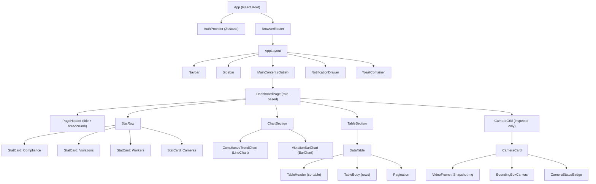

# ConstructSafe AI — UI Design Guidelines

**Version:** 1.0.0  
**Framework:** React 18 + Vite + Tailwind CSS v3 + Lucide React + Recharts  
**Last Updated:** 2024-01-15  

---

## Table of Contents

1. [Design Philosophy](#1-design-philosophy)
2. [Color Palette](#2-color-palette)
3. [Typography](#3-typography)
4. [Spacing System](#4-spacing-system)
5. [Component Library](#5-component-library)
6. [Dashboard Layouts by Role](#6-dashboard-layouts-by-role)
7. [Icon System](#7-icon-system)
8. [Responsive Breakpoints](#8-responsive-breakpoints)
9. [Dark vs Light Mode](#9-dark-vs-light-mode)
10. [Status Indicator System](#10-status-indicator-system)
11. [Camera Feed UI](#11-camera-feed-ui)
12. [PPE Detection Result Display](#12-ppe-detection-result-display)
13. [Alert and Notification UI](#13-alert-and-notification-ui)
14. [Component Hierarchy Diagram](#14-component-hierarchy-diagram)
15. [Tailwind Config Customizations](#15-tailwind-config-customizations)
16. [Accessibility Guidelines](#16-accessibility-guidelines)

---

## 1. Design Philosophy

ConstructSafe AI is a **professional enterprise construction safety management platform**. Its visual design must communicate authority, trust, and clarity — the same values demanded by the industry it serves.

### Core Principles

| Principle | Implementation |
|---|---|
| **Professional & Enterprise** | Clean lines, structured layouts, data-first presentation |
| **Safety-First Visual Language** | Orange accents for CTAs and warnings; red for critical alerts; green for compliance |
| **Clarity Over Decoration** | Information density without visual clutter |
| **Consistency** | A rigid component system ensures predictable behavior across all 5 role dashboards |
| **Performance** | Lightweight component tree; lazy loading for heavy views (camera feeds, charts) |

### What This Product Is NOT

> [!IMPORTANT]
> ConstructSafe AI must **never** look like a gaming interface, cyberpunk dashboard, or futuristic sci-fi application.

- ❌ No neon colors (electric blue, hot pink, fluorescent green)
- ❌ No heavy gradients as decorative elements
- ❌ No animated glowing borders or pulsing backgrounds
- ❌ No dark-first design — the product defaults to **light mode**
- ❌ No glassmorphism or frosted card effects
- ✅ Clean white card surfaces on light gray backgrounds
- ✅ Slate/dark-gray navigation with structured hierarchy
- ✅ Safety-orange as a purposeful accent (CTAs, warnings, branding)
- ✅ Charts and data are the visual centerpiece, not decoration

---

## 2. Color Palette

### Primary — Slate (Navigation, Headers, Text)

| Token | Hex | Tailwind Class | Usage |
|---|---|---|---|
| `slate-900` | `#0F172A` | `bg-slate-900` | Deepest backgrounds, top nav |
| `slate-800` | `#1E293B` | `bg-slate-800` | Sidebar background |
| `slate-700` | `#334155` | `bg-slate-700` | Sidebar hover, secondary nav |
| `slate-600` | `#475569` | `bg-slate-600` | Secondary text, icons |
| `slate-500` | `#64748B` | `text-slate-500` | Placeholder text, subtle labels |
| `slate-400` | `#94A3B8` | `text-slate-400` | Disabled text |

### Safety Orange — Accent (Brand, CTAs, Warnings)

| Token | Hex | Tailwind Class | Usage |
|---|---|---|---|
| `orange-700` | `#C2410C` | `bg-orange-700` | Active nav item, pressed button |
| `orange-600` | `#EA580C` | `bg-orange-600` | Primary button, brand accent |
| `orange-500` | `#F97316` | `bg-orange-500` | Hover state, warning badges |
| `orange-100` | `#FFEDD5` | `bg-orange-100` | Warning alert background |
| `orange-50` | `#FFF7ED` | `bg-orange-50` | Soft warning tint |

### Success — Green (Compliance, Passed, Online)

| Token | Hex | Tailwind Class | Usage |
|---|---|---|---|
| `green-700` | `#15803D` | `bg-green-700` | Strong pass indicator |
| `green-600` | `#16A34A` | `bg-green-600` | Success badge, compliance |
| `green-100` | `#DCFCE7` | `bg-green-100` | Success alert background |
| `green-50` | `#F0FDF4` | `bg-green-50` | Soft success tint |

### Danger — Red (Violations, Offline, Critical)

| Token | Hex | Tailwind Class | Usage |
|---|---|---|---|
| `red-700` | `#B91C1C` | `bg-red-700` | Critical badge text |
| `red-600` | `#DC2626` | `bg-red-600` | Danger button, violation alert |
| `red-100` | `#FEE2E2` | `bg-red-100` | Error/violation background |
| `red-50` | `#FEF2F2` | `bg-red-50` | Soft danger tint |

### Warning — Amber (Pending, Review, Expiring)

| Token | Hex | Tailwind Class | Usage |
|---|---|---|---|
| `amber-600` | `#D97706` | `bg-amber-600` | Warning badge |
| `amber-500` | `#F59E0B` | `text-amber-500` | Warning icons |
| `amber-100` | `#FEF3C7` | `bg-amber-100` | Warning alert background |

### Neutral Grays — Surfaces and Borders

| Token | Hex | Tailwind Class | Usage |
|---|---|---|---|
| `white` | `#FFFFFF` | `bg-white` | Card surfaces, modal backgrounds |
| `slate-50` | `#F8FAFC` | `bg-slate-50` | Page background |
| `slate-100` | `#F1F5F9` | `bg-slate-100` | Table row hover, inner surfaces |
| `slate-200` | `#E2E8F0` | `border-slate-200` | Dividers, card borders |
| `slate-300` | `#CBD5E1` | `border-slate-300` | Input borders |

### Color Usage Rules

> [!NOTE]
> Follow these rules strictly to maintain visual consistency.

- **Page background:** always `bg-slate-50`
- **Card surfaces:** always `bg-white` with `border border-slate-200` and `rounded-lg shadow-sm`
- **Primary action buttons:** `bg-orange-600 hover:bg-orange-700 text-white`
- **Top navigation:** `bg-slate-800 text-white`
- **Sidebar:** `bg-slate-800` with `text-slate-300` items; active = `bg-orange-600 text-white`

---

## 3. Typography

### Font Family

**Inter** is the sole typeface for all UI text. It is a professional, legible sans-serif designed for screen readability at all sizes.

```html
<!-- In index.html -->
<link rel="preconnect" href="https://fonts.googleapis.com">
<link href="https://fonts.googleapis.com/css2?family=Inter:wght@400;500;600;700&display=swap" rel="stylesheet">
```

```css
/* In tailwind.config.js */
fontFamily: {
  sans: ['Inter', 'ui-sans-serif', 'system-ui', 'sans-serif'],
}
```

### Type Scale

| Scale Token | Size | Line Height | Weight | Tailwind Class | Usage |
|---|---|---|---|---|---|
| `text-xs` | 12px | 16px | 400/500 | `text-xs` | Labels, metadata, timestamps |
| `text-sm` | 14px | 20px | 400/500 | `text-sm` | Body text, table content, form labels |
| `text-base` | 16px | 24px | 400 | `text-base` | Default body, card text |
| `text-lg` | 18px | 28px | 500/600 | `text-lg` | Card titles, section headings |
| `text-xl` | 20px | 28px | 600 | `text-xl` | Page section headings |
| `text-2xl` | 24px | 32px | 700 | `text-2xl` | Stat card numbers, main KPIs |
| `text-3xl` | 30px | 36px | 700 | `text-3xl` | Dashboard hero metrics |
| `text-4xl` | 36px | 40px | 700 | `text-4xl` | Large display numbers (compliance %) |

### Font Weight Usage

| Weight | Value | Usage |
|---|---|---|
| Regular | 400 | Body text, table rows, descriptions |
| Medium | 500 | Labels, secondary headings, button text |
| Semibold | 600 | Card titles, nav items, form labels |
| Bold | 700 | KPI numbers, page titles, alert headings |

### Text Colors

| Use Case | Tailwind Class |
|---|---|
| Primary (page titles, headings) | `text-slate-900` |
| Secondary (labels, card titles) | `text-slate-700` |
| Muted (captions, metadata) | `text-slate-500` |
| Disabled | `text-slate-400` |
| On dark backgrounds (nav/sidebar) | `text-white` / `text-slate-200` |
| Links | `text-orange-600 hover:text-orange-700 underline` |

---

## 4. Spacing System

ConstructSafe AI uses Tailwind's default spacing scale (1 unit = 4px). All layouts use consistent multiples.

### Key Spacing Values

| Tailwind | px | Usage |
|---|---|---|
| `p-1` / `m-1` | 4px | Tight badge padding, icon gaps |
| `p-2` / `m-2` | 8px | Small button padding, inline spacing |
| `p-3` | 12px | Compact card padding |
| `p-4` | 16px | Standard card padding, form groups |
| `p-6` | 24px | Card padding (default), section gutters |
| `p-8` | 32px | Page-level padding |
| `gap-4` | 16px | Card grid gaps |
| `gap-6` | 24px | Section-level gaps |
| `space-y-4` | 16px | Vertical form field spacing |

### Layout Grid

- **Page container:** `max-w-screen-2xl mx-auto px-4 sm:px-6 lg:px-8`
- **Dashboard card grid:** `grid grid-cols-1 sm:grid-cols-2 lg:grid-cols-4 gap-4`
- **Sidebar width:** fixed `w-64` on desktop, overlay on mobile
- **Content area with sidebar:** `flex-1 ml-64 p-6` on desktop

---

## 5. Component Library

### 5.1 Navbar (Top Navigation)

**Structure:** Full-width, `h-16`, `bg-slate-800`, sticky top.

**Contains:**
- Left: Logo (orange construction helmet icon + "ConstructSafe" wordmark in white)
- Center: (empty on desktop, mobile hamburger menu)
- Right: Search button, Notification bell with unread count badge, User avatar dropdown

```jsx
// Key Tailwind classes
<nav className="fixed top-0 left-0 right-0 z-50 h-16 bg-slate-800 flex items-center px-6 shadow-md">
```

**Notification Badge:** `absolute -top-1 -right-1 bg-red-600 text-white text-xs font-bold rounded-full w-5 h-5 flex items-center justify-center`

---

### 5.2 Sidebar

**Structure:** Fixed left, `w-64`, `h-screen`, `bg-slate-800`, scrollable nav links.

**Sections:** separated by `border-t border-slate-700`
- Project selector (dropdown)
- Main navigation links with icons
- Role-specific links
- Settings / Profile (bottom)

**Nav Item States:**

| State | Classes |
|---|---|
| Default | `flex items-center gap-3 px-4 py-2.5 text-slate-300 hover:bg-slate-700 hover:text-white rounded-md` |
| Active | `flex items-center gap-3 px-4 py-2.5 bg-orange-600 text-white rounded-md` |
| Disabled | `flex items-center gap-3 px-4 py-2.5 text-slate-500 cursor-not-allowed` |

---

### 5.3 Cards

#### Stat Card (KPI Card)

Used in dashboard header rows to display a single metric.

```
┌─────────────────────────────┐
│ [Icon]      PPE Compliance  │
│                             │
│ 94.7%           ▲ +3.4%    │
│                 vs last mo  │
└─────────────────────────────┘
```

**Classes:** `bg-white rounded-lg border border-slate-200 shadow-sm p-6`

| Element | Classes |
|---|---|
| Icon wrapper | `w-10 h-10 rounded-lg bg-orange-50 flex items-center justify-center` |
| Icon | `w-5 h-5 text-orange-600` |
| Label | `text-sm font-medium text-slate-500 mt-3` |
| Value | `text-3xl font-bold text-slate-900 mt-1` |
| Delta positive | `text-xs font-medium text-green-600 flex items-center gap-1` |
| Delta negative | `text-xs font-medium text-red-600 flex items-center gap-1` |

#### Info Card (Content Card)

Used to display lists, charts, or structured data sections.

**Classes:** `bg-white rounded-lg border border-slate-200 shadow-sm`

- **Header:** `flex items-center justify-between px-6 py-4 border-b border-slate-200`
- **Body:** `p-6`
- **Footer (optional):** `px-6 py-3 bg-slate-50 border-t border-slate-200 rounded-b-lg`

#### Alert Card

Used to call out a critical action or violation.

| Severity | Background | Border | Icon Color |
|---|---|---|---|
| Critical | `bg-red-50` | `border-red-200` | `text-red-600` |
| Warning | `bg-amber-50` | `border-amber-200` | `text-amber-600` |
| Info | `bg-blue-50` | `border-blue-200` | `text-blue-600` |
| Success | `bg-green-50` | `border-green-200` | `text-green-600` |

---

### 5.4 Tables

Standard data tables for lists of violations, workers, inspections, etc.

**Structure:**

```jsx
<div className="bg-white border border-slate-200 rounded-lg shadow-sm overflow-hidden">
  <table className="w-full text-sm">
    <thead className="bg-slate-50 border-b border-slate-200">
      <tr>
        <th className="px-6 py-3 text-left text-xs font-semibold text-slate-500 uppercase tracking-wider">...</th>
      </tr>
    </thead>
    <tbody className="divide-y divide-slate-100">
      <tr className="hover:bg-slate-50 transition-colors">
        <td className="px-6 py-4 text-slate-700">...</td>
      </tr>
    </tbody>
  </table>
</div>
```

**Features:**
- Sortable columns: show `ChevronUp`/`ChevronDown` icon on hover
- Selectable rows: `cursor-pointer hover:bg-slate-50`
- Sticky header on overflow: `sticky top-0`
- Pagination bar below table (prev/next + page indicator)

---

### 5.5 Forms

**Form Group Structure:**

```jsx
<div className="space-y-1">
  <label className="block text-sm font-medium text-slate-700">Email Address</label>
  <input className="w-full px-3 py-2 border border-slate-300 rounded-md text-sm text-slate-900 
    placeholder-slate-400 focus:outline-none focus:ring-2 focus:ring-orange-500 focus:border-orange-500" />
  <p className="text-xs text-red-600">Must be a valid email address.</p>
</div>
```

**Input States:**

| State | Border | Ring |
|---|---|---|
| Default | `border-slate-300` | — |
| Focus | `border-orange-500` | `ring-2 ring-orange-500 ring-opacity-20` |
| Error | `border-red-500` | `ring-2 ring-red-500 ring-opacity-20` |
| Disabled | `border-slate-200 bg-slate-50` | — |

**Select, Textarea:** Same patterns as `<input>`.

**Form Layout:** Use `grid grid-cols-1 sm:grid-cols-2 gap-4` for multi-column forms.

---

### 5.6 Buttons

| Variant | Classes |
|---|---|
| **Primary** | `px-4 py-2 bg-orange-600 hover:bg-orange-700 text-white text-sm font-medium rounded-md transition-colors focus:outline-none focus:ring-2 focus:ring-orange-500` |
| **Secondary** | `px-4 py-2 bg-white hover:bg-slate-50 text-slate-700 text-sm font-medium rounded-md border border-slate-300 transition-colors` |
| **Danger** | `px-4 py-2 bg-red-600 hover:bg-red-700 text-white text-sm font-medium rounded-md transition-colors` |
| **Ghost** | `px-4 py-2 text-slate-600 hover:text-slate-900 hover:bg-slate-100 text-sm font-medium rounded-md transition-colors` |

**Sizes:**

| Size | Classes Added/Replaced |
|---|---|
| Small | `px-3 py-1.5 text-xs` |
| Medium (default) | `px-4 py-2 text-sm` |
| Large | `px-5 py-2.5 text-base` |

**Loading State:** Replace label with `<Loader2 className="w-4 h-4 animate-spin" />` and add `disabled cursor-not-allowed opacity-70`.

---

### 5.7 Status Badges

Compact, inline status indicators used in tables and cards.

```jsx
// Usage pattern
<span className={`inline-flex items-center px-2.5 py-0.5 rounded-full text-xs font-medium ${badgeClass}`}>
  {label}
</span>
```

| Status | `badgeClass` |
|---|---|
| Active / Compliant | `bg-green-100 text-green-700` |
| Open / Violation | `bg-red-100 text-red-700` |
| Pending / Under Review | `bg-amber-100 text-amber-700` |
| Inactive / Offline | `bg-slate-100 text-slate-500` |
| Resolved | `bg-blue-100 text-blue-700` |

---

### 5.8 Modals

Centered overlay dialogs for forms, confirmations, and detail views.

```
Backdrop: fixed inset-0 bg-slate-900/60 z-50 flex items-center justify-center p-4
Dialog:   bg-white rounded-xl shadow-2xl w-full max-w-lg
Header:   flex items-center justify-between p-6 border-b border-slate-200
Body:     p-6
Footer:   flex justify-end gap-3 p-6 border-t border-slate-200 bg-slate-50 rounded-b-xl
```

- Use `AnimatePresence` + `motion.div` from Framer Motion for enter/exit animations (scale + opacity)
- Trap focus within modal when open
- Close on `Escape` key and backdrop click (unless `preventClose` is set)

---

### 5.9 Toast Notifications

Appear in top-right corner, auto-dismiss after 5 seconds.

**Container:** `fixed top-4 right-4 z-[100] flex flex-col gap-2`

```
┌──────────────────────────────────────┐
│ [✓] PPE Violation Verified           │
│     Detection #det_001abc confirmed  │  [✕]
└──────────────────────────────────────┘
```

| Toast Type | Left Border | Icon | Icon Color |
|---|---|---|---|
| Success | `border-l-4 border-green-500` | `CheckCircle` | `text-green-600` |
| Error | `border-l-4 border-red-500` | `XCircle` | `text-red-600` |
| Warning | `border-l-4 border-amber-500` | `AlertTriangle` | `text-amber-600` |
| Info | `border-l-4 border-blue-500` | `Info` | `text-blue-600` |

**Base Classes:** `bg-white border border-slate-200 rounded-lg shadow-lg p-4 flex items-start gap-3 min-w-80 max-w-sm`

---

### 5.10 Charts (Recharts)

All charts use the Recharts library. Consistent color and style tokens must be used.

#### Chart Color Tokens

```js
const CHART_COLORS = {
  primary:   '#EA580C',  // orange-600 — compliance lines, primary series
  success:   '#16A34A',  // green-600  — safe/pass bars
  danger:    '#DC2626',  // red-600    — violations, failures
  warning:   '#D97706',  // amber-600  — pending/warning series
  slate:     '#64748B',  // slate-500  — secondary/neutral series
  slateLight:'#CBD5E1',  // slate-300  — grid lines, axis lines
};
```

#### Line Chart — Compliance Trend

```jsx
<ResponsiveContainer width="100%" height={260}>
  <LineChart data={data} margin={{ top: 5, right: 20, left: 0, bottom: 5 }}>
    <CartesianGrid strokeDasharray="3 3" stroke="#CBD5E1" />
    <XAxis dataKey="date" tick={{ fontSize: 12, fill: '#64748B' }} />
    <YAxis tick={{ fontSize: 12, fill: '#64748B' }} domain={[80, 100]} />
    <Tooltip contentStyle={{ borderRadius: 8, border: '1px solid #E2E8F0' }} />
    <Line type="monotone" dataKey="compliance" stroke="#EA580C" strokeWidth={2} dot={false} />
  </LineChart>
</ResponsiveContainer>
```

#### Bar Chart — Violations by Type

- Use `BarChart` with `Bar fill="#DC2626"` for violations
- Stacked bar for `compliance` (green) + `violations` (red) = 100%

#### Pie Chart — PPE Item Compliance

- Use `PieChart` with `Pie`, `Cell` for each PPE item
- Each PPE item (helmet, vest, gloves, boots) gets a distinct color from `CHART_COLORS`

#### Area Chart — Detection Volume

- Use `AreaChart` with gradient `fill` using `LinearGradient`
- `stroke="#EA580C"` and `fill="url(#orangeGradient)"`

---

## 6. Dashboard Layouts by Role

### 6.1 Admin Dashboard

**Purpose:** System-wide oversight across all projects.

**Layout:**
```
┌─────────────────────────────────────────────────────────┐
│  Stat Row: [Total Projects] [Active Workers] [Compliance] [Open Violations] │
├─────────────────────────┬───────────────────────────────┤
│  Compliance Trend Chart │  Violations by Project (Bar)  │
├─────────────────────────┴───────────────────────────────┤
│  Recent Alerts Table (last 10 violations)               │
├─────────────────────────┬───────────────────────────────┤
│  User Management Card   │  Camera Status Overview       │
└─────────────────────────┴───────────────────────────────┘
```

**Key Widgets:**
- 4 KPI stat cards across top
- 7-day compliance trend line chart
- Violations by project stacked bar
- Recent alerts table (clickable rows → violation detail)
- System health: camera online ratio, AI engine status badge
- Quick links: Add User, Add Project, View Reports

---

### 6.2 Project Manager Dashboard

**Purpose:** Manage one or multiple projects, track daily compliance.

**Layout:**
```
┌─────────────────────────────────────────────────────────┐
│  Project Selector Dropdown                               │
├──────────────┬──────────────┬────────────┬──────────────┤
│  Compliance% │ Open Viol.   │ Workers    │ Cameras Live │
├──────────────┴──────────────┴────────────┴──────────────┤
│  30-Day Compliance + Violation Trend (dual-axis Area)   │
├─────────────────────────┬───────────────────────────────┤
│  PPE Compliance by Type │  Zone Heatmap Summary         │
├─────────────────────────┴───────────────────────────────┤
│  Pending Violations (table, top 5, link to full list)   │
│  Upcoming Inspections (table, next 5)                   │
└─────────────────────────────────────────────────────────┘
```

---

### 6.3 Safety Inspector Dashboard

**Purpose:** Daily inspections, violation review, incident management.

**Layout:**
```
┌─────────────────────────────────────────────────────────┐
│  [My Open Violations] [Pending Verifications] [Today's Detections] [Inspections Due] │
├─────────────────────────┬───────────────────────────────┤
│  Live Camera Feed Grid  │  Real-time Alert Feed         │
│  (2x2, click to expand) │  (scrolling, last 20 alerts)  │
├─────────────────────────┴───────────────────────────────┤
│  Violations Awaiting Verification (table with actions)  │
├─────────────────────────┬───────────────────────────────┤
│  My Scheduled Inspections│  Worker Violations Heatmap   │
└─────────────────────────┴───────────────────────────────┘
```

---

### 6.4 Worker Dashboard

**Purpose:** Personal compliance record, training status, notifications.

**Layout (compact, mobile-first):**
```
┌─────────────────────────────────────────┐
│  Welcome, [Name]  |  Project: Tower A   │
├──────────────┬──────────────────────────┤
│  My Score    │  My Open Violations      │
│  (large %)   │  (badge count + list)    │
├──────────────┴──────────────────────────┤
│  Training & Certifications              │
│  (progress bars, expiry warnings)       │
├─────────────────────────────────────────┤
│  Recent Notifications (last 5)          │
├─────────────────────────────────────────┤
│  Safety Tips of the Day                 │
└─────────────────────────────────────────┘
```

---

### 6.5 Client Dashboard

**Purpose:** Read-only project safety overview for the client stakeholder.

**Layout:**
```
┌─────────────────────────────────────────────────────────┐
│  Project: [Name]   Period: [Date Picker]   Export PDF   │
├──────────────┬──────────────┬────────────┬──────────────┤
│  Compliance% │ Total Viol.  │ Incidents  │ Inspections  │
├──────────────┴──────────────┴────────────┴──────────────┤
│  Monthly Compliance Trend (clean area chart)            │
├─────────────────────────┬───────────────────────────────┤
│  Violations by Severity │  Incidents Timeline           │
│  (Pie chart)            │  (clean list)                 │
├─────────────────────────┴───────────────────────────────┤
│  Safety Highlights Summary (text card, PM-authored)     │
└─────────────────────────────────────────────────────────┘
```

> [!NOTE]
> The Client dashboard has **no controls** — no create/edit buttons, no raw data tables. All data is aggregated and clean.

---

## 7. Icon System

**Library:** [Lucide React](https://lucide.dev/) — consistent, clean, construction-appropriate icon set.

**Standard Size:** `w-5 h-5` (20px) for inline icons; `w-4 h-4` for compact/badge contexts.

### Core Icon Assignments

| Context | Lucide Icon | Import |
|---|---|---|
| Dashboard / Home | `LayoutDashboard` | `lucide-react` |
| Projects | `FolderOpen` | |
| Workers | `HardHat` | |
| Cameras | `Camera` | |
| PPE Detection | `ScanFace` | |
| Safety Violations | `ShieldAlert` | |
| Incidents | `AlertOctagon` | |
| Inspections | `ClipboardCheck` | |
| Notifications | `Bell` | |
| Reports | `BarChart2` | |
| Analytics | `TrendingUp` | |
| Users / Admin | `Users` | |
| Settings | `Settings` | |
| Logout | `LogOut` | |
| Active / Online | `CheckCircle2` | |
| Offline / Error | `XCircle` | |
| Warning / Pending | `AlertTriangle` | |
| Helmet (PPE) | `HardHat` | |
| Safety Vest | `Shirt` | |
| Camera Stream | `Video` | |
| Play Stream | `Play` | |
| Stop Stream | `Square` | |
| Upload | `Upload` | |
| Download / Export | `Download` | |
| Filter | `Filter` | |
| Search | `Search` | |
| Add / New | `Plus` | |
| Edit | `Pencil` | |
| Delete | `Trash2` | |
| View Detail | `ChevronRight` | |
| Expand | `Maximize2` | |
| Close | `X` | |
| Verified | `BadgeCheck` | |
| Corrective Action | `Wrench` | |
| Location / Zone | `MapPin` | |
| Time / Schedule | `Clock` | |
| Calendar | `Calendar` | |

### Icon Usage Rules

- Always pair an icon with a text label in navigation (never icon-only except icon buttons with `aria-label`)
- Use `aria-hidden="true"` on decorative icons
- Match icon color to context: `text-orange-600` for primary, `text-red-600` for danger, etc.

---

## 8. Responsive Breakpoints

| Name | Range | Tailwind Prefix | Layout |
|---|---|---|---|
| **Mobile** | `< 768px` | (default) | Single column, bottom nav, collapsed sidebar |
| **Tablet** | `768px – 1024px` | `md:` | 2 columns, overlay sidebar |
| **Desktop** | `> 1024px` | `lg:` | Fixed sidebar + main content, 4-column stat row |
| **Wide** | `> 1280px` | `xl:` | Wider content area, 2-panel layouts |

### Mobile Adaptations

- Sidebar collapses to an off-canvas drawer, opened by hamburger button in top nav
- Stat cards stack to `grid-cols-2` on mobile, `grid-cols-1` on smallest screens
- Tables scroll horizontally within a container: `overflow-x-auto`
- Camera feed: single column on mobile, 2×2 grid on tablet+
- Modals: full-screen on mobile (`rounded-none`, `h-full`)
- Charts: reduce height to `180px` on mobile

### Tablet Adaptations

- Sidebar: overlay mode (toggle with hamburger), not persistent
- Dashboard grid: `sm:grid-cols-2 lg:grid-cols-4`
- Two-panel layouts collapse to stacked single-panel

---

## 9. Dark vs Light Mode

**Default:** Light mode. The application ships in light mode and does not automatically follow system preferences.

**Dark mode is optional** and can be enabled via a toggle in Settings. When dark mode is active, Tailwind's `dark:` class variants apply.

### Dark Mode Token Mapping

| Light (default) | Dark equivalent |
|---|---|
| `bg-slate-50` (page bg) | `dark:bg-slate-900` |
| `bg-white` (card) | `dark:bg-slate-800` |
| `border-slate-200` | `dark:border-slate-700` |
| `text-slate-900` | `dark:text-slate-100` |
| `text-slate-500` | `dark:text-slate-400` |
| `bg-slate-100` (hover) | `dark:bg-slate-700` |

**Implementation:** Add `darkMode: 'class'` to `tailwind.config.js`. Toggle by adding/removing the `dark` class on `<html>`. Persist preference in `localStorage`.

> [!TIP]
> Build all components in light mode first. Add `dark:` variants only as a polish pass at the end of development to avoid rework.

---

## 10. Status Indicator System

A unified visual language for status across all entity types.

### Dot + Badge Pattern

```jsx
// Inline status dot
<span className="inline-flex items-center gap-1.5 text-sm">
  <span className={`w-2 h-2 rounded-full ${dotClass}`}></span>
  {label}
</span>
```

### Status Map

| Status | Dot Class | Badge Class | Meaning |
|---|---|---|---|
| `active` / `safe` / `online` | `bg-green-500` | `bg-green-100 text-green-700` | Operating normally, compliant |
| `violation` / `critical` / `offline` | `bg-red-500` | `bg-red-100 text-red-700` | Requires immediate attention |
| `warning` / `pending` / `under_review` | `bg-amber-500` | `bg-amber-100 text-amber-700` | Needs attention, non-critical |
| `inactive` / `idle` / `closed` | `bg-slate-400` | `bg-slate-100 text-slate-500` | Not active, no action needed |
| `resolved` / `completed` | `bg-blue-500` | `bg-blue-100 text-blue-700` | Closed/resolved state |

### PPE Item Compliance Icons

Each PPE item has a colored icon status:

| PPE Item | Icon | Compliant | Violation |
|---|---|---|---|
| Helmet | `HardHat` | `text-green-600` | `text-red-600` |
| Safety Vest | `Shirt` | `text-green-600` | `text-red-600` |
| Gloves | `Hand` | `text-green-600` | `text-red-600` |
| Boots | `Footprints` | `text-green-600` | `text-red-600` |
| Goggles | `Glasses` | `text-green-600` | `text-red-600` |

---

## 11. Camera Feed UI

### Grid Layout

Camera feeds are displayed in a responsive grid within the Safety Inspector and PM dashboards.

```
Desktop (4 cameras):        Tablet (4 cameras):     Mobile:
┌──────┬──────┐             ┌──────┬──────┐          ┌──────┐
│  C1  │  C2  │             │  C1  │  C2  │          │  C1  │
├──────┼──────┤             ├──────┼──────┤          ├──────┤
│  C3  │  C4  │             │  C3  │  C4  │          │  C2  │
└──────┴──────┘             └──────┴──────┘          └──────┘
grid-cols-2 gap-2           grid-cols-2             grid-cols-1
```

For 1–8 cameras: `grid grid-cols-1 sm:grid-cols-2 lg:grid-cols-2 xl:grid-cols-4 gap-3`

### Camera Feed Card

```
┌─────────────────────────────┐
│ [●] Gate A — Entry Camera   │  ← Header: status dot + name
│ ┌─────────────────────────┐ │
│ │  [RTSP frame / snapshot]│ │  ← 16:9 feed frame
│ │  ┌─────────────┐        │ │
│ │  │ PERSON  ⚠   │        │ │  ← Bounding box overlay
│ │  │ 91% conf    │        │ │
│ │  └─────────────┘        │ │
│ └─────────────────────────┘ │
│ 240 detections | 2 violations today    [▶ Expand] │
└─────────────────────────────┘
```

**Bounding Box Overlay:**
- Drawn in HTML5 Canvas overlaid on `` or `<video>` element
- **Compliant person:** `border: 2px solid #16A34A` (green)
- **Violation person:** `border: 2px solid #DC2626` (red), with floating label
- **Label format:** `Missing: Helmet (91%)`
- Label background: `rgba(220, 38, 38, 0.9)` pill, white text, `text-xs`

**Confidence Score Display:**
- Show as a small pill inside or below the bounding box
- Format: `91% conf` — green if ≥ 80%, amber if 60–79%, red if < 60%

**Offline State:** Show gray placeholder with `Camera` icon + "Offline" text centered.

**Click to Expand:** Opens a modal with full-resolution feed + detection detail panel alongside.

---

## 12. PPE Detection Result Display

For results from uploaded video or webcam frame submissions.

### Detection Result Card

```
┌─────────────────────────────────────────────────────┐
│  Detection #det_001abc          Jan 15, 2024 10:30  │
│  Gate A Camera | Project: Tower Block A             │
├───────────────────┬─────────────────────────────────┤
│  ORIGINAL FRAME   │  ANNOTATED FRAME                │
│  [image]          │  [image with bounding boxes]    │
├───────────────────┴─────────────────────────────────┤
│  Persons Detected: 2  |  Violations: 1              │
├─────────────────────────────────────────────────────┤
│  Person 1 (Violation)                       🔴      │
│  Missing: Helmet ✗  Vest ✗                          │
│  Confidence: 91%                                    │
│  Bounding Box: [120, 45, 280, 490]                  │
├─────────────────────────────────────────────────────┤
│  Person 2 (Compliant)                       🟢      │
│  All PPE items detected                             │
│  Confidence: 94%                                    │
├─────────────────────────────────────────────────────┤
│  [✓ Verify & Create Violation] [✕ Mark False Positive] │
└─────────────────────────────────────────────────────┘
```

### PPE Item Status Row

Display each required PPE item as an icon + status chip:

```
HardHat [✕ MISSING]  Shirt [✓ OK]  Hand [✕ MISSING]  Boot [✓ OK]
```

- Missing: `bg-red-100 text-red-700` badge + `✕`
- Present: `bg-green-100 text-green-700` badge + `✓`

---

## 13. Alert and Notification UI

### Toast Notifications (Real-time)

Triggered by WebSocket `ppe_alert` and `notification` events. Appear in top-right corner.

- Max 4 toasts visible simultaneously; oldest auto-dismisses
- Each toast: `animate-in slide-in-from-right-4 fade-in` on enter
- Dismiss animation: `animate-out slide-out-to-right-4 fade-out`

### Alert Banner

Full-width banner pinned below the navbar for critical site-wide alerts.

```
┌─────────────────────────────────────────────────────────────────┐
│ ⚠  CRITICAL: Incident reported at Zone C — Tower Block A        │
│    View Incident →                                           [✕] │
└─────────────────────────────────────────────────────────────────┘
```

- Background: `bg-red-600 text-white` for critical; `bg-amber-500 text-white` for warning
- Dismissible; persists until dismissed or incident resolved
- Shows only most critical active alert if multiple exist

### Notification Drawer

Slide-in panel from right, `w-96`, toggled by Bell icon in navbar.

```
┌──────────────────────────────┐
│ Notifications        [Mark All Read] │
├──────────────────────────────┤
│ ● [PPE Violation]    10:30   │  ← unread: bg-orange-50
│   Missing helmet at Gate A   │
├──────────────────────────────┤
│   [Inspection Due]   09:00   │  ← read: bg-white
│   Zone B inspection today    │
├──────────────────────────────┤
│          View All →          │
└──────────────────────────────┘
```

- Unread items: `bg-orange-50 border-l-2 border-orange-500`
- Read items: `bg-white`
- Timestamp: relative format (`5 minutes ago`, `2 hours ago`)
- Click notification → navigates to `action_url` and closes drawer

---

## 14. Component Hierarchy Diagram



---

## 15. Tailwind Config Customizations

```js
// tailwind.config.js
import defaultTheme from 'tailwindcss/defaultTheme';

/** @type {import('tailwindcss').Config} */
export default {
  content: ['./index.html', './src/**/*.{js,ts,jsx,tsx}'],
  darkMode: 'class',
  theme: {
    extend: {
      fontFamily: {
        sans: ['Inter', ...defaultTheme.fontFamily.sans],
      },
      colors: {
        // Brand orange alias
        brand: {
          50:  '#FFF7ED',
          100: '#FFEDD5',
          500: '#F97316',
          600: '#EA580C',
          700: '#C2410C',
        },
        // Safety-specific semantic alias
        safety: {
          helmet:    '#EA580C',
          vest:      '#16A34A',
          violation: '#DC2626',
          clear:     '#16A34A',
        },
      },
      keyframes: {
        'slide-in-right': {
          from: { transform: 'translateX(100%)', opacity: '0' },
          to:   { transform: 'translateX(0)',    opacity: '1' },
        },
        'slide-out-right': {
          from: { transform: 'translateX(0)',    opacity: '1' },
          to:   { transform: 'translateX(100%)', opacity: '0' },
        },
        'fade-in': {
          from: { opacity: '0' },
          to:   { opacity: '1' },
        },
      },
      animation: {
        'slide-in-right':  'slide-in-right 0.25s ease-out',
        'slide-out-right': 'slide-out-right 0.2s ease-in',
        'fade-in':         'fade-in 0.15s ease-out',
      },
      boxShadow: {
        card: '0 1px 3px 0 rgb(0 0 0 / 0.08), 0 1px 2px -1px rgb(0 0 0 / 0.08)',
        'card-hover': '0 4px 6px -1px rgb(0 0 0 / 0.1), 0 2px 4px -2px rgb(0 0 0 / 0.1)',
      },
    },
  },
  plugins: [
    require('@tailwindcss/forms'),
    require('@tailwindcss/typography'),
  ],
};
```

**Required Tailwind Plugins:**

```bash
npm install @tailwindcss/forms @tailwindcss/typography
```

---

## 16. Accessibility Guidelines (WCAG 2.1 AA)

### Color Contrast

| Foreground | Background | Ratio | Requirement |
|---|---|---|---|
| `text-slate-900 (#0F172A)` | `bg-white` | 19.3:1 | ✅ AAA |
| `text-white` | `bg-orange-600 (#EA580C)` | 3.1:1 | ✅ AA Large |
| `text-white` | `bg-red-600 (#DC2626)` | 4.5:1 | ✅ AA |
| `text-slate-700` | `bg-white` | 9.5:1 | ✅ AAA |
| `text-slate-500` | `bg-white` | 4.6:1 | ✅ AA |

> [!WARNING]
> `text-orange-500 (#F97316)` on `bg-white` only achieves a 2.9:1 ratio — **do not use for body text**. Only use as an icon or decorative accent.

### Keyboard Navigation

- All interactive elements must be reachable and operable via Tab / Shift+Tab / Enter / Space
- Visible `:focus` ring on all interactive elements: `focus:outline-none focus:ring-2 focus:ring-orange-500 focus:ring-offset-2`
- Modal and drawer: implement focus trap using `focus-trap-react` or native `inert` attribute
- Skip-to-main-content link: first element in `<body>`, visually hidden until focused

```html
<a href="#main-content" class="sr-only focus:not-sr-only focus:fixed focus:top-4 focus:left-4 
  focus:z-50 focus:bg-white focus:px-4 focus:py-2 focus:rounded focus:shadow-lg focus:text-orange-600">
  Skip to main content
</a>
```

### Semantic HTML

- Use proper heading hierarchy: `<h1>` for page title, `<h2>` for section headings, `<h3>` for card titles
- Use `<nav>` for sidebar and top navigation with descriptive `aria-label`
- Use `<main id="main-content">` for page content area
- Tables: always include `<thead>`, `<th scope="col">`, and `<caption>` for data tables
- Forms: always associate `<label for="...">` with inputs; use `aria-describedby` for error messages

### ARIA Patterns

| Component | Required ARIA |
|---|---|
| Modal | `role="dialog"`, `aria-modal="true"`, `aria-labelledby` |
| Alert Banner | `role="alert"` or `aria-live="assertive"` |
| Toast | `role="status"` (info/success) or `role="alert"` (error) |
| Notification count | `aria-label="7 unread notifications"` on bell button |
| Status badge | `aria-label="Status: Active"` when status dot is decorative |
| Icon buttons | `aria-label="Close"` on `<button>` with only icon child |
| Loading states | `aria-busy="true"` on loading containers |
| Camera feed | `role="img"` with `aria-label="Camera: Gate A — live feed"` |

### Motion & Animation

- Respect `prefers-reduced-motion` media query:
  ```css
  @media (prefers-reduced-motion: reduce) {
    *, *::before, *::after { animation-duration: 0.01ms !important; transition-duration: 0.01ms !important; }
  }
  ```
- Never use animation as the sole indicator of state change

### Images and Media

- All bounding box annotations on camera feeds have text equivalents in screen-reader-accessible sibling DOM
- Evidence photos: `alt="PPE violation evidence photo for detection #det_001abc"`
- Charts: provide a data table as an alternative for screen readers (can be visually hidden with `sr-only` class)

---

*End of UI Design Guidelines — ConstructSafe AI v1.0*
